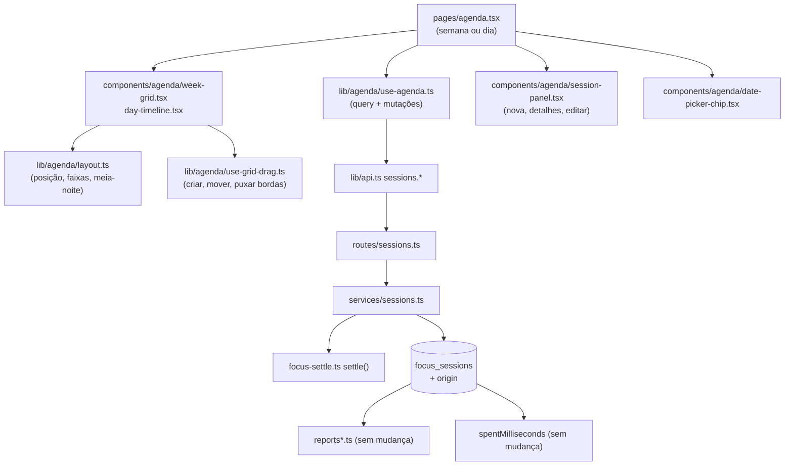

# Agenda Design

**Spec**: `.specs/features/agenda/spec.md`
**Status**: Approved
**Interface source (binding)**: canvas do #19, https://claude.ai/artifact/XWxFcmc4CKCHLjs8hraDiX (artboards `Agenda · semana`, `Nova sessão arrastando na grade`, `Sessão existente: detalhes e ajuste`, `Agenda · dia no celular`), e o comentário de design na issue #19.

---

## Approaches

| # | Abordagem | Trade-off | Veredito |
| - | --------- | --------- | -------- |
| A | Sessões manuais na mesma tabela `focus_sessions`, com uma coluna `origin`; rotas novas `/api/sessions` para ler um intervalo, criar, editar e excluir | Tempo gasto, relatórios, liquidação e cascatas já leem `focus_sessions` e passam a contar as manuais sem mudança. Custo: uma migration num `focus_sessions` populado (coluna com default) | **Escolhida** |
| B | Tabela nova `manual_sessions` | Cada consulta de tempo (`spentMilliseconds`, `clippedSessions`, a aba Sessões, `isAwaitingExtend`) precisaria de um `UNION`; dois lugares para o mesmo conceito | Rejeitada |
| C | Registrar pela fila do foco (`start` + `pause` com `occurred_at` no passado) | AD-002 recusa `occurred_at` com mais de 24h ou anterior à última mudança, e não há como editar ou excluir uma sessão | Rejeitada |

---

## Architecture Overview



Toda leitura e escrita de `/api/sessions` roda `settle(tx, userId, now)` antes (AD-001), dentro de uma transação que trava a linha do usuário (`SELECT ... FOR UPDATE` em `users`), como `applyAction` faz no foco, para que uma ação de foco e uma edição da Agenda não se cruzem.

---

## Code Reuse Analysis

### Existing Components to Leverage

| Component | Location | How to Use |
| --------- | -------- | ---------- |
| Liquidação e tempo gasto | `backend-node/src/services/focus-settle.ts` (`settle`, `spentMilliseconds`) | `settle` antes de ler ou escrever; o tempo gasto já soma qualquer linha de `focus_sessions` |
| Sessões cortadas no período | `backend-node/src/services/reports.ts:104` (`clippedSessions`, `reportScope`) | Mesmo recorte por fuso e filtro de lista para `GET /api/sessions`; o corte na meia-noite fica no cliente |
| Guardas de rota | `authGuards(ctx)`, `workspaceContext(ctx)`, `requireWrite` (como em `routes/tasks.ts`) | Leitura para qualquer membro; escrita com `requireWrite` (AGENDA-44) |
| Validação de período | `routes/reports.ts:15` (`period`) | Mesmo formato `from`/`to` (`z.iso.date()`), com limite de 42 dias (AGENDA-45) |
| Busca de tarefa no workspace | `findTask` em `services/focus.ts` (ou o equivalente de `services/tasks.ts`) | 404 `Task not found` para tarefa de outro workspace (AGENDA-25) |
| Calendário | `frontend/src/components/ui/calendar.tsx`, `popover.tsx` | Calendário do chip `Hoje` (AGENDA-39 a AGENDA-41) |
| Diálogo de confirmação | `frontend/src/components/delete-confirmation-dialog.tsx` | Confirmar `Excluir` (AGENDA-32) |
| Itens da barra lateral | `frontend/src/lib/nav-items.ts` | Item `Agenda` entre as listas e `Relatórios` (AGENDA-13) |
| Duração e relógio | `components/board/format-duration.ts`, `lib/focus/format-clock.ts` | `6h 15min`, `1h 15min` e horários |
| Cor da lista | paleta `--chart-*` usada por `ListBadge` | Cor do bloco (AGENDA-04) |
| Fuso do workspace | `useWorkspace().current.timezone` / `applicationTimezone()` (AD-004) | Dia, semana e meia-noite no fuso do workspace |

### Integration Points

| System | Integration Method |
| ------ | ------------------ |
| Banco | Migration `0005_session_origin.sql`: `ALTER TABLE focus_sessions ADD COLUMN origin varchar(8) NOT NULL DEFAULT 'focus'` |
| Relatórios | Sem mudança de código: as sessões manuais entram por já estarem em `focus_sessions` (AGENDA-22); um teste de rota prova |
| Quadro e foco | Sem mudança de código: `spentMilliseconds` soma a sessão manual (AGENDA-21, AGENDA-46); o frontend invalida `['lists']` e `['focus']` depois de cada escrita |
| Fila offline (AD-002) | Sem mudança: `lastChange` usa `max(started_at, ended_at)` de todas as sessões, manuais inclusive (ver Assumptions da spec) |
| Tokens (AD-007) | As rotas novas não declaram `config.tokenScope`; o teste `test/routes/token-scopes.test.ts` e `test/support/token-routes.ts` ganham as rotas como fechadas a token |
| App | `app.ts` registra `sessionRoutes(ctx)`; `App.tsx` ganha a rota `/agenda` dentro do `AppLayout` |

---

## Components

### `services/sessions.ts` (backend)

- **Purpose**: ler as sessões do usuário num intervalo e criar, editar e excluir sessões encerradas.
- **Location**: `backend-node/src/services/sessions.ts`
- **Interfaces**:
  - `listSessions(db, actor, workspace, { from, to, listId? }, now): Promise<AgendaSession[]>` - sessões que tocam o intervalo `[from 00:00, to+1 00:00)` no fuso do workspace, sem cortar; a aberta vem com `ended_at: null`.
  - `createSession(db, actor, workspace, input, now): Promise<AgendaSession>` - `input = { kind, task_id?, list_id?, started_at, ended_at }`; grava `origin = 'manual'`, `device_id = 'agenda'`, `end_reason = 'manual'`, `last_seen_at = ended_at`.
  - `updateSession(db, actor, workspace, id, input, now): Promise<AgendaSession>` - muda `started_at`, `ended_at` e, se mandados, `task_id`/`list_id`; mantém `origin`.
  - `deleteSession(db, actor, workspace, id, now): Promise<void>`
  - `overlaps(...)` não existe no servidor: o aviso de sobreposição (AGENDA-19) é calculado no cliente com as sessões já carregadas.
- **Dependencies**: `settle`, `findTask`, `focusSessions`.
- **Reuses**: o recorte de `clippedSessions` (sem o `greatest/least`, que só serve aos relatórios).

### `routes/sessions.ts` (backend)

- **Purpose**: expor o serviço com validação zod e as guardas do workspace.
- **Location**: `backend-node/src/routes/sessions.ts`
- **Interfaces**: ver `Surface` abaixo.
- **Dependencies**: `authGuards`, `workspaceContext`, `requireWrite`.
- **Reuses**: o padrão de `routes/reports.ts` e `routes/tasks.ts`.

### `lib/agenda/layout.ts` (frontend)

- **Purpose**: transformar sessões em blocos posicionados: corte na meia-noite do fuso (AGENDA-07), faixas lado a lado para sobrepostas (AGENDA-06), topo e altura em minutos, total por dia (AGENDA-01).
- **Location**: `frontend/src/lib/agenda/layout.ts`
- **Interfaces**:
  - `dayPieces(sessions, days: string[], timezone, now): Map<string, Piece[]>`
  - `assignLanes(pieces): Array<Piece & { lane: number; lanes: number }>`
  - `dayTotal(pieces): number` (segundos das sessões de tarefa)
- **Dependencies**: `date-fns` (já instalado).
- **Reuses**: nada; é lógica pura, testada sem DOM.

### `lib/agenda/use-grid-drag.ts` (frontend)

- **Purpose**: o arraste na grade com eventos de ponteiro: criar sobre o vazio (AGENDA-14), puxar a borda de cima ou de baixo (AGENDA-18, AGENDA-29) e mover o bloco inteiro (AGENDA-30), encaixando em 15 min e parando em agora (AGENDA-23).
- **Location**: `frontend/src/lib/agenda/use-grid-drag.ts`
- **Interfaces**: `useGridDrag({ pxPerMinute, snapMinutes: 15, nowMinute, onCommit })` devolve os handlers de ponteiro e o rascunho atual.
- **Dependencies**: nenhuma lib nova.
- **Reuses**: nada. O `@dnd-kit/sortable` do quadro ordena itens numa lista e não redimensiona ao longo de um eixo de tempo, então não serve aqui.

### `components/agenda/*` e `pages/agenda.tsx` (frontend)

- **Purpose**: `pages/agenda.tsx` escolhe semana ou dia pela largura (AGENDA-36) e mantém a semana e o dia escolhidos; `week-grid.tsx` e `day-timeline.tsx` desenham a grade; `session-block.tsx` desenha um bloco; `session-panel.tsx` tem os modos nova, detalhes e editar; `date-picker-chip.tsx` é o chip `Hoje` com o calendário.
- **Location**: `frontend/src/pages/agenda.tsx`, `frontend/src/components/agenda/`
- **Dependencies**: `use-agenda.ts`, `layout.ts`, `use-grid-drag.ts`, `ui/calendar.tsx`, `ui/popover.tsx`, `delete-confirmation-dialog.tsx`.
- **Reuses**: `ListBadge`, `formatDuration`, `formatClock`, `useWorkspace`.

### `lib/agenda/use-agenda.ts` (frontend)

- **Purpose**: `useQuery(['agenda', from, to, listId])` com `sessions.list`, e mutações `create`, `update`, `remove` com atualização otimista e volta em erro (AGENDA-35); depois de cada escrita, invalida `['agenda']`, `['lists']`, `['focus']` e `['reports']`.
- **Location**: `frontend/src/lib/agenda/use-agenda.ts`
- **Reuses**: o padrão de mutação de `pages/list-board.tsx` e `components/board/subtask-list.tsx`.

---

## Data Models

### `focus_sessions` (mudança)

```sql
ALTER TABLE focus_sessions ADD COLUMN origin varchar(8) NOT NULL DEFAULT 'focus';
-- 'focus' | 'manual'; as linhas que já existem ficam 'focus'.
```

`FOCUS_END_REASONS` ganha `'manual'` (não há `CHECK` no banco: `drizzle/0002_focus.sql:21`).

### `AgendaSession` (resposta)

```typescript
interface AgendaSession {
  id: string
  kind: 'task' | 'break'
  origin: 'focus' | 'manual'
  task_id: string | null
  task_title: string | null
  list_id: string
  list_name: string
  list_color: number
  started_at: string // ISO, sem corte
  ended_at: string | null // null enquanto aberta
}
```

**Relationships**: a mesma de hoje (sessão → usuário, workspace, lista e tarefa, com cascata, AD-005).

---

## Surface

| Route | In | Out | Status | Requirements |
| ----- | -- | --- | ------ | ------------ |
| `GET /api/sessions` | `from`, `to` (datas), `list_id?` | `{ sessions: AgendaSession[] }` | `200`, `422` (mais de 42 dias, `to` antes de `from`) | AGENDA-01 a 11, 45 |
| `GET /api/sessions/tasks` | - | `{ tasks: { id, title, list_id, list_name, list_color, column }[] }`: as tarefas das listas ativas do workspace, em qualquer coluna, Concluídas de qualquer data inclusive | `200` (qualquer membro); fechada a token (AD-007) | AGENDA-16 |
| `POST /api/sessions` | `kind`, `task_id` (tarefa) ou `list_id` (intervalo), `started_at`, `ended_at` | `AgendaSession` | `201`, `403` viewer, `404` tarefa, `422` horário | AGENDA-20, 23 a 25, 44 |
| `PATCH /api/sessions/:id` | `started_at?`, `ended_at?`, `task_id?`, `list_id?` | `AgendaSession` | `200`, `403`, `404` sessão ou tarefa, `409 session_running`, `422` | AGENDA-29 a 31, 33, 34 |
| `DELETE /api/sessions/:id` | - | - | `204`, `403`, `404`, `409 session_running` | AGENDA-32 a 34 |

Corpo de erro: o formato que já existe (`{ detail, code? }`); `422` usa `code: 'invalid_time'` para fim no futuro e `code: 'invalid_duration'` para fora de 1 min a 24 h.

---

## Error Handling Strategy

| Error Scenario | Handling | User Impact |
| -------------- | -------- | ----------- |
| Fim depois de agora (com 5 s de tolerância, como AD-002) | `422 invalid_time` | Painel: `A sessão não pode terminar no futuro.` |
| Duração fora de 1 min a 24 h, ou fim não depois do início | `422 invalid_duration` | Painel: `Use de 1 minuto a 24 horas.` |
| Tarefa de outro workspace ou de lista arquivada | `404 Task not found` | Toast com a mensagem |
| Editar ou excluir a sessão aberta | `409 session_running` | O cliente nem oferece; se chegar, toast |
| Sessão de outro usuário ou inexistente | `404 Session not found` | Toast; a grade recarrega |
| Viewer escrevendo | `403 Read-only role` (guarda que já existe) | Os controles não aparecem |
| Falha de rede ao salvar ou ajustar | Mutação otimista volta | O bloco volta ao lugar e aparece o toast (AGENDA-35) |
| Falha ao ler a semana | Query em erro | `Não foi possível carregar a agenda.` com `Tentar de novo` (AGENDA-12) |

---

## Risks & Concerns

| Concern | Location (file:line) | Impact | Mitigation |
| ------- | -------------------- | ------ | ---------- |
| Uma sessão manual que termina "agora" move o corte de `lastChange`, e ações offline anteriores passam a ser recusadas | `backend-node/src/services/focus.ts:57` | Um outro dispositivo offline pode ver ações recusadas depois de o usuário registrar tempo na Agenda | Comportamento aceito e registrado nas Assumptions da spec; o aviso de ações recusadas já trata o caso (corrigido no PR #17) |
| `isAwaitingExtend` olha o `end_reason` da última sessão da tarefa; uma sessão manual depois do fim da estimativa tira a tarefa de "esperando Estender" | `backend-node/src/services/focus-state.ts` (`isAwaitingExtend`) | Ao retomar, a tarefa conta para cima em vez de pedir `Estender` | Aceitável: o usuário já registrou à mão além da estimativa; um teste fixa o comportamento |
| Migration num `focus_sessions` populado | `backend-node/drizzle/` | Tempo de lock no `ALTER TABLE` | `ADD COLUMN ... DEFAULT` constante é só metadado no Postgres 11+ e no PGlite; sem backfill |
| Teste de rotas por token compara a tabela da spec de tokens | `backend-node/test/routes/token-scopes.test.ts`, `test/support/token-routes.ts` | As rotas novas quebram o teste se não entrarem como fechadas | Tarefa de backend inclui a atualização do teste |
| A grade de 24 h com 7 colunas pode renderizar muitos blocos | `frontend/src/components/agenda/week-grid.tsx` | Semana cheia com centenas de sessões curtas fica lenta | Uma semana tem no máximo dezenas de sessões no uso real; `layout.ts` roda em `useMemo` por semana |
| Arraste por ponteiro não existe no projeto | - | Padrão novo, sem testes de referência | `use-grid-drag.ts` isolado e testado com eventos de ponteiro do Testing Library; o painel oferece os mesmos ajustes por campo, então o teclado não depende do arraste |

---

## Tech Decisions

| Decision | Choice | Rationale |
| -------- | ------ | --------- |
| Onde ficam as sessões manuais | `focus_sessions` + coluna `origin` | Abordagem A; vira **AD-008** em `.specs/STATE.md` ao aprovar o design, porque relatórios e tempo gasto de toda feature futura dependem disso |
| Recorte na meia-noite | No cliente (`layout.ts`) | A API devolve a sessão inteira, que é o que o painel de edição precisa; o corte é só de desenho |
| Aviso de sobreposição | No cliente | A sobreposição é permitida (spec), então não é regra do servidor; o cliente já tem as sessões da semana |
| Arraste | Eventos de ponteiro próprios, sem lib nova | `@dnd-kit/sortable` não cobre redimensionar ao longo do tempo; uma lib de calendário traria um visual que não é o do design |
| Visão do dia | Mesma página, abaixo de 768 px | Um componente de timeline compartilhado entre semana (7 colunas) e dia (1 coluna) |
