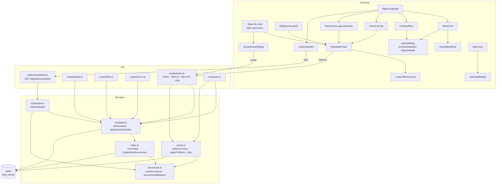
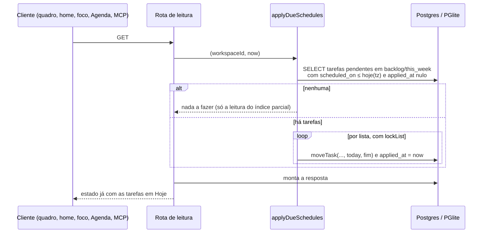
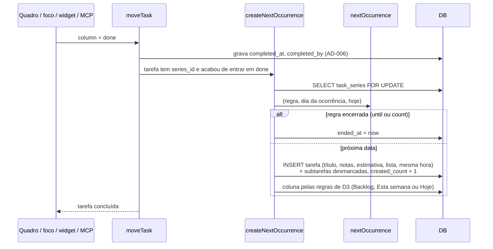

# Agendamento de tarefas Design

**Spec**: `.specs/features/agendamento/spec.md`
**Design visual**: https://claude.ai/artifact/3PBEaM4xuqa4e2iB74KGnX (aprovado em 2026-11-07)
**Status**: Approved

---

## Architecture Overview

O agendamento é um estado da tarefa, não um processo agendado. Três regras de tempo existem (a ida para Hoje no dia, a próxima ocorrência e as projeções da Agenda), e as três são resolvidas **no momento em que alguém lê ou escreve**, nunca por um job. É o mesmo princípio da liquidação do foco (AD-001), e é o que faz a feature funcionar igual no servidor e no desktop local, que roda em PGlite sem worker.

### Abordagens consideradas

| | A. Resolver na leitura e na escrita (recomendada) | B. Job no scheduler | C. Resolver no cliente |
| --- | --- | --- | --- |
| Ida para Hoje | `applyDueSchedules` no começo de cada leitura do quadro, da home, do foco e da Agenda | Job de hora em hora move as tarefas | O frontend mostra a tarefa em Hoje sem mudar o banco |
| Próxima ocorrência | Criada na transação de concluir (`moveTask`) | Criada por job | Criada pelo cliente depois de concluir |
| Modo local (PGlite) | Funciona | Não funciona: o desktop não tem Redis nem worker | Funciona |
| Consistência entre clientes (MCP, widget, mobile) | Igual para todos: o banco é a verdade | Atraso de até 1h | Cada cliente reimplementa e diverge |
| Custo | Um `UPDATE` condicional por leitura, barato com índice parcial | Infra que o local não tem | Regras duplicadas em web, desktop e mobile |

**Escolha: A.** B quebra o modo local; C viola "o servidor é a fonte da verdade" (AD-001) e faria o MCP e o mobile verem outro quadro.

### Componentes



### Ciclo de vida do agendamento de uma tarefa

```mermaid
stateDiagram-v2
    [*] --> SemAgendamento
    SemAgendamento --> Agendada: setSchedule(dia, hora?)
    Agendada --> Agendada: mudar dia ou hora<br/>(zera applied_at; D3 move de coluna)
    Agendada --> EmHoje: leitura com dia ≤ hoje<br/>(applyDueSchedules grava applied_at)
    Agendada --> EmHoje: salvar com dia = hoje
    EmHoje --> TiradaDeHoje: usuário move à mão
    TiradaDeHoje --> TiradaDeHoje: leituras não a trazem de volta<br/>(applied_at preenchido)
    TiradaDeHoje --> Agendada: mudar dia ou hora
    Agendada --> SemAgendamento: Remover agendamento
    EmHoje --> Concluida: concluir
    Agendada --> Concluida: concluir
    Concluida --> [*]: sem série
    Concluida --> ProximaOcorrencia: com série e regra não encerrada
    ProximaOcorrencia --> Agendada: nova tarefa no dia seguinte da regra
```



### Leitura com a ida para Hoje



### Concluir uma ocorrência



Todos os caminhos de conclusão passam por `moveTask` (`routes/tasks.ts:161`, `mcp/tools.ts:117`, `services/focus.ts:268`), então a próxima ocorrência nasce num ponto só. A tarefa criada já concluída pela Agenda (`routes/sessions.ts:114`) não tem série e não é afetada.

---

## Code Reuse Analysis

### Existing Components to Leverage

| Component | Location | How to Use |
| --- | --- | --- |
| `moveTask` | `backend-node/src/services/tasks.ts:124` | Única porta para mudar de coluna: `setSchedule` e `applyDueSchedules` a chamam; ganha o gancho de `createNextOccurrence` ao entrar em `done` |
| `lockList` | `backend-node/src/services/tasks.ts:45` | Serializa a ida para Hoje e a criação da próxima ocorrência por lista |
| `duplicateTask` | `backend-node/src/services/tasks.ts:183` | Base da cópia da próxima ocorrência (título, notas, estimativa, subtarefas desmarcadas) |
| `dayTimezone`, `daySql` | `backend-node/src/services/day.ts:7`, `:21` | "Hoje" e "semana" no fuso do workspace (AD-004) |
| Validação zod e `toTaskRead` | `backend-node/src/routes/schemas.ts`, `routes/tasks.ts` | Campos novos no contrato da tarefa |
| `config.tokenScope` | `backend-node/src/routes/tasks.ts:135` | `PATCH`/`DELETE`/`skip` com `tasks:write`; a rota nova da Agenda nasce fechada (AD-007) |
| `migratedDb` | `backend-node/test/support/db.ts` | Testes de serviço e de schema no PGlite |
| `useGridDrag` | `frontend/src/lib/agenda/use-grid-drag.ts` | Ganha os gestos de bloco agendado e de `Sem hora` |
| Layout de faixas das sessões | `frontend/src/lib/agenda/layout.ts` | Blocos agendados lado a lado com as sessões |
| `SessionBlock`, `SessionPanel`, `SessionTaskPicker` | `frontend/src/components/agenda/` | Moldura e estilo do bloco agendado, do painel do dia e do `Novo agendamento` |
| `Calendar`, `Popover`, `Tooltip`, `Dialog` | `frontend/src/components/ui/` | Seletor, tooltips e a pergunta da série |

### Integration Points

| System | Integration Method |
| --- | --- |
| Quadro, home, foco, widget | As leituras chamam `applyDueSchedules` antes de responder; o widget e o foco recebem a tarefa em Hoje pelo polling atual (AD-003) |
| Agenda | Rota nova `GET /agenda/scheduled?from&to`, separada de `GET /sessions`, porque tarefas agendadas são do workspace (D9) e sessões são pessoais |
| MCP e tokens `tkz_` | `create_task`, `update_task`, `get_board`, `get_task` com os campos novos; escopo `tasks:write` existente |
| Mobile | Só leitura dos campos; nenhuma escrita nova (D4) |
| Banco | Duas migrações: colunas em `tasks` e a tabela `task_series` |

---

## Components

### schedule.ts (backend)

- **Purpose**: Aplicar as regras de coluna de um agendamento e a ida para Hoje.
- **Location**: `backend-node/src/services/schedule.ts`
- **Interfaces**:
  - `setSchedule(db, task, schedule: { on: string | null; time: string | null }, byUserId, now): Promise<Task>` - valida (sem passado), grava, zera `applied_at`, aplica D3 e D21.
  - `applyDueSchedules(db, workspaceId, now): Promise<number>` - move as vencidas para Hoje e devolve quantas moveu.
- **Dependencies**: `moveTask`, `dayTimezone`, `daySql`.
- **Reuses**: o padrão de liquidação de `services/focus-settle.ts`.

### recurrence.ts (backend)

- **Purpose**: Aritmética de datas da regra, sem banco.
- **Location**: `backend-node/src/services/recurrence.ts`
- **Interfaces**:
  - `nextOccurrence(rule: Rule, after: PlainDate, today: PlainDate, createdCount: number): PlainDate | null` - D17; `null` quando `until` ou `count` encerram.
  - `occurrencesBetween(rule, after, from, to, createdCount): PlainDate[]` - para as projeções.
  - `parseRule(input): Rule` - valida a regra recebida (zod).
- **Dependencies**: nenhuma. Trabalha com datas de calendário (`YYYY-MM-DD`); o "hoje" vem de `daySql` (AD-004).
- **Reuses**: nada.

### series.ts (backend)

- **Purpose**: Ciclo de vida da série.
- **Location**: `backend-node/src/services/series.ts`
- **Interfaces**:
  - `setRecurrence(db, task, rule | null, now)` - cria, muda ou encerra (D15).
  - `applyToSeries(db, task, schedule, now)` - "esta e as próximas": recalcula `weekdays` ou `month_day` e a hora (D16).
  - `skipOccurrence(db, task, now)` - D18.
  - `createNextOccurrence(tx, task, now)` - chamada por `moveTask` (D13, D17, D19).
- **Dependencies**: `recurrence.ts`, `setSchedule`, `duplicateTask`.

### scheduled.ts (backend)

- **Purpose**: Listar o que a Agenda precisa num período.
- **Location**: `backend-node/src/services/scheduled.ts` e a rota `backend-node/src/routes/scheduled.ts`
- **Interfaces**:
  - `listScheduled(db, workspaceId, from, to, now): Promise<{ timed: ScheduledTask[]; untimed: ScheduledTask[]; projected: ProjectedOccurrence[] }>`
- **Dependencies**: `applyDueSchedules`, `occurrencesBetween`.

### moveTask (backend, alterado)

- **Purpose**: Continua sendo a porta de troca de coluna; ganha um passo ao entrar em `done`.
- **Location**: `backend-node/src/services/tasks.ts:124`
- **Interfaces**: inalterada.
- **Dependencies**: + `createNextOccurrence`.

### Rotas e MCP (backend, alterados)

- `PATCH /tasks/:id` aceita `scheduled_on`, `scheduled_time`, `recurrence` e `scope`.
- `DELETE /tasks/:id?scope=occurrence|series`.
- `POST /tasks/:id/skip`.
- `GET /lists/:id/board`, a leitura das listas da home e `GET /api/focus` chamam `applyDueSchedules`.
- `mcp/tools.ts`: os mesmos campos em `create_task`, `update_task`, `get_board`, `get_task`.

### Frontend

| Componente | Local | Responsabilidade |
| --- | --- | --- |
| `scheduleBadge`, `recurrenceSummary` | `frontend/src/lib/schedule.ts` | Textos do selo e da regra; um lugar só para os formatos do spec |
| `SchedulePicker` | `frontend/src/components/schedule/schedule-picker.tsx` | Calendário, hora em 15 min, `Repetir`, resumo |
| `CustomRecurrence` | `frontend/src/components/schedule/custom-recurrence.tsx` | Regra personalizada e validação |
| `SeriesScopeDialog` | `frontend/src/components/schedule/series-scope-dialog.tsx` | "Só esta / esta e as próximas" para mover e excluir |
| `useScheduled` | `frontend/src/lib/agenda/use-scheduled.ts` | Lê `GET /agenda/scheduled`, invalida com o quadro |
| `ScheduledBlock` | `frontend/src/components/agenda/scheduled-block.tsx` | Bloco pontilhado, relógio ou repetição, tooltip |
| `UntimedRow` | `frontend/src/components/agenda/untimed-row.tsx` | Linha `Sem hora`, 3 por dia, `+X` |
| `DayScheduledPanel` | `frontend/src/components/agenda/day-scheduled-panel.tsx` | Todas as tarefas agendadas do dia |
| `NewSchedulePanel` | `frontend/src/components/agenda/new-schedule-panel.tsx` | Agendar uma tarefa existente ou nova numa janela |
| `useGridDrag` (alterado) | `frontend/src/lib/agenda/use-grid-drag.ts` | `moveScheduled` e `dropUntimed` |

---

## Data Models

### Banco

```sql
-- 0010_task_schedule.sql
ALTER TABLE tasks
  ADD COLUMN scheduled_on date,
  ADD COLUMN scheduled_time time,
  ADD COLUMN schedule_applied_at timestamptz,
  ADD CONSTRAINT ck_tasks_schedule_time_needs_day CHECK (scheduled_time IS NULL OR scheduled_on IS NOT NULL),
  ADD CONSTRAINT ck_tasks_schedule_time_step CHECK (scheduled_time IS NULL OR (extract(minute FROM scheduled_time)::int % 15 = 0 AND extract(second FROM scheduled_time) = 0));

-- Só as candidatas à ida para Hoje: a leitura frequente (polling de 15 s do foco) toca um índice pequeno.
CREATE INDEX ix_tasks_schedule_due ON tasks (list_id, scheduled_on)
  WHERE scheduled_on IS NOT NULL AND schedule_applied_at IS NULL AND "column" IN ('backlog', 'this_week');

-- Para a Agenda: tarefas agendadas de um período.
CREATE INDEX ix_tasks_scheduled_on ON tasks (scheduled_on) WHERE scheduled_on IS NOT NULL AND "column" <> 'done';

-- 0011_task_series.sql
CREATE TABLE task_series (
  id uuid PRIMARY KEY,
  workspace_id uuid NOT NULL REFERENCES workspaces(id) ON DELETE CASCADE,
  freq varchar(8) NOT NULL CHECK (freq IN ('daily', 'weekly', 'monthly')),
  "interval" smallint NOT NULL DEFAULT 1 CHECK ("interval" BETWEEN 1 AND 99),
  weekdays smallint[] CHECK (weekdays IS NULL OR (array_length(weekdays, 1) >= 1 AND weekdays <@ ARRAY[1,2,3,4,5,6,7]::smallint[])),
  month_day smallint CHECK (month_day BETWEEN 1 AND 31),
  until date,
  "count" smallint CHECK ("count" BETWEEN 1 AND 999),
  created_count smallint NOT NULL DEFAULT 1,
  ended_at timestamptz,
  created_at timestamptz NOT NULL,
  CHECK (until IS NULL OR "count" IS NULL),
  CHECK ((freq = 'weekly') = (weekdays IS NOT NULL)),
  CHECK ((freq = 'monthly') = (month_day IS NOT NULL))
);
ALTER TABLE tasks ADD COLUMN series_id uuid REFERENCES task_series(id) ON DELETE SET NULL;
CREATE INDEX ix_tasks_series ON tasks (series_id) WHERE series_id IS NOT NULL;
```

### Contrato

```typescript
interface RecurrenceRule {
  freq: 'daily' | 'weekly' | 'monthly'
  interval: number            // 1–99
  weekdays?: number[]         // 1 (seg) – 7 (dom); obrigatório em weekly
  month_day?: number          // 1–31; obrigatório em monthly
  until?: string | null       // YYYY-MM-DD
  count?: number | null       // 1–999; não convive com until
}

interface TaskRead {
  // ...campos atuais
  scheduled_on: string | null         // YYYY-MM-DD, fuso do workspace
  scheduled_time: string | null       // HH:MM, múltiplo de 15
  series: { id: string; rule: RecurrenceRule; next_on: string | null } | null
}

interface TaskPatch {
  // ...campos atuais
  scheduled_on?: string | null
  scheduled_time?: string | null
  recurrence?: RecurrenceRule | null  // null encerra a série
  scope?: 'occurrence' | 'series'     // só vale para tarefas de série; padrão 'occurrence'
}

interface ScheduledTask {
  id: string
  title: string
  list: { id: string; name: string; color: string }
  column: 'backlog' | 'this_week' | 'today'
  position: number
  estimate_minutes: number | null
  scheduled_on: string
  scheduled_time: string | null
  series: { id: string; rule: RecurrenceRule } | null
}

interface ProjectedOccurrence {
  series_id: string
  task_id: string                     // a ocorrência aberta, aberta no clique
  title: string
  list: { id: string; name: string; color: string }
  on: string
  time: string
  estimate_minutes: number | null
}

// GET /agenda/scheduled?from=YYYY-MM-DD&to=YYYY-MM-DD
interface ScheduledResponse {
  timed: ScheduledTask[]
  untimed: ScheduledTask[]
  projected: ProjectedOccurrence[]
}
```

**Relationships**: `task_series` 1—N `tasks` (no máximo uma pendente por série, D13); `task_series` N—1 `workspaces`. A regra parte do `scheduled_on` da ocorrência aberta; a série não guarda o dia de início.

---

## Error Handling Strategy

| Error Scenario | Handling | User Impact |
| --- | --- | --- |
| Dia anterior a hoje ou hora de hoje que já passou | 422 `schedule_in_past` | O seletor já desabilita; via API, a mensagem de validação |
| Hora sem dia, fora do passo de 15 min | 422 de validação (zod) e `check` no banco | Mensagem de validação |
| Regra inválida (semanal sem dias, `until` antes do dia, `until` com `count`) | 422 de validação | `CustomRecurrence` mostra o erro antes de enviar |
| `recurrence` sem `scheduled_on` | 422 `recurrence_needs_day` | Só pela API/MCP; a tela sempre tem dia |
| `skip` ou `scope` em tarefa sem série | 409 `not_in_series` / `scope` ignorado | Os itens não aparecem no menu |
| Duas leituras simultâneas querem mover a mesma tarefa | `lockList` + releitura sob a trava, como `moveTask` faz | Nenhum; a tarefa entra em Hoje uma vez |
| Conclusão concorrente de duas ocorrências da mesma série (dois dispositivos) | `SELECT ... FOR UPDATE` em `task_series` e só cria se não houver outra pendente | Nenhuma duplicata |
| `viewer` | 403 `Read-only role` em toda escrita | Itens desabilitados |
| Token `tkz_` na rota da Agenda | 403 (AD-007) | Nenhum; a Agenda é do app |
| Falha ao gravar depois de soltar na Agenda | O rascunho volta ao lugar e o aviso mostra o erro da API | Mesma experiência do arraste de sessão |

---

## Risks & Concerns

| Concern | Location (file:line) | Impact | Mitigation |
| --- | --- | --- | --- |
| Leitura que escreve: `GET` passa a fazer `UPDATE` | `backend-node/src/routes/board.ts:39`, `routes/focus.ts` | Leituras de `viewer` e de token gravam; risco de surpresa em logs e réplicas | Escrita idempotente e de sistema (não vira `updated_at` do usuário além da troca de coluna, igual a `moveTask`); documentada como AD-009 |
| Polling do foco a cada 15 s (AD-003) | `routes/focus.ts` | Uma consulta extra por poll por dispositivo | Índice parcial `ix_tasks_schedule_due` e saída antecipada quando não há candidatas |
| `moveTask` abre transação própria e é chamado dentro de outra pelo foco | `backend-node/src/services/tasks.ts:132`, `services/focus.ts:268` | `createNextOccurrence` roda em transação aninhada (savepoint) | Receber `tx` e testar o caminho do foco (`focus-transitions.test.ts`) |
| `moveTask` renumera a coluna inteira com um `UPDATE` por tarefa | `backend-node/src/services/tasks.ts:159-163` | Ida para Hoje de várias tarefas de uma lista multiplica os `UPDATE`s | Agrupar por lista e mover em lote numa só renumeração em `applyDueSchedules` |
| "Hoje" no fuso do workspace contra datas sem fuso | `backend-node/src/services/day.ts:21` | Erro de um dia na virada se o "hoje" vier do relógio do servidor | `today` sempre de `daySql` (AD-004); `recurrence.ts` só recebe datas de calendário |
| Mudança de fuso do workspace | `workspaces.timezone` | Tarefas mantêm o horário de parede; uma tarefa pode "vencer" antes ou depois | Comportamento aceito no spec (horário de parede, como no Google Agenda); teste cobre |
| Excluir tarefa apaga o tempo registrado (AD-005) | `backend-node/src/services/tasks.ts:174` | "Excluir só esta" numa ocorrência com tempo perde o tempo | O diálogo avisa e sugere `Pular esta ocorrência` (D18) |
| Cobertura do caminho de conclusão pelo MCP e pelo widget | `backend-node/src/mcp/tools.ts:117` | A próxima ocorrência poderia não nascer por um caminho | Teste de conclusão por rota, foco e MCP em T11 |

---

## Tech Decisions

| Decision | Choice | Rationale |
| --- | --- | --- |
| Quando as regras de tempo rodam | Na leitura e na escrita, nunca em job | Funciona no PGlite sem worker; o banco é a verdade para todos os clientes (abordagem A) |
| Onde a próxima ocorrência nasce | Dentro de `moveTask`, ao entrar em `done` | Único ponto de conclusão de quadro, foco, widget e MCP |
| Projeções | Calculadas na leitura, nunca gravadas | Mudar a regra não exige migrar linhas; "uma aberta por vez" (D13) |
| Regra | Colunas estruturadas, não string RRULE | Validação no banco e no zod; contrato explícito; mapeável para RRULE |
| Datas | `date` + `time` separados, no fuso do workspace | Dia sem hora é caso de primeira classe; horário de parede estável |
| Agenda separada das sessões | `GET /agenda/scheduled` | Tarefas são do workspace (D9), sessões são pessoais (AD-008) |
| Escopo de série | Campo `scope` na API, pergunta no frontend | A API não decide pela pessoa (D16) |

### Decisão de projeto (registrada em `STATE.md` como AD-009 em 2026-11-07)

**AD-009** - Regras dependentes de data nas tarefas (ida para Hoje pelo agendamento, próxima ocorrência de uma série) são aplicadas na leitura e na escrita, como a liquidação do foco (AD-001), e nunca por job. Toda leitura que mostra colunas de tarefas chama `applyDueSchedules` antes de responder. Estende AD-001 para tarefas; não substitui nenhuma decisão ativa. Conforma com AD-004 (dia no fuso do workspace), AD-006 (conclusão por `moveTask`) e AD-007 (rota nova fechada a tokens).
