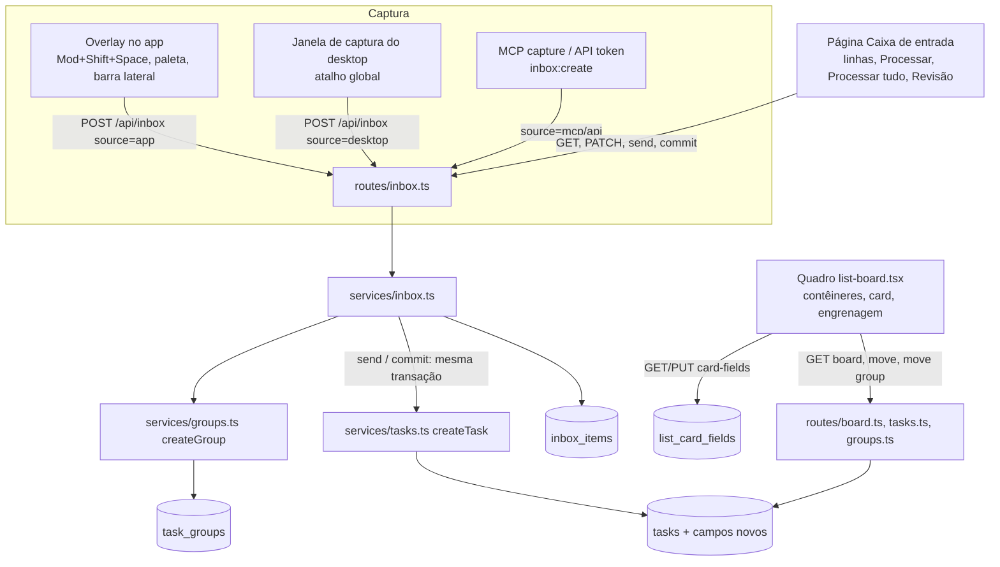

# Caixa de entrada Design

**Spec**: `.specs/features/caixa-de-entrada/spec.md`
**Status**: Draft

O usuário escolheu duas coisas em 2026-11-13. Os itens ficam numa tabela nova, `inbox_items`, e só viram tarefa ao serem enviados. As tarefas de um grupo ficam juntas na ordem da coluna, usando a `position` que já existe, e por isso não há uma segunda ordem para manter.

Este design segue AD-001 e AD-009: nada roda por job, e a limpeza da Lixeira acontece quando a caixa é lida. Segue também AD-004 (o prazo é calculado no fuso do workspace), AD-005 (apagar a lista leva junto os grupos dela), AD-006 (concluir passa por `moveTask`), AD-007 (só a captura é aberta a tokens) e AD-011 (os campos novos do card ficam atrás de "Campos do card"). Ele cria duas decisões novas, AD-012 e AD-013.

---

## Architecture Overview



Enviar um item (pela linha, pelo Processar ou pela revisão) roda numa única transação. Primeiro, um `DELETE … RETURNING` com trava (`FOR UPDATE`) tira o item da caixa. Em seguida são criadas a tarefa, o lembrete ou o grupo e as tarefas dele, e a transação é confirmada. Se dois envios do mesmo item chegarem juntos, o segundo não acha mais a linha e recebe 409 (EDGE-01). Se a criação falhar, nada é confirmado e o item continua na caixa (PROC-08, ALL-07).

---

## Code Reuse Analysis

### Existing Components to Leverage

| Component | Location | How to Use |
| --- | --- | --- |
| `createTask`, `lockList`, `moveTask`, `moveTaskToList`, `duplicateTask` | `backend-node/src/services/tasks.ts:62-265` | O envio chama `createTask` dentro da transação do item. `moveTask` ganha a intenção de grupo e a normalização de blocos; `moveTaskToList` passa a limpar `group_id` (EDGE-04). Os literais de `Task` em :99-117 e :216-234 recebem as colunas novas. |
| `updateTaskAndSchedule`, schemas zod em snake_case | `backend-node/src/routes/tasks.ts:43-199` | `updateTaskBody` e `taskReadSchema` ganham os campos novos. O MCP já reaproveita esses schemas, então a API-02 sai quase de graça. |
| `buildBoard`, `sum` | `backend-node/src/services/board.ts:92-211` | O SELECT e `view()` ganham os campos novos e o `Board` ganha `groups`. O `sum` passa a ignorar tarefas com `waiting` (WAIT-04). |
| `applyDueSchedules` | `backend-node/src/services/schedule.ts:119` | Continua igual; a leitura da caixa não passa por ele. |
| `startFocus`, `todayTasks`, `startNext` | `backend-node/src/services/focus.ts:156-222` | Recusam lembretes: 422 no início e filtro de `kind` na fila (REM-05). |
| `listScheduled` | `backend-node/src/services/scheduled.ts:82-136` | Devolve `kind`, e o frontend desenha o lembrete com hora como marcador (REM-06). |
| `createTaskFromToken` + idempotência | `backend-node/src/services/task-intake.ts:66-75` | Mesmo padrão para `captureFromToken` (origem `mcp` ou `api` e o token). |
| `requireUser`, `workspaceContext`, `requireWrite`, `ensureWritable` | `backend-node/src/plugins/auth.ts:37`, `plugins/workspace.ts:27-77` | A caixa usa `reading`, porque até um `viewer` captura. O envio confere a escrita na lista de destino. |
| `config.tokenScope` (AD-007), `TOKEN_SCOPES` | `backend-node/src/plugins/token-auth.ts`, `db/schema.ts:159` | Escopo novo `inbox:create`, declarado só em `POST /api/inbox`. |
| `Tool`, `callTool` | `backend-node/src/mcp/tools.ts:36-212` | Ferramenta nova `capture` (escopo `inbox:create`, `write: false`, porque um `viewer` também captura). |
| `migratedDb`, `createTestApp`, roles, tokens, mcp helpers | `backend-node/test/support/*` | Testes de serviço em PGlite e de rota com os papéis. |
| `visibleNavItems`, badge do admin | `frontend/src/lib/nav-items.ts:17-45`, `components/app-layout.tsx:265-318` | O `NavItem` ganha `badge?: 'inbox'`, e o contador segue o padrão visual do selo do admin. |
| `CommandPalette` `QUICK_ACTIONS`, `useCommandPaletteHotkey` | `frontend/src/components/command-palette.tsx:59-68`, `hooks/use-command-palette-hotkey.ts` | Ação `Capturar` e um hook irmão, `use-capture-hotkey.ts` (Mod+Shift+Space). |
| `tasksApi`, `listsApi`, `extractApiError`, sonner | `frontend/src/lib/api.ts:367-460`, `lib/api-errors.ts` | Objetos novos `inboxApi`, `groupsApi` e `cardFieldsApi` no mesmo arquivo. |
| dnd-kit (`DndContext`, `SortableContext`, `collisionDetection`, `dropTarget`) | `frontend/src/pages/list-board.tsx:61-589`, `components/board/drop-target.ts` | Os contêineres viram droppables `group:<id>:<col>`, e o título do contêiner vira um sortable `container:<id>:<col>`. `dropTarget` passa a devolver também o grupo. |
| `TaskCard`, `ScheduleBadgeView`, `EstimateEditor` | `frontend/src/components/board/task-card.tsx` | Ganha a linha da flag, os chips de prazo e de Aguardando, o ícone de prioridade e a borda vermelha. Cada um aparece só se o campo estiver ligado. |
| `TaskDialog` (react-hook-form + zod) | `frontend/src/components/board/task-dialog.tsx:54-130` | Campos novos no mesmo form, salvos com `Salvar`. |
| `SoundSettings` (popover com switches) | `frontend/src/components/focus/sound-settings.tsx` | Modelo do `CardFieldsSettings`, mas guardando no servidor. |
| `DurationInput`, `scheduleBadge` | `frontend/src/components/board/estimate.ts`, `lib/schedule.ts` | Estimativa `HH:MM` na linha e no Processar, e o mesmo cálculo de dia. |
| Janela do widget e `WINDOW_ROLE_ARG` | `desktop/src/main/widget-window.ts:13-39`, `preload/index.ts:5,58` | Modelo da janela de captura (sem moldura, sempre no topo, rota `/capture`). |
| `config-store`, `trustedHandle`, `IPC` | `desktop/src/main/config-store.ts`, `main/ipc.ts:16-27`, `shared/ipc.ts` | Guardam o atalho de captura e expõem o IPC para ler, trocar e fechar. |

### Integration Points

| System | Integration Method |
| --- | --- |
| Banco | Migração `0017_caixa_de_entrada.sql` (drizzle-kit, com o comentário à mão no topo) e um teste de schema em `test/db/caixa-de-entrada-schema.test.ts`. |
| Quadro | `GET /api/lists/:id/board` devolve os campos novos por card e `groups`. O frontend agrupa as tarefas consecutivas de um mesmo `group_id` em um contêiner. |
| Tokens e MCP | `inbox:create` entra em `TOKEN_SCOPES`, na tabela `test/support/token-routes.ts` (o total passa de 15 para 16), em `CALLS`, nos tipos e nas chaves do diálogo de tokens do frontend. A ferramenta `capture` também é nova. |
| Membros | `removeMember` (`services/workspaces.ts:306`) apaga os `inbox_items` do membro naquele workspace (EDGE-08). |
| Desktop | Um atalho global registrado só em `capture-shortcut.ts` (AD-012), uma janela de captura e um IPC novo para ler e trocar o atalho. |
| Mobile | Nada muda: o app lê o próprio SQLite e não usa o contrato da API. |

---

## Components

### Backend

#### `services/inbox.ts`
- **Purpose**: Guarda e processa os itens da caixa de cada usuário.
- **Location**: `backend-node/src/services/inbox.ts`
- **Interfaces**:
  - `captureItem(db, owner: {workspaceId, userId}, input: {text, source, tokenId?}, now): InboxItem`: CAP-01, CAP-09. Tira os espaços das pontas, recusa vazio (422) e mais de 500 caracteres (422).
  - `listItems(db, owner, tab: 'current' | 'trash', now): InboxItem[]`: antes de ler, apaga os itens descartados há mais de 30 dias (INBOX-06). A ordem é `created_at` crescente em Atuais e `discarded_at` decrescente na Lixeira.
  - `countCurrent(db, owner): number`: INBOX-01.
  - `updateItem(db, owner, id, changes: {list_id?, estimate_minutes?, draft?})`: QUICK-02 e o rascunho (ALL-02). Devolve 404 se o item é de outro usuário (INBOX-03).
  - `discardItem` / `restoreItem(db, owner, id, now)`: INBOX-04, INBOX-05, EDGE-03. A lista, a estimativa e o rascunho continuam no item.
  - `sendItem(db, owner, id, decision: Decision, now): SendResult`: o envio avulso, pela linha ou pelo Processar (QUICK-04, PROC-05, PROC-06, REM-01, GRP-01). Tudo numa transação: `takeItem` (o `DELETE … RETURNING` sob `FOR UPDATE`, ou 409) e depois `applyDecision`.
  - `commitDrafts(db, owner, now): CommitResult`: ALL-06 e ALL-07. Lê os itens com `draft`, valida todos (lista ativa, escrita na lista, item ainda na caixa) e, se algum falha, devolve 409 com `{item_id, reason}[]` sem gravar nada. Se todos passam, aplica cada decisão na mesma transação.
  - `applyDecision(tx, owner, item, decision, now)`, interno: `task` e `reminder` chamam `createTask`, `done` chama `createTask` com `column: 'done'`, `group` chama `createGroup` e cria as tarefas, e `discard` manda o item para a Lixeira.
- **Dependencies**: `services/tasks.ts`, `services/groups.ts`, `services/day.ts` (coluna pelo agendamento), `plugins/workspace.ts` (`canWrite` para a lista).
- **Reuses**: o padrão de transação e trava de `createTask`, e a idempotência de `task-intake.ts` para a captura por token.

#### `services/decision.ts`
- **Purpose**: Um só schema zod da decisão, usado no envio e no rascunho, e o cálculo da coluna de destino.
- **Interfaces**:
  - `decisionSchema`: a união discriminada por `type`:
    - `task`: `name`, `list_id`, `priority`, `due_on`, `estimate_minutes`, `scheduled_on`, `scheduled_time`, `notes`, `column?`.
    - `reminder`: igual a `task`, sem estimativa.
    - `group`: `name`, `list_id`, `priority`, `due_on`, `column?` e `tasks: {title, estimate_minutes}[1..50]`.
    - `done`: `name`, `list_id`.
    - `discard`.
  - `targetColumn(scheduledOn, today, weekEnd): TaskColumn`: PROC-03. Um `column` explícito tem precedência (PROC-04).
  - `parseTaskLine(text): {title, estimate_minutes}`: GRP-03. `HH:MM` no fim do texto vira a estimativa. Fica em `shared/`, porque o frontend também a usa.

#### `services/groups.ts`
- **Purpose**: Os grupos de uma lista e as regras de bloco na coluna.
- **Interfaces**:
  - `createGroup(tx, listId, input: {name, priority, due_on, notes}, now): TaskGroup`
  - `listGroups(db, listId): TaskGroup[]`: o select do modal (MODAL-04).
  - `moveGroupBlock(db, groupId, workspaceId, {from, to, beforeTaskId}, byUserId, now)`: GRP-09. Sob `lockList`, tira do `from` todas as tarefas do grupo, insere as mesmas na mesma ordem antes de `beforeTaskId` em `to` e renumera as duas colunas. Para `to = 'done'`, cada tarefa recebe a conclusão como em `moveTask`.
  - `normalizeBlocks(ids, groupOf): string[]`: função pura. Numa lista ordenada de ids de uma coluna, junta as tarefas de cada grupo na posição da primeira tarefa do grupo, mantendo a ordem relativa entre elas. Roda depois de toda inserção ou movimento numa coluna (AD-013).
  - `hasOpenTasks(tx, groupId): boolean`: GRP-10.

#### Mudanças em `services/tasks.ts`
- `moveTask(…, target: {column, beforeTaskId, group?: string | null})`:
  - `group` ausente mantém o grupo.
  - `null` tira a tarefa do grupo (GRP-07).
  - Um id põe a tarefa nesse grupo (GRP-06, GRP-08). O grupo precisa ser da mesma lista; se não for, a resposta é 422.
  - Depois do splice vem `normalizeBlocks`.
  - Entrar em `done` apaga `flagged` e `flag_reason` (FLAG-05).
  - A resposta ganha `group_without_next_action: {id, name} | null` (GRP-10).
- `createTask` aceita `kind`, `priority`, `due_on`, `waiting`, `waiting_for`, `flagged`, `flag_reason` e `group_id`. Com `group_id`, a tarefa nasce no fim do bloco do grupo.
- `updateTask` aceita os mesmos campos. Desmarcar `waiting` apaga `waiting_for` (WAIT-05) e tirar `flagged` apaga `flag_reason` (FLAG-04). Trocar `group_id` (MODAL-04) segue o mesmo caminho de `moveTask` com a coluna atual, com a tarefa no fim do bloco do grupo novo.
- `moveTaskToList` limpa `group_id` (EDGE-04).
- `duplicateTask` copia os campos novos, menos a flag.

#### `routes/inbox.ts`, `routes/groups.ts`, `routes/card-fields.ts`

| Rota | Guarda | Token | Requisitos |
| --- | --- | --- | --- |
| `POST /api/inbox` `{text, source?: 'app' \| 'desktop'}` | `reading` | `inbox:create` | CAP-01, CAP-09. Com token, a origem é `api`, ignorando o `source` do corpo. |
| `GET /api/inbox?tab=current\|trash` | `reading` | fechada | INBOX-02, INBOX-06 |
| `GET /api/inbox/count` | `reading` | fechada | INBOX-01 |
| `PATCH /api/inbox/:id` `{list_id?, estimate_minutes?, draft?}` | `reading` | fechada | QUICK-02, ALL-02 |
| `POST /api/inbox/:id/discard`, `/restore` | `reading` | fechada | INBOX-04, INBOX-05 |
| `POST /api/inbox/:id/send` `{decision}` | `reading`; a escrita é conferida na lista | fechada | QUICK-04, PROC-05, PROC-06 |
| `POST /api/inbox/commit` | `reading` | fechada | ALL-06, ALL-07 |
| `GET /api/lists/:id/groups` | `reading` | `tasks:read` | MODAL-04 |
| `POST /api/groups/:id/move` `{from, to, before_task_id}` | `writing` | fechada | GRP-09 |
| `GET /api/lists/:id/card-fields`, `PUT` `{hidden: CardField[]}` | `reading` | fechada | FIELDS-03, FIELDS-04 |

A ferramenta MCP `capture` (`{text}`) chama `captureItem` com a origem `mcp` (CAP-09). `get_task`, `get_board`, `create_task` e `update_task` passam a ter os campos novos (API-01, API-02).

#### Mudanças em `services/board.ts` e `services/focus.ts`
- `TaskCardView` passa a ter `kind`, `priority`, `due_on`, `waiting`, `waiting_for`, `flagged`, `flag_reason` e `group_id`, e o `Board` passa a ter `groups: {id, name, priority, due_on}[]`.
- O `sum` ignora `waiting` (WAIT-04). Os lembretes não têm estimativa e, por isso, já ficam fora da soma.
- `startFocus` responde 422 `Reminders have no focus` para um lembrete. `todayTasks` e `startNext` ignoram lembretes (REM-05).

### Frontend

#### Caixa de entrada
- **Location**: `frontend/src/pages/inbox.tsx`, na rota `/inbox` dentro do `AppLayout`, e `frontend/src/components/inbox/`.
- **Componentes**:
  - `InboxPage`: abas Atuais e Lixeira, o campo de captura no topo e o botão `Processar tudo`.
  - `InboxRow`: a linha inteira é um link para `?process=<id>`, que estica um `::after` por cima da linha.
    - Os controles ficam acima do link (`relative z-1`): `ListSelect`, a estimativa (`DurationInput`), `Enviar` e o descartar.
    - O hover e o foco seguem QUICK-08 e QUICK-09.
  - `ProcessDialog`: o modal sobre a página, controlado por `?process=<id>` ou `?process=all`.
    - Tem os formulários `TaskForm`, `ReminderForm` e `GroupForm`, todos com o mesmo layout de lista e prioridade.
    - Tem também o `GoesTo` (o "Vai para", que pode ser trocado), a `ReviewStep` e o rodapé com `Descartar`, `Já fiz`, `Pular` e `Salvar e próximo`.
    - Avulso, chama `send`. Em `Processar tudo`, faz `PATCH draft` e, na revisão, `commit`.
  - `PrioritySelect` e `PriorityIcon` (`components/board/priority.tsx`), reaproveitados no modal da tarefa e no grupo (PRI-04).
- **Dados**: as chaves `['inbox', tab]` e `['inbox','count']`. Enviar ou confirmar invalida `['inbox']` e `['lists']`.

#### Captura
- `components/capture/capture-overlay.tsx`: o diálogo com um campo só. Enter envia `POST /api/inbox` com `source: 'app'`, Esc fecha (CAP-04, CAP-05) e o toast de sucesso é `Guardado na caixa`.
- `hooks/use-capture-hotkey.ts`: Mod+Shift+Space no `document`, no mesmo formato de `use-command-palette-hotkey.ts`. O overlay é montado no `AppLayout`.
- A paleta ganha a ação `Capturar` em `QUICK_ACTIONS`, e a barra lateral ganha o botão `Capturar` e o item `Caixa de entrada` com contador.
- `pages/capture-window.tsx`: a rota `/capture`, fora do layout como `/widget`. É o mesmo campo, com `source: 'desktop'`, e fecha a janela pelo IPC depois de guardar.

#### Quadro
- `components/board/task-card.tsx` ganha `fields: CardFieldsState`.
  - Ordem: título, linha da flag, chips (prazo e Aguardando) e linha de baixo (prioridade, estimativa, agendamento e, à direita, o tempo gasto).
  - Borda vermelha só com `flagged && fields.flag` (FLAG-03, FIELDS-05).
- `components/board/reminder-card.tsx`: o card compacto (REM-03).
- `components/board/group-container.tsx`: o fundo cinza, o título com `<n> tarefas` (contando só a coluna, EDGE-05) e um `SortableContext` próprio dentro.
- `components/board/card-fields-settings.tsx`: a engrenagem na barra do quadro (`list-board.tsx:432-456`) e o popover `Campos do card`.
- `lib/board/due.ts`: `dueState(due_on, column, today)`, que devolve `neutral`, `soon` (amanhã ou hoje), `late` ou `done`. O `today` vem do fuso do workspace, como em `scheduleBadge`.
- `lib/board/blocks.ts`: `columnItems(tasks, groups)`, que transforma a lista plana de tarefas em `(Task | Container)[]` agrupando as consecutivas do mesmo grupo. É uma função pura, com teste.
- `drop-target.ts`: `dropTarget` devolve `{column, before, group: string | null | undefined}` a partir do `over` (card, `group:<id>:<col>`, `container:<id>:<col>` ou `column:<col>`).
  - Soltar dentro do contêiner dá o grupo dele. Soltar na coluna fora de um contêiner dá `null` quando a tarefa tinha grupo.
  - Arrastar um `container:` chama `groupsApi.move`.
  - `collisionDetection` prioriza o card, depois o contêiner e por último a coluna.
- No fim do movimento, se a resposta traz `group_without_next_action`, aparece o toast com `Adicionar tarefa`, que abre o diálogo de tarefa já no grupo (GRP-10).
- `task-dialog.tsx`: a ordem de MODAL-01 e o bloco `FlagField` (`+ Flag` ou o bloco vermelho com o motivo e `Tirar flag`). O Aguardando é um switch que abre `De quem`, e o grupo é um select vindo de `GET /api/lists/:id/groups`. Num lembrete, Estimativa, Grupo e Subtarefas ficam escondidos (MODAL-06).

### Desktop

#### `desktop/src/main/capture-shortcut.ts`
- **Purpose**: É o único lugar do app que registra um atalho global (AD-012).
- **Interfaces**: `createCaptureShortcut({globalShortcut, store, onPress})` com `apply(): {ok: true} | {ok: false, reason: 'in_use'}`, `set({enabled, accelerator})` e `dispose()`.
  - O padrão é `{enabled: true, accelerator: 'CommandOrControl+Shift+Space'}`.
  - `set` libera a combinação anterior antes de registrar a nova (CAP-07).
  - Se `register` devolve `false`, grava `enabled: false` e responde `in_use` (CAP-08).
- O teste do WIDGET-05 (`widget-shortcut.test.ts:113-120`) passa a aceitar `globalShortcut` apenas em `capture-shortcut.ts` e continua garantindo que o widget só usa `before-input-event`.

#### `desktop/src/main/capture-window.ts`
- Abre uma janela sem moldura, `alwaysOnTop`, centralizada, com `WINDOW_ROLE_ARG + 'capture'`, carregando `${APP_ORIGIN}/capture`. Ela fecha ao perder o foco ou ao guardar, e um segundo toque no atalho só devolve o foco a ela (CAP-06).
- O `config-store` guarda `captureShortcut`. O IPC ganha `capture:get-shortcut`, `capture:set-shortcut` e `capture:close` (`trustedHandle`), e `TrackzynApi` e o teste de contagem de membros são atualizados.
- **Onde trocar o atalho**: um card `Neste computador` aparece na página de configurações do workspace só quando `isDesktop()`. Ele tem o switch, um campo que grava a combinação e a mensagem `Esse atalho já está em uso` (CAP-07, CAP-08). O desktop não tem uma tela de preferências própria.

---

## Data Models

Migração `0017_caixa_de_entrada.sql`.

### `inbox_items` (nova)

```typescript
interface InboxItem {
  id: string                    // uuid
  workspaceId: string           // fk workspaces, on delete cascade
  userId: string                // fk users, on delete cascade; dono (INBOX-03)
  text: string                  // varchar(500), check length(trim(text)) between 1 and 500
  source: 'app' | 'desktop' | 'mcp' | 'api'   // check
  createdViaTokenId: string | null            // fk personal_access_tokens, on delete set null
  listId: string | null         // fk lists, on delete set null (QUICK-02)
  estimateMinutes: number | null // check between 1 and 1440
  draft: Decision | null        // json; decisão do Processar tudo (ALL-02)
  discardedAt: Date | null      // na Lixeira desde
  createdAt: Date
}
// index ix_inbox_items_owner on (user_id, workspace_id, discarded_at, created_at)
```

### `task_groups` (nova)

```typescript
interface TaskGroup {
  id: string
  listId: string                // fk lists, on delete cascade (AD-005)
  name: string                  // varchar(255)
  notes: string | null          // até 10 000
  priority: Priority            // default 'none'
  dueOn: string | null          // date
  createdAt: Date
  updatedAt: Date
}
```

### `tasks` (colunas novas)

```typescript
type Priority = 'none' | 'low' | 'medium' | 'high' | 'ultra'
interface TaskAdditions {
  kind: 'task' | 'reminder'     // default 'task'
  priority: Priority            // default 'none'
  dueOn: string | null          // date, fuso do workspace
  waiting: boolean              // default false
  waitingFor: string | null     // varchar(100)
  flagged: boolean              // default false
  flagReason: string | null     // varchar(200)
  groupId: string | null        // fk task_groups, on delete set null
}
// checks:
//  ck_tasks_kind, ck_tasks_priority
//  ck_tasks_reminder_estimate: kind = 'task' OR estimate_minutes IS NULL        (REM-02)
//  ck_tasks_waiting_for:       waiting OR waiting_for IS NULL                   (WAIT-05)
//  ck_tasks_flag_reason:       flagged OR flag_reason IS NULL                   (FLAG-04)
//  ck_tasks_flag_done:         "column" <> 'done' OR NOT flagged                (FLAG-05)
// index ix_tasks_group on (group_id) where group_id is not null
```

### `list_card_fields` (nova)

```typescript
type CardField = 'priority' | 'due' | 'flag' | 'waiting'
interface ListCardFields {
  userId: string                // fk users, cascade
  listId: string                // fk lists, cascade
  hidden: CardField[]           // json; vazio = tudo ligado (FIELDS-03)
  updatedAt: Date
}
// primary key (user_id, list_id)
```

A tabela guarda os campos **escondidos**, e não os ligados. Assim, um campo que entrar no futuro já nasce ligado para todo mundo, sem precisar de migração de dados.

---

## Error Handling Strategy

| Error Scenario | Handling | User Impact |
| --- | --- | --- |
| Texto vazio ou com mais de 500 caracteres | zod 422 no backend; o frontend valida antes | O campo mantém o foco; aparece `Até 500 caracteres` sem apagar o texto (CAP-02, CAP-03). |
| Item de outro usuário | 404, igual a um item que não existe | Nada vaza (INBOX-03). |
| Lista arquivada ou sem escrita no envio | 409 `{reason: 'list_archived' \| 'list_read_only'}`; o item continua e a lista dele é limpa | Toast com o motivo; o select da linha volta vazio (QUICK-06). |
| Envio duplicado | `DELETE … RETURNING` não acha a linha, e a resposta é 409 `already_processed` | A segunda janela vê a linha sumir no refetch (EDGE-01). |
| `commit` com itens inválidos | 409 `{items: [{item_id, reason}]}` e nada é gravado | A revisão marca cada item com o motivo (ALL-07, EDGE-02). |
| Grupo de outra lista em `moveTask` ou `PATCH` | 422 | Não acontece pela interface; protege a API. |
| Estimativa num lembrete pela API | 422 (zod) e o check no banco | REM-02. |
| Foco num lembrete | 422 `Reminders have no focus` | REM-05. |
| Atalho global recusado pelo sistema | `register` devolve `false`, e o atalho fica com `enabled: false` | `Esse atalho já está em uso` no card do desktop (CAP-08). |
| Falha de rede ao capturar | O overlay mantém o texto e mostra `Não deu para guardar. Tente de novo.` | Nada se perde no campo. |

---

## Risks & Concerns

| Concern | Location (file:line) | Impact | Mitigation |
| --- | --- | --- | --- |
| Todo o DnD do quadro está num arquivo grande, com estado de preview | `frontend/src/pages/list-board.tsx:61-589` | Contêineres aninhados podem quebrar o preview entre colunas | A lógica de alvo vai para funções puras com teste (`drop-target.ts`, `lib/board/blocks.ts`). `list-board.tsx` só liga os eventos. A tarefa do contêiner ganha um teste de interação para cada regra GRP-06 a GRP-09. |
| O teste do WIDGET-05 recusa `globalShortcut` em qualquer arquivo de `desktop/src/main` | `desktop/src/main/widget-shortcut.test.ts:113-120` | O atalho global não passa no teste | AD-012: o teste ganha a exceção nomeada só para `capture-shortcut.ts`. |
| Atalho global no Linux com Wayland | Electron `globalShortcut` | Pode não registrar (incerto, não verificado) | `register` falso cai em CAP-08, e a captura continua pelo app e pela bandeja. |
| Contagens fixas em testes de contrato | `backend-node/test/routes/token-scopes.test.ts` (`toHaveLength(15)`), comentário "twenty-three members" em `desktop/src/shared/ipc.ts:30` | Os testes falham ao abrir as rotas e o IPC novos | Atualizar as tabelas e as contagens na mesma tarefa que cria a rota ou o canal. |
| Literais de `Task` repetidos | `backend-node/src/services/tasks.ts:99-117`, `:216-234` | Uma coluna nova esquecida em `duplicateTask` | Os testes de `createTask` e `duplicateTask` conferem os campos novos. |
| O SELECT do quadro é SQL cru | `backend-node/src/services/board.ts:121-145` | Um campo novo faltando no SELECT chega como `undefined` | Tipar `TaskRow` com os campos novos e testar `buildBoard` com cada um preenchido. |
| `normalizeBlocks` roda a cada movimento | `services/groups.ts` (novo) | Uma coluna grande renumera mais linhas | A coluna já é renumerada inteira hoje (`tasks.ts:186-190`), então o custo não muda de ordem. |
| A rota de configurações do workspace não é por dispositivo | `frontend/src/pages/workspace-settings.tsx` | O card `Neste computador` fica num lugar que trata de outra coisa | O card fica marcado como `Neste computador` e só aparece no desktop. Uma tela de preferências do desktop fica para depois. |

---

## Tech Decisions

| Decision | Choice | Rationale |
| --- | --- | --- |
| Onde o item mora | Tabela `inbox_items`, apagada ao enviar | Escolha do usuário (2026-11-13). O quadro, os relatórios e o MCP não mudam. |
| Ordem do grupo na coluna | Bloco contíguo pela `position`, normalizado em toda escrita (AD-013) | Escolha do usuário (2026-11-13). Uma ordem só. |
| Rascunho do Processar tudo | Coluna `draft` json no item | Some junto com o item; não precisa de tabela nova. |
| Envio da revisão | `POST /api/inbox/commit` numa transação, tudo ou nada | ALL-06 e ALL-07. |
| Campos do card | Tabela `list_card_fields` com os campos escondidos | Por usuário e por lista, apagada em cascata com a lista; campo novo nasce ligado. |
| Coluna pelo agendamento | `targetColumn` no backend; o frontend só mostra o "Vai para" calculado pela mesma regra em `shared/` | Uma regra para a interface e para a API. |
| Atalho global | Electron `globalShortcut`, só em `capture-shortcut.ts` (AD-012) | Exceção pedida pelo usuário ao WIDGET-05. |
| Estado de prazo | Calculado no frontend com o `today` do fuso do workspace | É só exibição. O banco guarda o dia. |
| Toast de grupo sem próxima ação | Vem na resposta do movimento | Funciona igual por arraste, foco e widget, sem outra consulta. |
