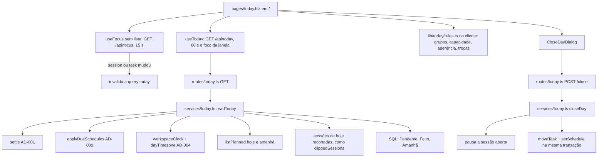

# Dashboard Hoje Design

**Spec**: `.specs/features/dashboard-hoje/spec.md`
**Status**: Approved (2026-11-11)

Abordagem escolhida pelo usuário em 2026-11-11: **endpoint do dia**. Um `GET /api/today` devolve o dia pronto, e um `POST /api/today/close` fecha o dia. O card Agora não passa por esse endpoint: ele usa o `useFocus()` que já existe, sem lista. As alternativas descartadas foram montar tudo no frontend (uma chamada por lista e regras de dia no navegador, contra o AD-004) e um híbrido (duas fontes de verdade para os números do dia).

---

## Architecture Overview



Regra de divisão: o **dia** (limites de hoje e de amanhã, fuso, "agora" em minutos do workspace) sai do SQL e do `workspaceClock`, como manda o AD-004. As **contas por minuto** (grupos, capacidade, aderência, trocas) são funções puras em TypeScript, testadas sem banco, que recebem horários já no fuso do workspace.

O que muda a cada minuto no navegador (o marcador `agora`, "passou há", a capacidade, o bloco que sugere a tarefa) é recalculado no cliente com as mesmas funções. Para isso a resposta traz os dados brutos (`start_minute`, `estimate_minutes`, sessões), e não só o resultado.

---

## Code Reuse Analysis

### Existing Components to Leverage

| Component | Location | How to Use |
| --------- | -------- | ---------- |
| `settle` | `backend-node/src/services/focus-settle.ts` | Primeira coisa de `readToday` e `closeDay` (AD-001) |
| `applyDueSchedules`, `workspaceClock`, `setSchedule` | `backend-node/src/services/schedule.ts` | Antes de ler as colunas (AD-009); `today`/`tomorrow` e o minuto atual; agendar amanhã em `closeDay` |
| `dayTimezone`, `daySql` | `backend-node/src/services/day.ts` | Limites de hoje e de amanhã no fuso |
| `listPlanned`, `workdayOf` | `backend-node/src/services/plans.ts` | Blocos do plano de hoje (com feitos, para os números) e de amanhã (só a contagem); jornada do usuário |
| `clippedSessions`, `verdictOf` | `backend-node/src/services/reports.ts` | Sessões de hoje recortadas ao dia (HOJE-68) com o mesmo SQL dos Relatórios; selo de `Feito hoje` |
| `spentSecondsByTask` | `backend-node/src/services/board.ts` | Tempo total da tarefa somando todos os membros (o mesmo do selo dos Relatórios) |
| `moveTask` | `backend-node/src/services/tasks.ts` | Destinos de `Fechar o dia` e "levar para `Hoje`" antes de `Começar foco` |
| `useFocus`, `deriveDisplay` | `frontend/src/lib/focus/use-focus.tsx`, `display.ts` | Estado e ações do card Agora: `start`, `pause`, `complete`, `extend`, `takeBreak`, `endBreak` |
| `BreakPicker` | `frontend/src/components/focus/break-picker.tsx` | Botão `Intervalo` do card |
| `TaskDialog` | `frontend/src/components/board/task-dialog.tsx` | Clique numa tarefa de `Pendente`, `Feito` ou `Amanhã` (HOJE-33): o mesmo diálogo que o painel da Agenda abre em `Abrir tarefa` |
| `formatDuration`, `minuteClock` | `components/board/format-duration.ts`, `lib/agenda/format.ts` | Todas as durações e horas |
| `greetingFor`, `hourIn`, `tomorrowPath` | `components/lists/greeting.ts`, `lib/plan/tomorrow.ts` | Saudação e `Planejar amanhã` |
| Visual da tarefa do Planejar | `frontend/src/components/plan/plan-sidebar.tsx:229-260` | O `TaskTile` copia as classes do `<li>` (borda, cantos, ponto, meta, pílula de estimativa) |
| Visual dos blocos | `frontend/src/components/plan/plan-block.tsx:89-96` | Bordas tracejadas de `Plano × real` e da tarefa sugerida |
| `PageHeader` | `frontend/src/components/page-header.tsx` | Cabeçalho do Hoje |
| `TOKEN_ROUTES`/`CLOSED_AGENDA_ROUTES` | `backend-node/test/support/token-routes.ts` | As duas rotas novas entram na lista de rotas fechadas a tokens (AD-007) |

### Integration Points

| System | Integration Method |
| ------ | ------------------ |
| Roteamento | `/` passa a ser `TodayPage`; a grade de listas (`HomePage` de hoje) vai para `/lists` como `ListsPage`. `nav-items.ts` ganha `today` (`/`) no topo; `allLists` → `/lists`; `newList` → `/lists?new=1`. `list-board.tsx:237,429` passam a levar para `/lists`. `login.tsx` e `admin-route.tsx` continuam em `/`. |
| Cache do foco | Quando `session.id` ou `task.id` do `useFocus()` mudam, a página invalida `['today', workspaceId]`, e uma conclusão pelo card aparece em `Feito hoje` sem esperar 60 s. |
| Banco | Nenhuma tabela ou coluna nova. |

---

## Components

### `rules.ts` (frontend, puro)

- **Purpose**: As contas por minuto do dia, sem rede.
- **Location**: `frontend/src/lib/today/rules.ts`. Só o cliente usa estas contas: o servidor devolve dados brutos, então não há cópia no backend.
- **Interfaces**:
  - `groupPending(tasks: PendingInput[], nowMinute: number): PendingGroup[]`: HOJE-25 e HOJE-26; cada tarefa cai no primeiro grupo que vale, e grupos vazios saem.
  - `capacity(pending: PendingInput[], focusLeftSeconds: number, nowMinute: number, workdayEnd: number): Capacity`: HOJE-29 a HOJE-32. Devolve `{ needSeconds, leftSeconds, overSeconds, freeSeconds, withoutEstimate }`.
  - `adherence(blocks: BlockInput[], sessions: SessionInput[], nowMinute: number): number | null`: HOJE-52. Interseção, por tarefa, dos minutos de bloco até agora com as sessões da mesma tarefa, dividida pelos minutos de bloco até agora, arredondada; `null` sem minutos de bloco.
  - `switches(sessions: SessionInput[]): number`: HOJE-53. Conta as sessões de tarefa, em ordem de início, cuja tarefa difere da anterior.
  - `suggestedBlock(blocks: BlockInput[], nowMinute: number): BlockInput | null`: HOJE-11. O bloco de tarefa não feita que contém `nowMinute`; o que começou mais tarde, se houver mais de um.
  - `timelineRange(workday, blocks, sessions): { from: number; to: number }`: HOJE-43, em horas cheias.
- **Dependencies**: nenhuma.

### `today.ts` (backend, serviço)

- **Purpose**: Ler o dia do usuário no workspace e fechar o dia.
- **Location**: `backend-node/src/services/today.ts`
- **Interfaces**:
  - `readToday(db, actor: { userId; workspace }, now: Date): Promise<TodayRead>`. Ordem: `settle` → `applyDueSchedules` → `workspaceClock` → consultas. Lê só; não grava fora do que `settle` e `applyDueSchedules` já gravam.
  - `closeDay(db, actor, moves: CloseMove[], now: Date): Promise<TodayRead>`. Numa transação: `settle`; se há sessão de tarefa aberta, encerra com `end_reason = 'pause'` pelo mesmo caminho do `pauseFocus`; valida que cada tarefa é do workspace e não está em `done` (422 `close_task_not_pending`); aplica `moveTask` e `setSchedule` passando o `tx`. Depois devolve `readToday`.
- **Dependencies**: `focus-settle`, `schedule`, `plans`, `reports`, `board`, `tasks`.

### `routes/today.ts`

- **Purpose**: Expor as duas operações.
- **Interfaces**:
  - `GET /api/today` → `200 TodayRead`; `preValidation: [requireUser, workspaceContext]`.
  - `POST /api/today/close` body `{ moves: Array<{ task_id: uuid; to: 'tomorrow' | 'this_week' | 'backlog' }> }` (de 0 a 500 itens, sem `task_id` repetido) → `200 TodayRead`; `preValidation: writing` (viewer recebe 403, HOJE-67).
  - Nenhuma das duas declara `tokenScope` (AD-007): um token recebe 403.

### Frontend

| Componente | Location | Purpose | Reqs |
| ---------- | -------- | ------- | ---- |
| `today` API + tipos | `lib/api.ts`, `types/index.ts` | `today.get()`, `today.close(moves)`, `TodayRead` | — |
| `useToday` | `lib/today/use-today.ts` | `useQuery(['today', workspaceId])`, `refetchInterval: 60_000`, `refetchOnWindowFocus`, mantém os últimos dados em erro | HOJE-70, 71, 73 |
| `useNowMinute` | `lib/today/use-now-minute.ts` | Minuto atual no fuso do workspace (`serverNow()` + `Intl`), troca a cada virada de minuto; avisa quando o dia muda, para refazer a leitura | HOJE-04, 70 |
| `ListsPage` | `pages/lists.tsx` | A grade de listas que hoje está em `home.tsx`, movida sem mudar o comportamento | HOJE-02 |
| `TodayPage` | `pages/today.tsx` | Monta o layout do mockup e liga `useToday` e `useFocus` | HOJE-01, 03, 05, 06 |
| `TaskTile` | `components/today/task-tile.tsx` | Card de tarefa no visual do Planejar, com as variantes `pending`, `late`, `done` e `ghost` (a linha tracejada) | HOJE-24, 27, 37, 55 |
| `NowCard` | `components/today/now-card.tsx` | Estados `focus`, `extend`, `break`, `suggested`, `empty` e `elsewhere`; `Abrir foco`; ações | HOJE-07 a 22, 74 |
| `TaskPicker` | `components/today/task-picker.tsx` | Popover com as tarefas de `Pendente` para `Outra tarefa` e `Escolher tarefa` | HOJE-15 |
| `PendingCard` | `components/today/pending-card.tsx` | Capacidade, grupos e vazio | HOJE-23 a 34, 72 |
| `DoneCard` | `components/today/done-card.tsx` | Feito hoje | HOJE-35 a 40 |
| `PlanVsReal` | `components/today/plan-vs-real.tsx` | Duas faixas, escala, `agora`, tooltips, rolagem | HOJE-42 a 48 |
| `DayStats` | `components/today/day-stats.tsx` | Os quatro números | HOJE-49 a 53 |
| `TomorrowCard` | `components/today/tomorrow-card.tsx` | Amanhã | HOJE-54 a 57 |
| `CloseDayDialog` | `components/today/close-day-dialog.tsx` | Diálogo, destinos, nota, cópia | HOJE-41, 58 a 67 |
| `summaryMarkdown` | `lib/today/summary.ts` | Resumo em Markdown, puro | HOJE-63 |

`Começar foco` numa tarefa fora de `Hoje` (HOJE-14) chama `tasks.move(id, { column: 'today', before_task_id: <primeira de Hoje> })` e, quando a resposta chega, `actions.start(id)`. Se o `move` falhar, o foco não começa e o erro vai para um toast (HOJE-22).

---

## Data Models

```typescript
/** GET /api/today and POST /api/today/close. Minutes are minutes of the day in the workspace timezone. */
interface TodayRead {
  server_now: string
  day: string                     // YYYY-MM-DD, today in the workspace timezone
  tomorrow: string
  timezone: string
  now_minute: number              // 0..1439 at server_now
  workday: { start: string; end: string }   // HH:MM
  pending: PendingTask[]          // Today column, active lists, not done, minus the open session's task
  done: DoneTask[]                // completed today by the reader, newest first
  plan: { saved: boolean; blocks: PlanBlock[] }   // today's plan, done tasks included
  sessions: DaySession[]          // the reader's sessions of today in the workspace, cut to the day
  tomorrow_plan_blocks: number
  tomorrow_tasks: TomorrowTask[]
  week_unscheduled: number        // this_week, not done, scheduled_on null
}

interface TaskRef { id: string; title: string; list: { id: string; name: string; color: number }; estimate_minutes: number | null }

interface PendingTask extends TaskRef {
  position: number
  scheduled_on: string | null
  scheduled_minute: number | null         // scheduled_time when scheduled_on = day
  plan_minute: number | null              // start of its first block in today's plan
  has_session_today: boolean
  days_late: number | null                // day - scheduled_on when scheduled_on < day
  subtasks: { done: number; total: number }
}

interface DoneTask extends TaskRef {
  completed_at: string
  spent_seconds: number                   // all members, as verdictOf in the reports
  verdict: 'early' | 'on_time' | 'late' | null
  diff_seconds: number
  series: boolean
}

interface PlanBlock { id: string; kind: 'task' | 'break'; task_id: string | null; title: string; list_color: number | null; start_minute: number; minutes: number; done: boolean }

interface DaySession { id: string; kind: 'task' | 'break'; task_id: string | null; title: string; list_id: string; list_color: number; start_minute: number; end_minute: number; open: boolean }

interface TomorrowTask extends TaskRef { scheduled_minute: number | null; series: boolean }

type CloseMove = { task_id: string; to: 'tomorrow' | 'this_week' | 'backlog' }
```

Os números do dia (`Tempo focado`, `Concluídas`, `Aderência`, `Trocas`) e a capacidade não vêm prontos: o cliente calcula com `lib/today/rules.ts` a cada minuto, a partir de `sessions`, `plan` e `pending`. O teste de serviço confere que `sessions` somam o mesmo que `/api/reports/overview` de hoje (HOJE-49).

---

## Error Handling Strategy

| Error Scenario | Handling | User Impact |
| -------------- | -------- | ----------- |
| `GET /api/today` falha | `useToday` mantém `data` anterior (`placeholderData: keepPreviousData`) e expõe `isError` | Faixa `Não foi possível atualizar` com `Tentar de novo`; os cards continuam com os últimos dados (HOJE-73) |
| Ação de foco recusada | O `useFocus` já devolve conflitos; a página mostra `extractApiError` num toast e o próximo poll corrige | Toast; o card volta ao estado do servidor (HOJE-22) |
| `tasks.move` antes de `Começar foco` falha | Não chama `start`; toast | O card continua `nada em foco` |
| `POST /api/today/close` com tarefa de outro workspace ou já concluída | 422 `close_task_not_pending`, transação desfeita | Diálogo continua aberto com o erro e as escolhas (HOJE-65) |
| Viewer chama `close` | 403 do `requireWrite` | O botão nem aparece (HOJE-67) |
| `navigator.clipboard.writeText` rejeita | O dia já foi fechado; toast `Não foi possível copiar o resumo` com a ação `Copiar de novo` | HOJE-66 |
| Sessão aberta em outro workspace | `useFocus()` traz `session.list_id` de uma lista que não está no workspace atual: o card mostra o estado `elsewhere` com o nome do workspace, achado em `useWorkspace().workspaces` pela lista da sessão | HOJE-20 |

---

## Risks & Concerns

| Concern | Location (file:line) | Impact | Mitigation |
| ------- | -------------------- | ------ | ---------- |
| `moveTask` e `setSchedule` abrem a própria transação com `db.transaction` | `backend-node/src/services/tasks.ts:154`, `schedule.ts:67` | Em `closeDay`, chamados com o `db` de fora, cada movimento grava sozinho, e uma falha no meio deixaria metade das tarefas movida (contra HOJE-61 e HOJE-65) | Chamar os dois com o `tx` da transação de `closeDay`; no drizzle, `tx.transaction` vira savepoint. Teste: a terceira de três tarefas é inválida e as duas primeiras continuam no lugar |
| Mover a Home de `/` quebra links | `lib/nav-items.ts:23-24`, `pages/list-board.tsx:237,429` | Breadcrumb e "lista excluída" levariam para o Hoje, não para as listas | A tarefa da rota troca esses links para `/lists` e atualiza `nav-items.test.ts` e `home.test.tsx` (que vira `lists.test.tsx`) |
| Rota nova esquecida na tabela de tokens | `backend-node/test/support/token-routes.ts:30` | `token-scopes.test.ts` falha ou, pior, a rota fica sem cobertura de negação | Somar `GET /api/today` e `POST /api/today/close` a `CLOSED_AGENDA_ROUTES` (renomeada para `CLOSED_PERSONAL_ROUTES`) |
| `GET /api/today` lê muito por chamada (Pendente, Feito, Amanhã, plano de dois dias, sessões, tempo gasto) | `services/today.ts` | Uma leitura a cada 60 s por aba aberta | Consultas por índice que já existe (`ix_tasks_list_column_position`, `ix_focus_sessions_user_started`, `uq_day_plans_user_workspace_day`); `spentSecondsByTask` só para as tarefas de `done`. Medir no teste com 200 tarefas; se passar de 150 ms no PGlite, juntar as consultas de tarefa |
| A tarefa da sessão aberta pode não estar em `Hoje` (uma sessão da Agenda, AD-008) | `services/today.ts` | Some de `Pendente` sem aparecer em lugar nenhum | Só é tirada de `Pendente` quando está lá; o card Agora mostra o título pelo `useFocus` em qualquer caso |
| O mockup trazia o item `Foco` na barra lateral | — | Não existe uma rota `/focus` sem lista | Fica fora: o atalho `Abrir foco` cobre o caso (HOJE-17) |

---

## Tech Decisions (only non-obvious ones)

| Decision | Choice | Rationale |
| -------- | ------ | --------- |
| Onde calcular os números do dia | No cliente, com `lib/today/rules.ts`, a partir de dados brutos | Mudam a cada minuto sem nova leitura; o servidor continua dono do dia e do fuso (AD-004) |
| Card Agora | `useFocus()` sem lista, não `GET /api/today` | Reaproveita poll de 15 s, fila offline, `action_id` (AD-002) e o tratamento de conflito do Foco |
| Destino `Amanhã` em `Fechar o dia` | `this_week` + `scheduled_on = amanhã` | Na coluna `Hoje` a tarefa continuaria pendente hoje; o agendamento a traz de volta amanhã (D21) |
| Grade de listas | Movida para `/lists`, o componente sem mudança | Menor risco: o arquivo muda de nome e os testes acompanham |

Nenhuma decisão aqui vira regra de projeto; nada entra no `STATE.md`.
