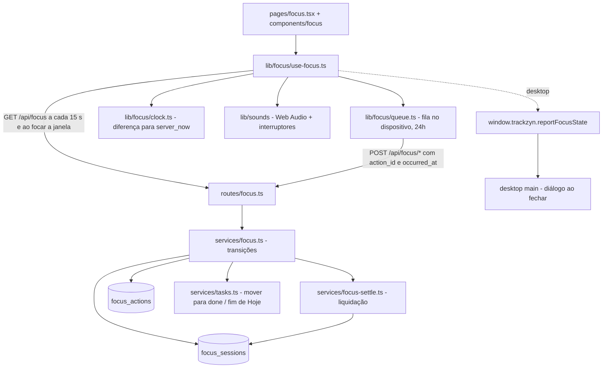
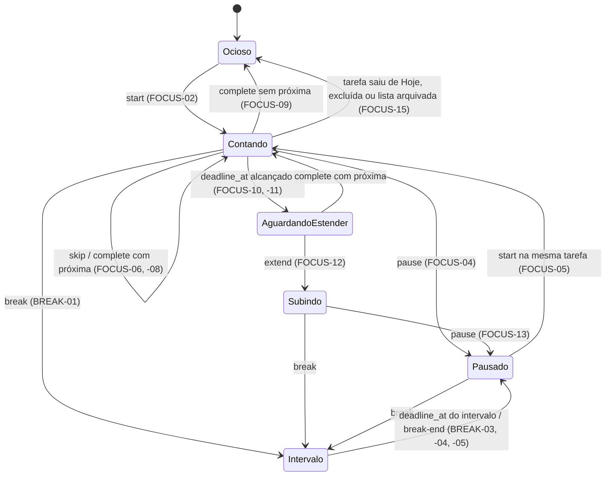

# Foco e sons Design

**Spec**: `.specs/features/foco-e-sons/spec.md`
**Status**: Draft

Segue AD-001 (servidor como fonte da verdade e fechamento das sessões vencidas na leitura seguinte), AD-002 (ações idempotentes com `occurred_at`), AD-003 (polling + IPC, sem push), AD-004 e AD-005 de `.specs/STATE.md`. A arquitetura foi escolhida pelo usuário entre três alternativas (servidor + jobs + SSE; cliente dono com log de eventos).

---

## Architecture Overview

O servidor guarda o foco como sessões (`focus_sessions`) e aplica as ações como transições numa transação. Antes de qualquer leitura ou ação, ele **liquida** o usuário: fecha toda sessão aberta cujo `deadline_at` já passou, com `ended_at = deadline_at`. É isso que faz o fim da estimativa e o fim do intervalo acontecerem no horário certo mesmo com o app fechado.

O cliente mostra o cronômetro a partir de `started_at`, `deadline_at` e `server_now`, e envia as ações por uma fila que guarda cada ação até a resposta chegar. Os sons são disparados pelo cliente quando o cronômetro cruza um limite.



### Transições (servidor)



`Pausado` e `AguardandoEstender` não têm sessão aberta. `AguardandoEstender` é derivado: a última sessão da tarefa terminou com `end_reason = 'estimate'` e nenhuma outra começou depois.

---

## Code Reuse Analysis

### Existing Components to Leverage

| Component | Location | How to Use |
| --------- | -------- | ---------- |
| Guards | `backend-node/src/plugins/auth.ts`, `plugins/workspace.ts` | `requireWrite` em toda ação (FOCUS-17) |
| `HttpError` e formato de erro | `backend-node/src/http/http-error.ts`, `plugins/errors.ts` | 409 com `detail` e `code` (FOCUS-18, SYNC-02) |
| Mover tarefa | `backend-node/src/services/tasks.ts` (de `listas-e-quadro`) | `complete` e `skip` usam o mesmo movimento do quadro |
| Fuso do dia | `backend-node/src/services/day.ts` (de `listas-e-quadro`) | Nada de dia aqui; usado pelo quadro |
| Harness PGlite | `backend-node/test/support/test-app.ts` | Testes de transição com `now` injetado |
| TanStack Query | `frontend/src/main.tsx` (QueryClient) | `refetchInterval: 15000`, `refetchOnWindowFocus` |
| Cliente HTTP | `frontend/src/lib/api.ts` | Token e `X-Workspace-Id`; a pausa ao fechar usa `fetch(..., { keepalive: true })` com os mesmos cabeçalhos |
| Notificações | `frontend/src/components/ui/sonner.tsx` | Avisos de SYNC-06 |
| Ponte do desktop | `desktop/src/shared/ipc.ts`, `preload/index.ts`, `main/ipc.ts` (`trustedHandle`) | Canal `focus:state` e diálogo ao fechar (SYNC-08) |

### Integration Points

| System | Integration Method |
| ------ | ------------------ |
| Banco | Migration `0002_focus`: `focus_sessions`, `focus_actions` |
| Quadro | `services/board.ts` passa a somar o tempo de cada tarefa (`spentSecondsByTask`), já liquidado |
| Tarefas e listas | `services/tasks.ts` (mover para fora de Hoje, excluir) e `services/lists.ts` (arquivar) fecham a sessão aberta da tarefa com `end_reason = 'task_left'` (FOCUS-15) |
| Widget | `widget-desktop` usa os mesmos hooks e ações; esta feature não sabe do widget, exceto pela regra de qual janela toca os sons |

---

## Components

### services/focus-settle.ts

- **Purpose**: Fechar as sessões vencidas de um usuário e limpar as ações aplicadas há mais de 24h.
- **Location**: `backend-node/src/services/focus-settle.ts`
- **Interfaces**:
  - `settle(tx, userId, now: Date): Promise<void>` - `UPDATE focus_sessions SET ended_at = deadline_at, end_reason = CASE kind WHEN 'task' THEN 'estimate' ELSE 'break_end' END WHERE user_id = $1 AND ended_at IS NULL AND deadline_at <= $now`
  - `spentSeconds(tx, taskIds, now): Map<taskId, number>` - soma de `coalesce(ended_at, now) - started_at` das sessões `task`
- **Dependencies**: schema
- **Reuses**: nada

### services/focus.ts + routes/focus.ts

- **Purpose**: Aplicar cada ação como uma transição, numa transação, de forma idempotente.
- **Location**: `backend-node/src/services/focus.ts`, `backend-node/src/routes/focus.ts`
- **Interfaces** (todas as ações: corpo `{action_id, occurred_at, device_id, ...}`; resposta `FocusState`):
  - `GET /api/focus?list_id=` → `FocusState` (FOCUS-02, -03, SYNC-11)
  - `POST /api/focus/start {task_id, takeover?: boolean}` (FOCUS-02, -05, SYNC-02, -03, -04)
  - `POST /api/focus/pause` (FOCUS-04)
  - `POST /api/focus/skip {task_id}` (FOCUS-06, -07)
  - `POST /api/focus/complete {task_id}` (FOCUS-08, -09)
  - `POST /api/focus/extend {task_id}` (FOCUS-12)
  - `POST /api/focus/break {minutes, list_id}` (BREAK-01, -02)
  - `POST /api/focus/break/end` (BREAK-04)
  - `POST /api/focus/heartbeat` (SYNC-10) - sem `action_id`; atualiza `last_seen_at` da sessão aberta deste `device_id`
  - `POST /api/focus/recover {decision: 'keep'|'cut'}` (SYNC-11)
- **Dependencies**: `focus-settle.ts`, `services/tasks.ts`
- **Reuses**: guards, `HttpError`

Cada ação segue os mesmos passos:
1. Abre a transação e trava a linha do usuário (`SELECT ... FROM users WHERE id = $1 FOR UPDATE`), o que serializa as ações de um usuário.
2. Se o `action_id` já existe em `focus_actions`, devolve a resposta guardada.
3. Valida `occurred_at` (AD-002).
4. Liquida as sessões vencidas.
5. Aplica a transição usando `occurred_at` como horário.
6. Grava `focus_actions` e responde.

### Frontend: lib/focus

- **Purpose**: Estado do foco no cliente, relógio corrigido, fila no dispositivo e cronômetro.
- **Location**: `frontend/src/lib/focus/`
- **Interfaces**:
  - `clock.ts`: `updateOffset(serverNow: string)`, `serverNow(): number` - diferença medida a cada resposta (FOCUS-03)
  - `display.ts`: `deriveDisplay(state: FocusState, nowMs): { mode: 'countdown'|'countup'|'awaiting_extend'|'break'|'paused'|'idle'|'all_clear', seconds: number }` - pura, é o que o cronômetro mostra
  - `optimistic.ts`: `applyOptimistic(state, action, nowMs): FocusState` - a mesma transição do servidor, para mostrar a ação sem conexão (SYNC-05)
  - `queue.ts`: `enqueue(action)`, `flush(send)`, `pending()`, `conflicts()`, `retry(id)`, `discard(id)`; guarda em `localStorage['trackzyn.focus.queue']`; descarta o que passa de 24h (SYNC-06); 409 ou 422 viram conflito (SYNC-07); falha de rede mantém na fila
  - `device-id.ts`: `deviceId()` - UUID em `localStorage['trackzyn.device']`, o mesmo para as janelas do mesmo app
  - `use-focus.ts`: `useFocus(listId)` → `{ state, display, actions }`; envia heartbeat a cada 60 s enquanto a sessão aberta é deste dispositivo
  - `use-leave-guard.ts`: no navegador, `beforeunload` com a tarefa contando e, em `pagehide`, `fetch('/api/focus/pause', { keepalive: true })` com `occurred_at` do fechamento (SYNC-09); no desktop, `window.trackzyn.reportFocusState({ active, running })`
- **Dependencies**: `lib/api.ts`, TanStack Query
- **Reuses**: QueryClient que já existe

### Frontend: lib/sounds

- **Purpose**: Os 4 sons sintetizados, os interruptores e a decisão de qual janela toca.
- **Location**: `frontend/src/lib/sounds/`
- **Interfaces**:
  - `synth.ts`: `play(kind: 'complete'|'progress'|'estimate'|'break_end')` - `AudioContext` com osciladores e envelopes. `complete`: arpejo ascendente de 3 notas, curto. `progress`: um "tic" suave de 1 nota. `estimate`: 2 notas descendentes. `break_end`: 3 batidas iguais (SOUND-05)
  - `prefs.ts`: `isEnabled(kind)`, `setEnabled(kind, on)` em `localStorage['trackzyn.sounds']`, todos ligados por padrão (SOUND-06)
  - `triggers.ts`: `soundsFor(prev: Display, next: Display, spentPrev, spentNext): Kind[]` - pura. Progresso quando `floor(spent/600)` aumenta com a sessão aberta (SOUND-02). Fim da estimativa na passagem para `awaiting_extend` (SOUND-03). Fim do intervalo na passagem de `break` para `paused` sem ação do usuário (SOUND-04)
  - `gate.ts`: `shouldPlayHere(): boolean` - no navegador, sempre; no desktop, `true` no widget e, na janela principal, só com o widget fechado (a regra de WIDGET-23, aplicada aqui)
- **Dependencies**: nenhuma biblioteca
- **Reuses**: nada

### Frontend: tela de foco

- **Purpose**: A tela do print `03-foco.png`, os diálogos e os ajustes de som.
- **Location**: `frontend/src/pages/focus.tsx` (`/focus/:listId`), `components/focus/` (`focus-task-card.tsx`, `focus-controls.tsx`, `break-picker.tsx` com 5/10/15 e campo de 1 a 120, `extend-prompt.tsx`, `elsewhere-dialog.tsx`, `stale-session-dialog.tsx`, `offline-conflicts.tsx`, `sound-settings.tsx`)
- **Interfaces**: só componentes; toda regra vem de `lib/focus` e `lib/sounds`
- **Dependencies**: `useFocus`
- **Reuses**: `ui/dialog`, `ui/popover`, `ui/switch` (interruptores), `ui/input`, `ui/button`

### Desktop: fechar com a tarefa contando

- **Purpose**: O diálogo de SYNC-08.
- **Location**: `desktop/src/main/focus-close.ts`, `desktop/src/shared/ipc.ts` (canais `focus:state` e `focus:pause-request`), `preload/index.ts`
- **Interfaces**:
  - `reportFocusState({ active: boolean, running: boolean }): void` em `TrackzynApi`
  - `onPauseRequest(cb: () => Promise<void>)` em `TrackzynApi`
  - No processo principal, o evento `close` da janela principal: com `running`, cancela o fechamento, mostra `dialog.showMessageBox` com "Há uma tarefa contando." e os botões `Pausar e sair` e `Cancelar`. `Pausar e sair` pede a pausa ao renderer, espera até 3 s e fecha
- **Dependencies**: `main/index.ts` (`before-quit` já existe)
- **Reuses**: `trustedHandle`

---

## Data Models

### focus_sessions

```typescript
interface FocusSession {
  id: string
  userId: string          // fk users.id ON DELETE CASCADE
  workspaceId: string     // fk workspaces.id ON DELETE CASCADE
  listId: string          // fk lists.id ON DELETE CASCADE (AD-005)
  taskId: string | null   // fk tasks.id ON DELETE CASCADE; null em 'break'
  kind: 'task' | 'break'
  deviceId: string        // varchar(64)
  startedAt: Date
  endedAt: Date | null
  deadlineAt: Date | null // task: started_at + (estimate - gasto antes); null sem estimativa ou depois de extend. break: started_at + planned
  plannedSeconds: number | null // só 'break', 60..7200
  lastSeenAt: Date
  endReason: 'pause'|'skip'|'complete'|'estimate'|'break'|'break_end'|'break_stop'|'switch'|'task_left'|'leave'|'crash_cut' | null
}
// UNIQUE INDEX (user_id) WHERE ended_at IS NULL   → SYNC-01
// INDEX (user_id, started_at), INDEX (task_id)
```

### focus_actions

```typescript
interface FocusAction {
  actionId: string        // uuid, PK → AD-002
  userId: string          // fk users.id ON DELETE CASCADE
  appliedAt: Date
  response: unknown       // json, o FocusState devolvido
}
```

### FocusState (resposta)

```typescript
interface FocusState {
  server_now: string
  session: { id; kind; task_id; list_id; device_id; started_at; deadline_at; planned_seconds } | null
  task: { id; title; estimate_minutes; spent_seconds; awaiting_extend: boolean } | null // a tarefa em foco ou a primeira de Hoje
  today: { pending: number; done: number; estimate_minutes: number }
  stale: { session_id: string; last_seen_at: string; seconds: number } | null // SYNC-11
}
```

**Relationships**: user 1—N focus_sessions (no máximo 1 aberta); list 1—N sessions; task 1—N sessions `task`; sessões `break` pertencem à lista em foco.

---

## Error Handling Strategy

| Error Scenario | Handling | User Impact |
| -------------- | -------- | ----------- |
| Ação fora de ordem (pausar sem sessão, concluir tarefa concluída, estender sem estar aguardando) | 409 `{detail, code: 'invalid_transition'}`, nada muda | Na fila: vira conflito com `Tentar de novo`/`Descartar` (SYNC-07) |
| Sessão aberta em outro dispositivo | 409 `{code: 'focus_elsewhere', session}` sem abrir sessão | Diálogo "Você já está focando em outro dispositivo." com `Assumir`/`Cancelar` (SYNC-02) |
| Intervalo fora de 1–120 min | 422 | Mensagem no campo (BREAK-02) |
| `occurred_at` no futuro (+5 s), anterior à última mudança ou com mais de 24h | 422 `{code: 'invalid_time'}` | Conflito na fila |
| Servidor fora do ar ou sem rede | A fila mantém a ação; `applyOptimistic` mostra o efeito | Cronômetro segue; reenvio automático (SYNC-05) |
| Ação na fila com mais de 24h | Descartada no `flush` | Aviso de SYNC-06 |
| Reenvio de ação já aplicada | `focus_actions` devolve a resposta guardada | Nada duplica |
| Sessão sem sinal há mais de 120 s | `GET /api/focus` devolve `stale` | Diálogo `Manter`/`Cortar no último sinal` (SYNC-11) |
| `viewer` | `requireWrite` → 403 | Botões escondidos (FOCUS-17) |
| Navegador bloqueia o áudio antes do primeiro clique | `AudioContext` retomado no primeiro `pointerdown` | O primeiro som pode não tocar (Edge Case da spec) |

---

## Risks & Concerns

| Concern | Location (file:line) | Impact | Mitigation |
| ------- | -------------------- | ------ | ---------- |
| A transição existe duas vezes (servidor e `optimistic.ts`) | `backend-node/src/services/focus.ts`, `frontend/src/lib/focus/optimistic.ts` | As duas podem divergir e a tela mostrar um estado que o servidor recusa | Uma tabela de casos (estado, ação, resultado) em JSON em `docs/` usada pelos testes das duas; a resposta do servidor sempre substitui o estado otimista |
| Fechar a janela principal encerra o app | `desktop/src/main/index.ts:169` | O diálogo de SYNC-08 precisa vir antes do `before-quit` | Tratar no evento `close` da janela, antes de `app.quit()` |
| `fetch` com `keepalive` ao fechar a aba pode não chegar | `frontend/src/lib/focus/use-leave-guard.ts` | A tarefa fica contando no servidor | O heartbeat para; ao reabrir, SYNC-11 pergunta se mantém ou corta. A perda fica limitada a 120 s de detecção |
| Relógio do cliente muito errado | `frontend/src/lib/focus/clock.ts` | `occurred_at` errado na fila | A diferença é medida a cada resposta e o servidor recusa horários fora dos limites de AD-002 |
| Testes dependem de tempo | `backend-node/src/services/focus.ts` | Testes lentos ou instáveis | `now` injetado nos serviços e `vi.useFakeTimers()` no frontend; nenhum teste espera relógio real |
| Trava por usuário serializa as ações | `FOR UPDATE` em `users` | Ações do mesmo usuário esperam umas às outras | Só um usuário humano faz poucas ações por minuto; não há impacto entre usuários |

---

## Tech Decisions (only non-obvious ones)

| Decision | Choice | Rationale |
| -------- | ------ | --------- |
| Estado pausado | Sem linha própria: pausado = nenhuma sessão aberta e uma tarefa em Hoje | A spec não restaura o foco ao reabrir (SYNC-12), então não há o que guardar |
| `AguardandoEstender` | Derivado de `end_reason = 'estimate'` da última sessão da tarefa | Evita uma coluna de estado que poderia divergir das sessões |
| Dispositivo | `device_id` gerado no cliente e gravado na sessão | Diferencia "outro dispositivo" (SYNC-02) da mesma máquina com duas janelas |
| Sons | Síntese com Web Audio, sem arquivo | Decisão do usuário; sem licença nem asset no bundle |
| Fila offline | `localStorage` | Poucas ações, 24h no máximo; acesso síncrono no `pagehide` |
