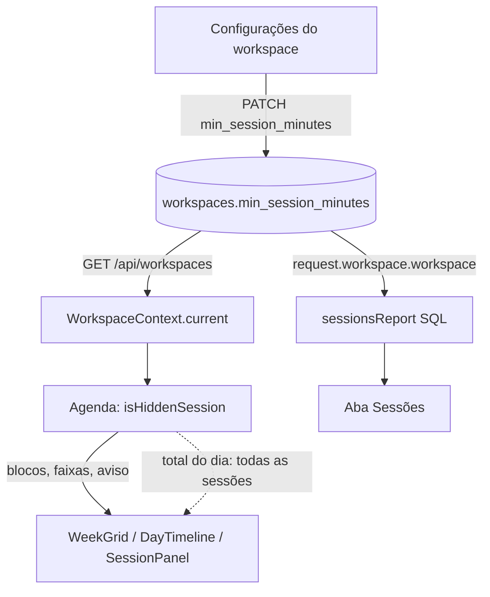

# Esconder sessões curtas Design

**Spec**: `.specs/features/hide-short-sessions/spec.md`
**Status**: Approved

---

## Architecture Overview

A configuração é uma coluna do workspace, lida com o resto do workspace. Cada tela esconde no lugar onde o dado já está montado:

- **Agenda (no navegador).** `GET /api/sessions` continua devolvendo todas as sessões. O total do dia (AGENDA-11) é somado no navegador a partir delas e precisa continuar contando as escondidas (HIDE-14). Por isso a Agenda recebe tudo e só deixa de desenhar os blocos curtos. O mesmo filtro tira as escondidas da divisão de largura (AGENDA-06) e do aviso de sobreposição (AGENDA-19), como pede HIDE-15.
- **Aba Sessões (no servidor).** As linhas de `GET /api/reports/sessions` são pedaços cortados na meia-noite e nas bordas do período, e só o SQL tem o início e o fim da sessão inteira. O filtro entra na consulta, pela duração inteira (HIDE-19, HIDE-20).
- **Visão geral.** `GET /api/reports/overview` não muda (HIDE-23).



---

## Code Reuse Analysis

### Existing Components to Leverage

| Component | Location | How to Use |
| --------- | -------- | ---------- |
| Atualização do workspace | `backend-node/src/routes/workspaces.ts:93` | Mais um campo no `workspaceUpdateBody`, com a checagem `requireMembership(..., 'owner')` que já existe (403 para editor e leitor, HIDE-05) |
| Leitura do workspace | `backend-node/src/routes/schemas.ts:20` (`workspaceReadSchema`, `toWorkspaceRead`) | Mais um campo `min_session_minutes`, lido por todos os membros (HIDE-02) |
| Erro de validação | `backend-node/src/plugins/errors.ts:68` | O zod já responde 422 para um corpo inválido (HIDE-04) |
| Consulta da aba Sessões | `backend-node/src/services/reports-sessions.ts:26` | O CTE `s` (de `clippedSessions`) já traz `started_at` e `ended_at` da sessão inteira; o filtro entra ali |
| Workspace atual no navegador | `frontend/src/contexts/workspace-provider.tsx` (`current`, `canManage`) | A Agenda lê `current.min_session_minutes`; a tela de configurações usa `canManage` para habilitar o campo (HIDE-10) |
| Recarga depois de salvar | `frontend/src/pages/workspace-settings.tsx:143` | Salvar já chama `refresh()` e invalida as consultas; a Agenda recebe o valor novo sem recarregar a página (HIDE-18) |
| Interruptor | `frontend/src/components/ui/switch.tsx` | O `Esconder sessões curtas` |
| Layout da grade | `frontend/src/lib/agenda/layout.ts` (`dayPieces`, `assignLanes`, `dayTotal`) | O total sai dos pedaços de todas as sessões; as faixas, só dos visíveis |

### Integration Points

| System | Integration Method |
| ------ | ------------------ |
| Banco | Migration `0007_workspace_min_session.sql`: `ALTER TABLE workspaces ADD COLUMN min_session_minutes smallint` com `CHECK (min_session_minutes BETWEEN 1 AND 60)`, nula por padrão (HIDE-01) |
| `GET /api/workspaces`, `GET /api/workspaces/current`, `PATCH /api/workspaces/:id` | Campo novo na leitura e na escrita |
| `GET /api/reports/sessions` | Mesmo contrato; menos linhas quando a configuração está ligada |
| Modo local do desktop | Mesmo backend e as mesmas migrations; nada a mais |

---

## Components

### Coluna e contrato do workspace (backend)

- **Purpose**: Guardar, ler e gravar o mínimo do workspace.
- **Location**: `backend-node/src/db/schema.ts`, `backend-node/drizzle/0007_workspace_min_session.sql`, `backend-node/src/routes/schemas.ts`, `backend-node/src/routes/workspaces.ts`
- **Interfaces**:
  - `workspaces.minSessionMinutes: number | null`
  - leitura: `min_session_minutes: number | null`
  - `PATCH` aceita `min_session_minutes: z.number().int().min(1).max(60).nullable().optional()`; ausente não muda, `null` desliga
- **Dependencies**: nenhuma nova
- **Reuses**: o padrão de `timezone` (campo opcional, gravado só quando vem no corpo)

### Filtro da aba Sessões (backend)

- **Purpose**: Deixar de fora os pedaços das sessões encerradas mais curtas que o mínimo.
- **Location**: `backend-node/src/services/reports-sessions.ts`
- **Interfaces**:
  - `sessionsReport(tx, userId, workspace: Pick<Workspace, 'id' | 'timezone' | 'minSessionMinutes'>, filter, now)`
  - na consulta: `WHERE ... AND (s.ended_at IS NULL OR s.ended_at - s.started_at >= make_interval(mins => ${min}))`, só quando `min` não é nulo
- **Dependencies**: a liquidação de `reportScope` (AD-001) roda antes, então uma sessão vencida já chega encerrada no próprio prazo
- **Reuses**: `clippedSessions`; dias sem nenhuma linha já não aparecem, porque `days` é montado a partir das linhas (HIDE-22)

### `isHiddenSession` (frontend)

- **Purpose**: A regra única de quem a Agenda esconde.
- **Location**: `frontend/src/lib/agenda/hide.ts`
- **Interfaces**:
  - `isHiddenSession(session: AgendaSession, minMinutes: number | null): boolean`: falso com o mínimo desligado ou para a sessão aberta (`ended_at === null`); verdadeiro quando `ended_at - started_at < minMinutes × 60 000` ms
- **Dependencies**: nenhuma
- **Reuses**: nada; função pura, testada nas bordas (X × 60 s − 1 s, exatamente X)

### Agenda (frontend)

- **Purpose**: Não desenhar as escondidas, sem mudar o total.
- **Location**: `frontend/src/pages/agenda.tsx`, `frontend/src/components/agenda/week-grid.tsx`, `frontend/src/components/agenda/day-timeline.tsx`
- **Interfaces**:
  - `WeekGrid` e `DayTimeline` recebem `hidden?: (session: AgendaSession) => boolean`. Montam os pedaços de todas as sessões; o total do dia (`dayTotal`) usa todos, e os blocos e as faixas (`assignLanes`) só os que não estão escondidos.
  - A página passa ao `SessionPanel` só as sessões visíveis (`overlapping.filter(...)`), então o aviso ignora as escondidas (HIDE-15).
  - `selected` é procurado entre as visíveis: uma sessão salva ou ajustada para menos de X sai da grade e o painel fecha, como no AGENDA-32 (HIDE-17).
  - No dia em que todas as sessões estão escondidas, o `DayTimeline` mostra o total e nenhum bloco, sem a mensagem de dia vazio (AGENDA-42), porque a mensagem continua dependendo de haver sessões.
- **Dependencies**: `useWorkspace().current`
- **Reuses**: `dayPieces`, `assignLanes`, `dayTotal`

### Configuração na tela do workspace (frontend)

- **Purpose**: Ligar, desligar e definir X.
- **Location**: `frontend/src/pages/workspace-settings.tsx`, `frontend/src/locales/{en,pt-BR}.json`, `frontend/src/types/index.ts`
- **Interfaces**:
  - abaixo do fuso: o interruptor `Esconder sessões curtas` e, enquanto ligado, o campo de número `Menos de` com o sufixo `minutos`
  - ligar com o valor salvo nulo preenche 1 (HIDE-07); desligado, o salvar envia `null` (HIDE-08)
  - um valor fora de 1 a 60 ou não inteiro mostra `Entre 1 e 60 minutos.` e bloqueia o salvar (HIDE-09)
  - os dois desabilitados sem `canManage` (HIDE-10)
- **Dependencies**: `workspacesApi.update`
- **Reuses**: o formulário que já salva nome, idioma e fuso no mesmo `PATCH`

---

## Data Models

```typescript
// backend-node/src/db/schema.ts (workspaces)
minSessionMinutes: smallint('min_session_minutes') // null = desligado; CHECK 1..60

// frontend/src/types/index.ts (Workspace)
/** Sessions shorter than this many minutes are hidden in the agenda and the Sessions report; null shows all. */
min_session_minutes: number | null
```

**Relationships**: uma por workspace; não referencia outra tabela.

---

## Error Handling Strategy

| Error Scenario | Handling | User Impact |
| -------------- | -------- | ----------- |
| `min_session_minutes` fora de 1 a 60, fracionário ou texto | O zod responde 422; nada é gravado | A tela não chega a enviar (HIDE-09); pela API, 422 |
| Editor ou leitor tenta mudar | `requireMembership(..., 'owner')` responde 403 | A tela já mostra o campo desabilitado |
| Valor inválido gravado direto no banco | O `CHECK` da coluna recusa | Nenhum |
| Falha ao salvar | O erro que o formulário já mostra para o `PATCH` | Igual às outras configurações |

---

## Risks & Concerns

| Concern | Location (file:line) | Impact | Mitigation |
| ------- | -------------------- | ------ | ---------- |
| O total do dia e as faixas saem da mesma lista de pedaços | `frontend/src/components/agenda/week-grid.tsx` (`pieces`, `dayTotal`, `assignLanes`) | Filtrar a lista antes do total faria o total cair, contra HIDE-14 | O filtro entra depois de `dayPieces` e antes de `assignLanes`; um teste afirma o total com uma sessão escondida no dia |
| `WeekGrid` e `DayTimeline` montam o layout cada um do seu jeito | `frontend/src/components/agenda/day-timeline.tsx` | Esconder só numa das visões | O mesmo `hidden` nas duas, com teste em cada uma |
| Os testes da aba Sessões semeiam o workspace sem a coluna nova | `backend-node/test/services/reports-sessions.test.ts` | Nenhum: a coluna é nula por padrão e o comportamento de hoje fica igual (HIDE-24) | Os testes atuais continuam passando sem mudança, e isso prova HIDE-24 |
| O `PATCH` trata `nullish` como "não mudou" nos outros campos | `backend-node/src/routes/workspaces.ts:106` | `null` precisa desligar, não ser ignorado | O campo testa `!== undefined`, como `timezone`, e o teste envia `null` |

---

## Tech Decisions

| Decision | Choice | Rationale |
| -------- | ------ | --------- |
| Onde a Agenda esconde | No navegador, com `GET /api/sessions` inalterado | O total do dia já é somado no navegador e precisa das escondidas (HIDE-14); filtrar no servidor exigiria mandar os totais à parte |
| Onde a aba Sessões esconde | No SQL | As linhas são pedaços; só a consulta tem a duração inteira da sessão (HIDE-20) |
| Tipo da coluna | `smallint` nulo com `CHECK 1..60` | Nulo é o "desligado" do interruptor, sem uma segunda coluna booleana |
| Valor anterior ao desligar | Não guardado: desligar grava `null`, e ligar de novo começa em 1 | Uma coluna só; HIDE-07 já define o valor ao ligar |
