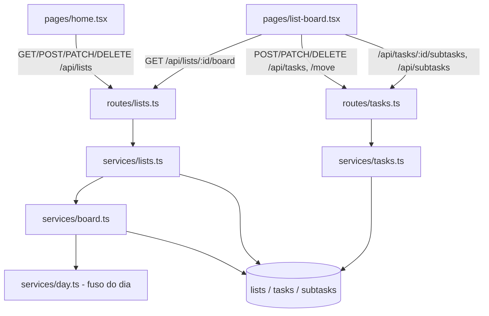

# Listas e quadro Design

**Spec**: `.specs/features/listas-e-quadro/spec.md`
**Status**: Draft

Segue AD-004 (fuso do dia) e AD-005 (lista no workspace, exclusão em cascata) de `.specs/STATE.md`.

---

## Architecture Overview

Três tabelas novas atrás de rotas Fastify no mesmo padrão de `routes/files.ts`: `requireUser` + `workspaceContext` para ler e `requireWrite` para escrever. O quadro é montado no servidor por um único `GET /api/lists/:id/board`, que devolve as colunas já ordenadas, as somas e as barras `x/y`, calculadas no fuso do dia (AD-004). Assim, a regra de "hoje" e "semana" fica num lugar só. O frontend troca o painel `/` pela home de listas e ganha a página do quadro, com arrastar e soltar.



---

## Code Reuse Analysis

### Existing Components to Leverage

| Component | Location | How to Use |
| --------- | -------- | ---------- |
| Guards de auth e workspace | `backend-node/src/plugins/auth.ts`, `plugins/workspace.ts` | `reading = [requireUser, workspaceContext(ctx)]`, `writing = [...reading, requireWrite]`, como em `routes/files.ts` |
| Formato de erro 422 | `backend-node/src/plugins/errors.ts` | Validação zod nas rotas; nada novo |
| `HttpError`, `UUID_PATTERN` | `backend-node/src/http/http-error.ts`, `services/users.ts` | 404 e validação de ids nos params |
| Fuso da aplicação | `backend-node/src/services/timezones.ts` (`applicationTimezone`) | Base de `services/day.ts` |
| Harness de teste | `backend-node/test/support/test-app.ts` | PGlite em memória para todos os testes de rota |
| Diálogo de exclusão | `frontend/src/components/delete-confirmation-dialog.tsx` | LIST-09 e TASK-05 |
| Primitivos de UI | `frontend/src/components/ui/` (dialog, tabs, dropdown-menu, card, badge, skeleton, input) | Cartões, menu `⋮`, abas do celular, carregamento |
| Paleta | `frontend/src/index.css` (`--chart-1` a `--chart-8`) | As 8 cores do selo da lista |
| Cliente HTTP | `frontend/src/lib/api.ts` | Novas funções; já envia token e `X-Workspace-Id` |
| Menu lateral | `frontend/src/lib/nav-items.ts` | Trocar `dashboard` pela home de listas |
| `renderWithProviders` | `frontend/src/test/utils` | Testes de página |

### Integration Points

| System | Integration Method |
| ------ | ------------------ |
| Banco | Migration `0001_lists_tasks` gerada com `drizzle-kit generate`; a `0000` fica intocada |
| Modo local (exportar/importar) | Automático: `local/data-transfer.ts` lê as tabelas de `db/schema.ts` |
| `foco-e-sons` | O quadro expõe `spent_seconds` por tarefa; nesta feature ele vale 0, e `foco-e-sons` passa a somar as sessões em `services/board.ts` |
| `relatorios` | Usa `lists.is_archived` e as tarefas concluídas |

---

## Components

### services/day.ts

- **Purpose**: Dar o fuso do dia e os limites de "hoje" e "semana" de um workspace.
- **Location**: `backend-node/src/services/day.ts`
- **Interfaces**:
  - `dayTimezone(db, workspace): Promise<string>` - `workspace.timezone ?? applicationTimezone(db)`
  - `daySql(tz)` - fragmentos SQL `date_trunc('day', now(), tz)` e `date_trunc('week', now(), tz)` (o `week` do Postgres começa na segunda)
- **Dependencies**: `services/timezones.ts`
- **Reuses**: `applicationTimezone`

### services/lists.ts + routes/lists.ts

- **Purpose**: CRUD de listas, ordem arrastável e arquivamento.
- **Location**: `backend-node/src/services/lists.ts`, `backend-node/src/routes/lists.ts`
- **Interfaces**:
  - `GET /api/lists?archived=false|true` → `{ timezone, lists: ListCard[] }` (LIST-01, -03, -05, -08)
  - `POST /api/lists {name, color}` → `201 List` (LIST-03, -04)
  - `PATCH /api/lists/:id {name?, color?, is_archived?}` → `200 List` (LIST-07, -08)
  - `POST /api/lists/:id/move {before_list_id: uuid|null}` → `204` (LIST-06)
  - `DELETE /api/lists/:id` → `204` (LIST-09)
- **Dependencies**: `db/schema.ts`, guards
- **Reuses**: padrão de `routes/files.ts` (zod, `toXRead`, códigos)

### services/tasks.ts + routes/tasks.ts

- **Purpose**: Tarefas, subtarefas, mover entre colunas e concluir pelo quadro.
- **Location**: `backend-node/src/services/tasks.ts`, `backend-node/src/routes/tasks.ts`
- **Interfaces**:
  - `POST /api/tasks {list_id, title, estimate_minutes?, column}` → `201 Task` (TASK-01, -02)
  - `GET /api/tasks/:id` → `200 Task` com `notes` e `subtasks` (TASK-03, -05)
  - `PATCH /api/tasks/:id {title?, estimate_minutes?, notes?}` → `200 Task` (TASK-03, -04)
  - `POST /api/tasks/:id/move {column, before_task_id: uuid|null}` → `200 Task`; entrar em `done` grava `completed_at = now()`, sair limpa (BOARD-03, -07, -08)
  - `DELETE /api/tasks/:id` → `204` (TASK-05)
  - `POST /api/tasks/:id/subtasks {title}`, `PATCH /api/subtasks/:id {title?, done?}`, `DELETE /api/subtasks/:id` (TASK-06, -07)
- **Dependencies**: `services/lists.ts` (a tarefa só existe se a lista é do workspace da requisição)
- **Reuses**: guards e formato de erro

### services/board.ts

- **Purpose**: Montar o quadro de uma lista numa consulta por bloco, no fuso do dia.
- **Location**: `backend-node/src/services/board.ts`
- **Interfaces**:
  - `GET /api/lists/:id/board` → `Board` (BOARD-01, -02, -04, -05, -06, -09, -10, -12, -13)
  - `spentSecondsByTask(db, listId): Map<taskId, number>` - nesta feature devolve um mapa vazio; `foco-e-sons` implementa a soma
- **Dependencies**: `services/day.ts`
- **Reuses**: nada novo

### Frontend: home de listas

- **Purpose**: Saudação, grade de cartões arrastáveis, criar/renomear/arquivar/excluir, listas arquivadas.
- **Location**: `frontend/src/pages/home.tsx` (em `/`, substitui `dashboard.tsx`), `pages/archived-lists.tsx` (`/lists/archived`), `components/lists/list-card.tsx`, `list-dialog.tsx`, `list-badge.tsx`, `greeting.tsx`
- **Interfaces**: `greetingFor(hour: number): 'dawn'|'morning'|'afternoon'|'night'` (função pura, LIST-02), com `hour` calculado por `Intl.DateTimeFormat(..., { timeZone, hour: 'numeric' })` a partir do `timezone` da resposta
- **Dependencies**: `lib/api.ts`, `useAuth` (para `preferences.display_name` e e-mail)
- **Reuses**: `delete-confirmation-dialog`, `ui/dialog`, `ui/dropdown-menu`, `page-header`

### Frontend: quadro

- **Purpose**: Quatro colunas, cartões, arrastar e soltar, diálogo da tarefa e abas no celular.
- **Location**: `frontend/src/pages/list-board.tsx` (`/lists/:listId`), `components/board/board-column.tsx`, `task-card.tsx`, `task-dialog.tsx`, `subtask-list.tsx`, `add-task-form.tsx`, `format-duration.ts`
- **Interfaces**: `formatDuration(seconds): string` → `0min`, `27min`, `1h`, `1h 27min` (pt-BR) / `1hr 27min` (en), pura e testada
- **Dependencies**: `@dnd-kit/core` e `@dnd-kit/sortable` (dependência nova)
- **Reuses**: `ui/tabs` (BOARD-14), `ui/card`, `ui/dialog`. Ganha dois primitivos shadcn novos em `components/ui/`: `checkbox.tsx` e `progress.tsx`, sobre o pacote `radix-ui` que já é dependência

---

## Data Models

### lists

```typescript
interface List {
  id: string              // uuid
  workspaceId: string     // fk workspaces.id ON DELETE CASCADE
  name: string            // varchar(100), 1..100
  color: number           // smallint 1..8 → --chart-N
  position: number        // int, 0..n-1 dentro do workspace
  isArchived: boolean     // default false
  createdByUserId: string | null // fk users.id ON DELETE SET NULL
  createdAt: Date
}
```

### tasks

```typescript
type Column = 'backlog' | 'this_week' | 'today' | 'done'
interface Task {
  id: string
  listId: string          // fk lists.id ON DELETE CASCADE
  title: string           // varchar(255), 1..255
  notes: string           // text, '' por padrão, até 10 000 (validado na rota)
  estimateMinutes: number | null // CHECK 1..1440
  column: Column          // varchar(16) CHECK IN (...)
  position: number        // int, 0..n-1 dentro de (list_id, column)
  completedAt: Date | null
  createdAt: Date
}
// CHECK ((column = 'done') = (completed_at IS NOT NULL))  → TASK-08
// INDEX (list_id, column, position)
```

### subtasks

```typescript
interface Subtask {
  id: string
  taskId: string          // fk tasks.id ON DELETE CASCADE
  title: string           // varchar(255)
  done: boolean
  position: number
}
```

**Relationships**: workspace 1—N lists 1—N tasks 1—N subtasks, todas em cascata (AD-005). `focus_sessions` entra em `foco-e-sons`.

### Board (resposta)

```typescript
interface Board {
  list: { id: string; name: string; color: number }
  timezone: string
  pending: { count: number; estimate_minutes: number }
  columns: {
    backlog: ColumnView; this_week: ColumnView; today: ColumnView
    done: { today_count: number; days: { date: string; tasks: TaskCardView[] }[] } // no máximo 2 dias
  }
}
interface ColumnView { tasks: TaskCardView[]; estimate_minutes: number; done?: number; total?: number } // done/total em today e this_week
interface TaskCardView { id: string; title: string; estimate_minutes: number | null; spent_seconds: number; position: number; subtasks: { done: number; total: number } }
```

---

## Error Handling Strategy

| Error Scenario | Handling | User Impact |
| -------------- | -------- | ----------- |
| Nome, título, estimativa, anotações ou subtarefa fora dos limites | zod na rota → 422 no formato que já existe | Mensagem no campo; diálogo continua aberto (LIST-04, TASK-02, -04, -07) |
| Lista ou tarefa de outro workspace, ou inexistente | Consulta sempre filtra por `workspace_id`; nada encontrado → `HttpError(404)` | 404; o frontend volta à home |
| Escrita por `viewer` | `requireWrite` → 403 `Read-only role` | Ações escondidas na UI (LIST-10, BOARD-15) |
| Dois movimentos simultâneos na mesma coluna | Transação que trava a linha da lista (`SELECT ... FOR UPDATE`) e renumera a coluna de 0 a n-1 | A última gravação vence; sem posições repetidas |
| Id que não é UUID | regex `UUID_PATTERN` nos params → 422 | Mensagem padrão |

---

## Risks & Concerns

| Concern | Location (file:line) | Impact | Mitigation |
| ------- | -------------------- | ------ | ---------- |
| Testes de baseline exigem exatamente as 6 tabelas e 1 migration registrada | `backend-node/test/db/baseline.test.ts:41-62`, `test/db/pglite.test.ts:27` | Qualquer migration nova falha: "base Alembic 001 não recebe DDL", "banco vazio recebe 6 tabelas" e a contagem `__drizzle_migrations = 1` | Na task de schema, reescrever as provas: a base Alembic recebe a `0000` como já aplicada e depois só a DDL das migrations seguintes (as 6 tabelas originais mantêm oid e colunas); o banco vazio recebe as 6 tabelas mais as novas; a contagem passa a ser o número de arquivos de migration |
| `pg-columns.json` foi lido de um Postgres 16 com as 6 tabelas | `backend-node/test/fixtures/pg-columns.json` | A comparação de colunas com o PGlite falha com tabelas novas | Regenerar o fixture rodando `npm run migrate` num Postgres 16 (o `docker compose` do projeto) na mesma task |
| Comentário de paridade com o Alembic desatualizado | `backend-node/src/db/schema.ts:17` | Induz a manter paridade com um backend Python que não existe mais | Atualizar o comentário na task de schema |
| Arrastar e soltar sem biblioteca no projeto | `frontend/package.json` | Implementação própria seria frágil em toque e acessibilidade | Adicionar `@dnd-kit/core` e `@dnd-kit/sortable`, respeitando a espera de 7 dias de `frontend/.npmrc` |
| `dashboard.tsx` e testes que o citam | `frontend/src/pages/dashboard.tsx`, `components/app-layout.test.tsx` | Trocar `/` quebra testes do layout | Ajustar os testes do layout na mesma task da home |
| Modo local exporta todas as tabelas do schema | `backend-node/src/local/data-transfer.ts:91` | Nenhum, mas sem prova as tabelas novas podem quebrar a ordem pai→filho | Prova: exportar e importar com listas, tarefas e subtarefas (Edge Case da spec) |

---

## Tech Decisions (only non-obvious ones)

| Decision | Choice | Rationale |
| -------- | ------ | --------- |
| Ordem dentro da coluna | `position` inteiro, renumerado de 0 a n-1 numa transação a cada movimento | "Última gravação vence" sem chaves fracionárias; colunas são pequenas |
| Movimento como ação | `POST /api/tasks/:id/move {column, before_task_id}` | O servidor calcula a posição; o cliente não manda a ordem inteira |
| Quadro montado no servidor | `GET /api/lists/:id/board` devolve somas e `x/y` prontos | As regras de dia ficam no SQL do fuso (AD-004), testadas uma vez |
| Cor da lista | Índice 1..8 da paleta, não um hex | O selo segue o tema claro/escuro e a paleta validada para daltonismo |
| Pré-visualização dos cartões da home | Calculada no `GET /api/lists`, com 4 títulos por lista | Evita uma requisição de quadro por cartão |
