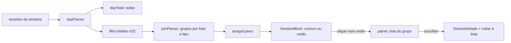

# Juntar sessões próximas Design

**Spec**: `.specs/features/merge-near-sessions/spec.md`
**Status**: Approved
**Desenho aprovado**: canvas `Agenda · sessões unidas` (https://claude.ai/artifact/Kk5E4r1KMaN4XmY1WRbUCz)

---

## Architecture Overview

A junção é só de exibição e só da Agenda, então mora no navegador. O backend ganha apenas a configuração, no mesmo molde de `min_session_minutes` (#22).

Na grade, cada coluna já passa por três etapas: `dayPieces` corta as sessões por dia, o filtro de escondidas (#22) tira as curtas, e `assignLanes` divide a largura. A junção entra entre o filtro e as faixas: uma função pura agrupa os pedaços visíveis do dia e devolve, para cada grupo, um pedaço só, que `assignLanes` trata como qualquer bloco (MERGE-21). O total do dia continua saindo de `dayPieces` com todas as sessões, antes do filtro e da junção (MERGE-20).



---

## Code Reuse Analysis

### Existing Components to Leverage

| Component | Location | How to Use |
| --------- | -------- | ---------- |
| Configuração `min_session_minutes` (#22) | `backend-node/src/routes/workspaces.ts`, `routes/schemas.ts`, `db/schema.ts`, `drizzle/0007_*` | Mesmo molde para `merge_gap_minutes`: coluna `smallint` com `CHECK 1..60`, leitura por todos, `PATCH` do dono com `null` desligando |
| Teste de migration e catálogo de colunas | `backend-node/test/db/workspace-min-session-schema.test.ts`, `test/db/baseline.test.ts`, `test/fixtures/pg-columns.json` | O mesmo teste para a coluna nova; o catálogo é lido de novo de um PostgreSQL 16 real, numa base temporária |
| Camadas da coluna | `frontend/src/lib/agenda/layout.ts` (`dayPieces`, `assignLanes`, `dayTotal`) | A junção é uma etapa nova entre o filtro e `assignLanes`; nada muda nas três |
| Filtro de escondidas | `frontend/src/components/agenda/week-grid.tsx` (`hiddenIds`), `day-timeline.tsx` | A junção recebe só os pedaços visíveis (MERGE-19) |
| Bloco e tooltip | `frontend/src/components/agenda/session-block.tsx` | O bloco unido é o mesmo componente com a lista de sessões: contador, nome acessível e tooltip próprios |
| Detalhes da sessão | `frontend/src/components/agenda/session-panel.tsx` (`SessionDetails`) | A sessão escolhida abre nos detalhes de hoje, com o botão de voltar por cima (MERGE-28, MERGE-33) |
| Seleção na página | `frontend/src/pages/agenda.tsx` (`selectedId`, `select`, `hidden`) | Ganha o grupo escolhido; a sessão escolhida sai da junção (MERGE-29) |
| Tela do workspace | `frontend/src/pages/workspace-settings.tsx` (`hideShort`, `minMinutes`, `minValid`) | O mesmo par interruptor e minutos, logo abaixo de `Esconder sessões curtas` |

### Integration Points

| System | Integration Method |
| ------ | ------------------ |
| Banco | Migration `0008_workspace_merge_gap.sql`: `ALTER TABLE workspaces ADD COLUMN merge_gap_minutes smallint` com `CONSTRAINT ck_workspaces_merge_gap_minutes CHECK (merge_gap_minutes BETWEEN 1 AND 60)` |
| `GET /api/workspaces`, `GET /api/workspaces/current`, `PATCH /api/workspaces/:id` | Campo novo na leitura e na escrita |
| `GET /api/sessions` e os relatórios | Sem mudança: a junção não chega ao servidor |
| Dev database | A migration roda ao reiniciar o container `trackzyn-backend-node-1`, depois de um `pg_dump` |

---

## Components

### Coluna e contrato do workspace (backend)

- **Purpose**: Guardar, ler e gravar o espaço máximo da junção.
- **Location**: `backend-node/drizzle/0008_workspace_merge_gap.sql`, `src/db/schema.ts`, `src/routes/schemas.ts`, `src/routes/workspaces.ts`
- **Interfaces**:
  - `workspaces.mergeGapMinutes: number | null`
  - leitura: `merge_gap_minutes: number | null`
  - `PATCH`: `merge_gap_minutes: z.number().int().min(1).max(60).nullable().optional()`
- **Reuses**: o tratamento de `min_session_minutes` em cada um desses arquivos

### `joinPieces` (frontend)

- **Purpose**: Agrupar os pedaços visíveis de um dia na regra da spec.
- **Location**: `frontend/src/lib/agenda/join.ts`
- **Interfaces**:
  - `joinPieces(pieces: Piece[], gapMinutes: number | null, apartId: string | null): Piece[]`
  - devolve os pedaços que não se juntam como vieram, e um pedaço por grupo de 2 ou mais, com `start` do primeiro, `end` do maior fim, `seconds` somado, `session` = a primeira sessão do grupo e `members: AgendaSession[]` em ordem de início
  - um pedaço só entra num grupo se a sessão estiver encerrada, couber inteira no dia (não passa da meia-noite) e não for `apartId` (MERGE-18, MERGE-29)
  - dois pedaços se juntam quando têm a mesma `list_id`, o mesmo `kind`, e o início do seguinte menos o maior fim do grupo até ali é `<= gapMinutes × 60` s, em segundos exatos das sessões, não em minutos arredondados (MERGE-11 a MERGE-17); a comparação é com o grupo inteiro, o que dá a cadeia (MERGE-13) e junta as sobrepostas (MERGE-14)
  - `gapMinutes` nulo devolve os pedaços sem mudança (MERGE-22)
- **Dependencies**: `Piece` de `layout.ts`, que ganha `members?: AgendaSession[]`
- **Reuses**: nada; função pura, testada nas bordas

### Bloco unido (frontend)

- **Purpose**: Desenhar o grupo e o tooltip dele.
- **Location**: `frontend/src/components/agenda/session-block.tsx`
- **Interfaces**:
  - com `piece.members`: o contador `N` no canto superior direito (MERGE-32), o nome acessível `<lista>, N sessões, HH:MM – HH:MM` (MERGE-25), `data-joined`, e o tooltip com `<lista> · N sessões`, uma linha por sessão (título ou `Intervalo`, `HH:MM – HH:MM`) e `Clique para escolher uma sessão` (MERGE-26)
  - sem `members`: o bloco de hoje, sem mudança
- **Reuses**: o `Tooltip` e as classes de repouso e hover de hoje

### Grade da semana e do dia (frontend)

- **Purpose**: Passar os pedaços visíveis pela junção e tratar o clique no bloco unido.
- **Location**: `frontend/src/components/agenda/week-grid.tsx`, `frontend/src/components/agenda/day-timeline.tsx`
- **Interfaces**:
  - props novas: `joinGap?: number | null`, `apartId?: string | null`, `onSelectGroup?: (members: AgendaSession[]) => void`, `selectedGroup?: string[] | null` (ids)
  - `laid = assignLanes(joinPieces(visíveis, joinGap, apartId))`
  - um bloco unido não tem alvo de arraste nem alças: o `pointerdown` só para a propagação, como na sessão em andamento (MERGE-30); o clique chama `onSelectGroup(piece.members)` (MERGE-27); fica selecionado quando um dos seus membros está em `selectedGroup`
- **Reuses**: o mesmo caminho dos blocos de hoje

### Painel do grupo (frontend)

- **Purpose**: Listar as sessões do bloco e voltar a ele.
- **Location**: `frontend/src/components/agenda/session-group-list.tsx`
- **Interfaces**:
  - `SessionGroupList({ sessions, timezone, onPick, onClose })`: título `<lista> · N sessões`, o dia e o intervalo do bloco, `Escolha uma sessão para ver os detalhes, editar ou excluir.`, e um `<button>` por sessão com o título, a origem (`registrada pelo foco` ou `registrada na agenda`), `HH:MM – HH:MM · <duração>` (MERGE-27)
  - em `SessionDetails`, a prop opcional `onBack` e o rótulo `‹ <lista> · N sessões` (MERGE-33)
- **Reuses**: o cartão do painel e os formatos de data e duração de `SessionDetails`

### Página da Agenda (frontend)

- **Purpose**: Ligar a configuração, a seleção do grupo e a escolha de uma sessão.
- **Location**: `frontend/src/pages/agenda.tsx`
- **Interfaces**:
  - `joinGap = current?.merge_gap_minutes ?? null`, passado às duas visões
  - estado novo `groupIds: string[] | null`. Clicar num bloco unido grava `groupIds` e limpa `selectedId`: o painel mostra `SessionGroupList` com `sessions.filter(id ∈ groupIds && !hidden)`
  - escolher uma sessão grava `selectedId` e mantém `groupIds`: o painel mostra `SessionDetails` com `onBack` (que limpa `selectedId`), e a grade recebe `apartId = selectedId`, então a sessão sai do bloco e ganha as alças (MERGE-29)
  - fechar, salvar ou excluir limpa os dois; sem `apartId`, a sessão volta ao grupo (MERGE-31)
  - mudar de semana fecha o painel, como hoje (AGENDA-47)
- **Reuses**: `select`, `closeSelected`, o painel de hoje

### Configuração na tela do workspace (frontend)

- **Purpose**: Ligar, desligar e definir X.
- **Location**: `frontend/src/pages/workspace-settings.tsx`, `frontend/src/locales/{en,pt-BR}.json`, `frontend/src/types/index.ts`, `frontend/src/lib/api.ts`
- **Interfaces**: abaixo de `Esconder sessões curtas`, o interruptor `Juntar sessões próximas` e, ligado, o campo `Até` com `minutos`; ligar com nulo preenche 1; desligado envia `null`; fora de 1 a 60 mostra `Entre 1 e 60 minutos.` e bloqueia o salvar; desabilitado sem `canManage` (MERGE-06 a MERGE-10)
- **Reuses**: a mesma validação e o mesmo `PATCH` de `min_session_minutes`

---

## Data Models

```typescript
// frontend/src/lib/agenda/layout.ts
export interface Piece {
  // ...campos de hoje
  /** The sessions a joined block stands for, in start order; absent on a common block (MERGE-11). */
  members?: AgendaSession[]
}

// frontend/src/types/index.ts (Workspace)
/** Sessions of one list and kind this many minutes apart or less are drawn as one block in the agenda; null keeps them apart. */
merge_gap_minutes: number | null
```

---

## Error Handling Strategy

| Error Scenario | Handling | User Impact |
| -------------- | -------- | ----------- |
| `merge_gap_minutes` fora de 1 a 60, fracionário ou texto | O zod responde 422; nada é gravado | A tela não chega a enviar (MERGE-09) |
| Editor ou leitor tenta mudar | `requireMembership(..., 'owner')` responde 403 | A tela já mostra desabilitado |
| A sessão escolhida é excluída por outro dispositivo | `selected` some da lista; o painel fecha, como no AGENDA-32 | Igual a hoje |
| Um grupo perde membros (escondidos ou excluídos) até sobrar um | `joinPieces` devolve o pedaço comum | O bloco volta a ser comum |

---

## Risks & Concerns

| Concern | Location (file:line) | Impact | Mitigation |
| ------- | -------------------- | ------ | ---------- |
| `Piece.start` e `end` são minutos fracionários; o limite de MERGE-11 é em segundos exatos | `frontend/src/lib/agenda/layout.ts` (`dayPieces`) | Arredondar faria `X min e 1 s` se juntar | `joinPieces` compara os instantes das sessões (`Date.parse`), com teste em exatamente X e em X + 1 s |
| A semana e o dia montam a coluna cada um à sua maneira | `week-grid.tsx`, `day-timeline.tsx` | Juntar só numa das visões | O mesmo `joinPieces` nas duas, com teste em cada uma (MERGE-23) e um teste da página na largura de celular (lição L-034 do #22) |
| O bloco unido usa a `session` da primeira sessão como chave e cor | `week-grid.tsx` (`key={piece.session.id}`) | Uma chave repetida se a primeira também aparecesse sozinha | A primeira só aparece sozinha quando sai do grupo, e então o grupo já não a tem; a chave do unido passa a ser `group:<id da primeira>` |
| O catálogo de colunas precisa de um PostgreSQL 16 real | `backend-node/test/fixtures/pg-columns.json` | Fixture escrita à mão esconde diferença de tipo | Ler de novo numa base temporária no container de dev, apagada em seguida, como no #22 |

---

## Tech Decisions

| Decision | Choice | Rationale |
| -------- | ------ | --------- |
| Onde junta | No navegador, numa função pura entre o filtro e as faixas | É só exibição, só na Agenda, e as faixas e o total já são calculados ali |
| Forma do bloco unido | Um `Piece` com `members`, não um tipo novo | `assignLanes` e `SessionBlock` continuam recebendo pedaços; o bloco comum não muda |
| Seleção do grupo | Ids dos membros no estado da página | O grupo é derivado a cada render; guardar ids sobrevive a uma nova leitura das sessões |
| Sessão escolhida | Sai do grupo pelo `apartId` | Reaproveita alças, arraste e o rascunho do painel sem nenhuma regra nova no arraste |
