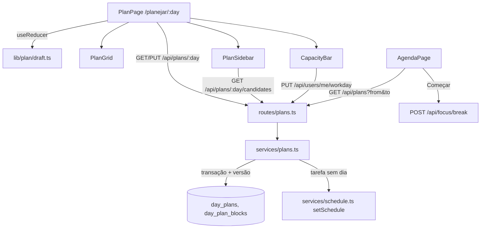

# Planejamento diário Design

**Spec**: `.specs/features/planejamento-diario/spec.md`
**Status**: Approved (2026-11-07)

---

## Architecture Overview

Duas tabelas novas guardam o plano: o cabeçalho do dia (`day_plans`) e os blocos (`day_plan_blocks`), com tarefa e pausa na mesma tabela. O frontend monta o rascunho num reducer puro e o envia inteiro com `PUT /api/plans/:day`. O servidor troca os blocos do dia numa transação, confere a versão e dá o dia do plano às tarefas sem dia pelo `setSchedule` que já existe. A Agenda lê os blocos da semana por `GET /api/plans`. Começar uma pausa chama `POST /api/focus/break` como o foco já chama, sem rota nova.



### Abordagens consideradas

| Abordagem | Como | Por que não / por que sim |
| --- | --- | --- |
| **A. Cabeçalho + blocos (escolhida)** | `day_plans` com `version`; `day_plan_blocks` com `kind` `task` ou `break` | Uma leitura e uma gravação por dia; a versão resolve as duas abas (PLAN-35); os blocos com chave estrangeira apagam junto com a tarefa (PLAN-40) e ficam consultáveis para o planejado × realizado. |
| B. Tabelas separadas para tarefa e pausa | `day_plan_tasks` e `day_breaks` | Duas consultas e dois `DELETE`/`INSERT` por gravação para o mesmo ciclo de vida; a Agenda junta tudo de novo. |
| C. JSON no cabeçalho | `day_plans.blocks jsonb` | Perde a cascata com a tarefa e as checagens do banco; o planejado × realizado teria de abrir o JSON. |

---

## Code Reuse Analysis

### Existing Components to Leverage

| Component | Location | How to Use |
| --- | --- | --- |
| `assignLanes`, `zonedInstant`, `dayOf`, `addDays`, `scheduledMinutes` | `frontend/src/lib/agenda/layout.ts` | Raias dos blocos sobrepostos, dia de amanhã no fuso, duração de 1h sem estimativa. |
| `PX_PER_MINUTE`, zoom e rolagem | `components/agenda/week-grid.tsx`, `lib/agenda/zoom.ts`, `use-zoom-scroll.ts` | Mesma escala da Agenda na grade do plano. |
| `WeekGrid` | `components/agenda/week-grid.tsx` | Recebe uma prop nova `planned` para os blocos do plano na Agenda (PLAN-24). |
| `ScheduledBlock` (visual) | `components/agenda/scheduled-block.tsx` | Base do `PlanBlock` de tarefa: cor da lista, borda tracejada. |
| `minuteClock`, `longDay` | `lib/agenda/format.ts`, `lib/schedule.ts` | Horários `HH:MM` e o dia por extenso no cabeçalho e em `Agendada para <dia>`. |
| `Input type="time"` HH:MM | `components/schedule/schedule-picker.tsx` | Campos de início, duração e expediente (D34). |
| `setSchedule` | `backend-node/src/services/schedule.ts:54` | Dá o dia à tarefa sem dia, com as regras D3 e o lock da lista. |
| `workspaceClock` | `backend-node/src/services/schedule.ts:28` | "Hoje" no fuso do workspace para recusar dias passados. |
| `periodQuery`, `MAX_AGENDA_DAYS` | `routes/reports.ts`, `routes/sessions.ts` | Validação de `from`/`to` em `GET /api/plans`. |
| `breakFocus` | `backend-node/src/services/focus.ts:299` | Já encerra a sessão de tarefa com `break` e recusa um segundo Intervalo (PLAN-27, PLAN-45). |
| Cliente do foco | `frontend/src/lib/api.ts` (focus) | `Começar` usa a mesma chamada de intervalo, com `device_id` e `action_id`. |

### Integration Points

| System | Integration Method |
| --- | --- |
| Tarefas | `day_plan_blocks.task_id` → `tasks.id` `on delete cascade`; leitura filtra listas arquivadas (PLAN-40). |
| Agendamento | Salvar chama `setSchedule(day, time = null)` só para tarefa sem `scheduled_on` (PLAN-09, PLAN-38). |
| Usuários | `users.preferences.workday = { start, end }`, mesclado no servidor. |
| Foco | `POST /api/focus/break` com `minutes` e `list_id` da pausa. |
| Agenda | `GET /api/plans?from&to` alimenta `planned` do `WeekGrid`; esconde o bloco agendado da mesma tarefa no mesmo dia (PLAN-25). |
| Tokens | Rotas sem `config.tokenScope`: 403 a tokens (AD-007, PLAN-42). |

---

## Components

### Backend: schema e migração

- **Purpose**: guardar o plano por usuário, workspace e dia.
- **Location**: `backend-node/src/db/schema.ts`, `backend-node/drizzle/0014_day_plans.sql`.
- **Interfaces**: tabelas `day_plans` e `day_plan_blocks` (Data Models).
- **Reuses**: o padrão de `check` e índice das tabelas de tarefas.

### Backend: `services/plans.ts`

- **Purpose**: ler e gravar o plano de um dia e os blocos de um período.
- **Location**: `backend-node/src/services/plans.ts`
- **Interfaces**:
  - `getPlan(db, actor, day, now): Promise<PlanRead>` — plano salvo (ou vazio, `version = 0`), `editable = day >= hoje`, o expediente.
  - `savePlan(db, actor, day, { baseVersion, blocks }, now): Promise<PlanRead>` — numa transação: recusa dia passado (422 `plan_day_past`), trava o cabeçalho (`SELECT … FOR UPDATE`, ou cria), compara a versão (409 `plan_changed`), confere que as tarefas e listas são do workspace (422), apaga e insere os blocos, `version + 1`, e chama `setSchedule` para cada tarefa sem dia.
  - `listPlanned(db, actor, from, to): Promise<PlannedBlock[]>` — blocos salvos do período para a Agenda.
  - `listCandidates(db, actor, day): Promise<Candidate[]>` — tarefas pendentes de listas ativas, com coluna, estimativa e `scheduled_on`.
  - `setWorkday(db, user, { start, end }): Promise<Workday>` — mescla em `preferences`; 422 se o fim não é depois do início.
- **Dependencies**: `schedule.ts`, `workspaceClock`.

### Backend: `routes/plans.ts`

- **Purpose**: expor o plano à sessão do app.
- **Location**: `backend-node/src/routes/plans.ts`
- **Interfaces**:
  - `GET /api/plans/:day` → `PlanRead`
  - `PUT /api/plans/:day` body `{ base_version, blocks: BlockInput[] }` → `PlanRead`; 403 viewer, 409, 422.
  - `GET /api/plans/:day/candidates` → `{ tasks: Candidate[] }`
  - `GET /api/plans?from&to` → `{ blocks: PlannedBlock[] }`
  - `PUT /api/users/me/workday` body `{ start, end }` → `Workday`
- **Reuses**: `authGuards`, `workspaceContext`, `periodQuery`.

### Frontend: `lib/plan/draft.ts`

- **Purpose**: o rascunho como reducer puro, testável sem DOM.
- **Interfaces**:
  - `draftReducer(state, action)` com `add`, `move`, `resize`, `edit`, `remove`, `reset(saved)`.
  - `isDirty(state): boolean` — rascunho difere do salvo (PLAN-07, PLAN-11).
  - `capacity(blocks, fixedTimed, workday): { planned, breaks, scheduled, free, over }` (PLAN-19, PLAN-20, PLAN-D7): `fixedTimed` são as tarefas pendentes com hora no dia sem bloco no rascunho; só os minutos dentro do expediente contam em `breaks` e `scheduled`.
  - `clampBreak(minutes)` e `clampTask(minutes)` com os limites de PLAN-05 e PLAN-17.
- **Reuses**: `scheduledMinutes`.

### Frontend: `lib/plan/use-plan.ts`

- **Purpose**: queries e mutações do plano (`['plan', workspace, day]`, `['plans', from, to]`, candidatas) e a invalidação da Agenda e do quadro ao salvar.

### Frontend: `pages/plan.tsx` (`/planejar/:day`)

- **Purpose**: a tela; junta cabeçalho (dia, setas, calendário), `CapacityBar`, `PlanSidebar`, `PlanGrid`, o rodapé `Rascunho — ainda não salvo` com `Descartar` e `Confirmar plano`, e a guarda de saída.
- **Interfaces**: `day` da rota; sem `day` válido, redireciona para amanhã.

### Frontend: `components/plan/plan-grid.tsx`

- **Purpose**: grade de um dia com blocos fixos (sessões, tarefas com hora) e os blocos do rascunho, com arraste, borda de baixo e o expediente marcado (PLAN-03, PLAN-05, PLAN-21).
- **Reuses**: `assignLanes`, escala e zoom da Agenda.
- **Note**: arraste próprio (`use-plan-drag.ts`) com pointer events e passo de 15 min; o `use-grid-drag` da Agenda é ligado a sessões e agendamentos e não aceita uma fonte de fora da grade.

### Frontend: `components/plan/plan-sidebar.tsx`

- **Purpose**: pausas prontas, `Nova pausa`, busca, filtro por lista e os grupos `Agendadas para o dia`, `Hoje`, `Esta semana` e `Backlog` (PLAN-02, PLAN-14).

### Frontend: `components/plan/plan-block.tsx`, `break-dialog.tsx`, `block-editor.tsx`, `capacity-bar.tsx`, `workday-editor.tsx`

- **Purpose**: bloco de tarefa ou pausa (riscado quando concluída, `Agendada para <dia>`), diálogo de nova pausa, editor do bloco (início, duração, lista da pausa, remover), barra de capacidade e editor do expediente.

### Frontend: Agenda

- **Purpose**: desenhar os blocos do plano e começar a pausa (PLAN-24 a PLAN-29).
- **Location**: `components/agenda/week-grid.tsx` (prop `planned`), `components/agenda/planned-block.tsx`, `pages/agenda.tsx`, `components/agenda/day-timeline.tsx`.

---

## Data Models

### `day_plans`

```typescript
interface DayPlan {
  id: string            // uuid
  userId: string        // fk users, on delete cascade
  workspaceId: string   // fk workspaces, on delete cascade
  day: string           // date, dia no fuso do workspace
  version: number       // integer, começa em 1 na primeira gravação
  updatedAt: Date
}
// unique (user_id, workspace_id, day)
```

### `day_plan_blocks`

```typescript
interface DayPlanBlock {
  id: string
  planId: string             // fk day_plans, on delete cascade
  kind: 'task' | 'break'
  taskId: string | null      // fk tasks, on delete cascade; só em 'task'
  name: string | null        // 1 a 40; só em 'break'
  listId: string | null      // fk lists, on delete cascade; só em 'break'
  startTime: string          // time, segundos zero
  minutes: number            // smallint; task 5..1440, break 5..120
}
// checks: forma de task × break, limites de minutes, segundos zero
// index (plan_id, start_time)
```

### Preferência do expediente

```typescript
// users.preferences.workday — ausente vale 09:00 às 18:00
interface Workday { start: string; end: string } // HH:MM, end > start
```

### Contratos

```typescript
interface PlanRead {
  day: string
  version: number            // 0 quando não há plano salvo
  editable: boolean          // day >= hoje (PLAN-34)
  workday: Workday
  blocks: Array<
    | { id: string; kind: 'task'; start: string; minutes: number; task: { id: string; title: string; list: ListRef; done: boolean; scheduled_on: string | null; estimate_minutes: number | null } }
    | { id: string; kind: 'break'; start: string; minutes: number; name: string; list: ListRef }
  >
}
type BlockInput =
  | { kind: 'task'; task_id: string; start: string; minutes: number }
  | { kind: 'break'; name: string; list_id: string; start: string; minutes: number }
type PlannedBlock = PlanRead['blocks'][number] & { day: string }
```

**Relationships**: um usuário tem no máximo um plano por workspace e dia; um plano tem N blocos; um bloco de tarefa aponta para uma tarefa do mesmo workspace.

---

## Error Handling Strategy

| Error Scenario | Handling | User Impact |
| --- | --- | --- |
| Plano mudou em outro lugar | 409 `plan_changed` | `O plano mudou em outro lugar` com `Recarregar`; o rascunho fica (PLAN-35). |
| Dia antes de hoje | 422 `plan_day_past` | A tela já abre só para leitura (PLAN-34). |
| Corpo inválido (hora, limites, tarefa de outro workspace, pausa sem nome) | 422 com `loc` | Não acontece pela tela; protege a API (PLAN-43). |
| Viewer salva | 403 `Read-only role` | A tela abre só para leitura para o viewer. |
| Falha de rede ao salvar | Mutação falha, rascunho intacto | `Não foi possível salvar o plano.` com `Tentar de novo` (PLAN-37). |
| `Começar` com Intervalo já aberto | Resposta atual de `POST /api/focus/break` | O toast de erro do foco (PLAN-45). |
| Expediente inválido | 422 | `O fim precisa ser depois do início` (PLAN-23). |

---

## Risks & Concerns

| Concern | Location (file:line) | Impact | Mitigation |
| --- | --- | --- | --- |
| `PATCH /api/users/me` troca `preferences` inteiro | `backend-node/src/services/users.ts:113` | Gravar o expediente pelo cliente pode apagar outras preferências | Rota própria `PUT /api/users/me/workday` que mescla no servidor. |
| `BrowserRouter` não tem `useBlocker` | `frontend/src/App.tsx:53` | A guarda de saída (PLAN-36) não intercepta a navegação interna | Guardar a saída com `beforeunload`, com um contexto de "rascunho sujo" consultado pelos links da barra lateral, pela paleta de comandos e pelas setas e calendário do dia, e com uma entrada extra do histórico (mesma URL) que o Voltar do navegador consome antes de perguntar; migrar para data router fica fora. |
| `use-grid-drag` é ligado a sessões e agendamentos | `frontend/src/lib/agenda/use-grid-drag.ts:164` | Reusar exigiria mexer no arraste da Agenda, já otimizado (b0e498a) | Hook próprio `use-plan-drag`, com a mesma conta de minuto e passo. |
| `WeekGrid` já tem 20+ props | `frontend/src/components/agenda/week-grid.tsx:38` | Mais uma prop aumenta o acoplamento | `planned` entra como uma camada desenhada por `PlannedBlock`, sem gestos; a grade do plano é outro componente. |
| Busca de tarefas da Agenda é para recentes | `backend-node/src/routes/sessions.ts:86` | Não serve para listar todas as pendentes por coluna | Rota própria `GET /api/plans/:day/candidates`, limitada a 500 tarefas. |
| `setSchedule` trava a lista por tarefa | `backend-node/src/services/schedule.ts:54` | Salvar muitas tarefas sem dia faz N locks na mesma transação | Ordenar por `list_id` antes de chamar, para evitar deadlock entre duas gravações. |

---

## Tech Decisions

| Decision | Choice | Rationale |
| --- | --- | --- |
| Gravação | Substitui o dia inteiro (`PUT`) com `base_version` | O rascunho já é o dia inteiro; reenviar é idempotente; a versão resolve a concorrência. |
| Concorrência | `version` inteiro no cabeçalho, 409 se diferente | Mais simples que comparar `updated_at` e não depende do relógio. |
| Rotas do plano | Só a sessão do app | AD-007; tokens e MCP ficaram fora da spec. |
| Pausa → Intervalo | Sem rota nova; o frontend chama o foco | `breakFocus` já cobre PLAN-26, PLAN-27 e PLAN-45. |
| Bloco do plano na Agenda | Esconde o bloco agendado da mesma tarefa no mesmo dia, só no frontend | PLAN-25 é uma regra de exibição pessoal; o servidor não precisa saber. |
