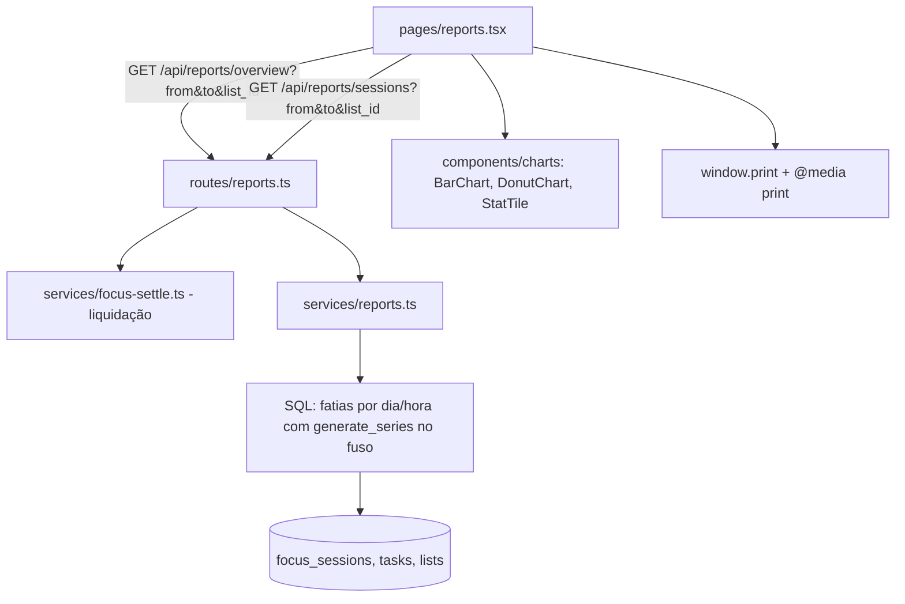

# Relatórios Design

**Spec**: `.specs/features/relatorios/spec.md`
**Status**: Draft

Segue AD-001 (liquidar antes de ler) e AD-004 (fuso do dia, agregação em SQL) de `.specs/STATE.md`.

---

## Architecture Overview

Duas rotas de leitura calculam tudo no Postgres (ou no PGlite do modo local), sempre filtrando pelo usuário logado (REPORT-09). Antes de agregar, cada rota liquida as sessões vencidas do usuário. As sessões são cortadas nos limites de cada dia e de cada hora com `generate_series` no fuso do dia, o que resolve a meia-noite (REPORT-10) e o horário de verão. Uma sessão aberta conta até `now()` (REPORT-11).

O frontend é uma página com duas abas e reaproveita a biblioteca de gráficos do template.



---

## Code Reuse Analysis

### Existing Components to Leverage

| Component | Location | How to Use |
| --------- | -------- | ---------- |
| Gráficos | `frontend/src/components/charts/` (`BarChart`, `DonutChart`, `StatTile`) | Gráfico por dia, tempo por lista e cartões (REPORT-01, -04, -06) |
| Seletor de período | `frontend/src/components/ui/date-range-picker.tsx`, `lib/date-range-format.ts` | Filtro de período |
| Abas | `frontend/src/components/ui/tabs.tsx` | `Visão geral` e `Sessões` |
| Selo da lista | `frontend/src/components/lists/list-badge.tsx` (de `listas-e-quadro`) | Filtro e linhas |
| Duração | `frontend/src/components/board/format-duration.ts` (de `listas-e-quadro`) | Todos os tempos |
| Liquidação | `backend-node/src/services/focus-settle.ts` (de `foco-e-sons`) | Chamada antes de cada consulta |
| Fuso do dia | `backend-node/src/services/day.ts` (de `listas-e-quadro`) | Limites do período e agrupamentos |
| Guards | `plugins/auth.ts`, `plugins/workspace.ts` | `requireUser` + `workspaceContext`; `viewer` pode ler o próprio relatório |
| Menu lateral | `frontend/src/lib/nav-items.ts` | Entrada `reports` |

### Integration Points

| System | Integration Method |
| ------ | ------------------ |
| Banco | Só leitura; um índice novo `focus_sessions (user_id, started_at)` já vem de `foco-e-sons` |
| Listas arquivadas | `lists.is_archived` no filtro (REPORT-08) |
| Listas excluídas | O frontend recebe 404 ao filtrar por uma lista que não existe mais e volta para `Todas as listas` com o aviso (Edge Case) |

---

## Components

### services/reports.ts + routes/reports.ts

- **Purpose**: Calcular a visão geral e a lista de sessões do usuário num período.
- **Location**: `backend-node/src/services/reports.ts`, `backend-node/src/routes/reports.ts`
- **Interfaces**:
  - `GET /api/reports/overview?from=YYYY-MM-DD&to=YYYY-MM-DD&list_id=uuid?` → `Overview` (REPORT-01 a -19)
  - `GET /api/reports/sessions?from&to&list_id?` → `SessionsReport` (REPORT-20 a -22)
  - Validação: `from <= to` e `to - from <= 365` (366 dias com os dois extremos) → senão 422 (REPORT-13); `list_id` de outro workspace ou inexistente → 404
- **Dependencies**: `focus-settle.ts`, `day.ts`
- **Reuses**: padrão de rotas de `files.ts`

Consulta central (esboço): `slices` = para cada sessão do usuário no período, a interseção `[greatest(started_at, dia_início), least(coalesce(ended_at, now()), dia_fim))` com cada dia de `generate_series(date_trunc('day', from, tz), to, '1 day')`. Daí saem:
- dias trabalhados (dias com fatia `task` maior que 0);
- tempo de tarefas e de intervalos por dia (REPORT-04);
- tempo por lista (REPORT-06);
- uma segunda série por hora do dia (`extract(hour from ... at time zone tz)`), para a hora mais produtiva (REPORT-05).

O dia da semana e o mês mais produtivos saem das fatias por dia. Os empates usam `rank() = 1` e todos voltam.

Tarefas concluídas: `tasks.completed_at` dentro do período, no fuso do dia; o tempo gasto é o total da tarefa (decisão do usuário). Selo por tarefa: `diff = spent - estimate*60`; `|diff| <= 0.05 * estimate*60` → `on_time`; `diff < 0` → `early`; senão `late` (REPORT-15 a -17).

### Frontend: página de relatórios

- **Purpose**: As telas dos prints `04` e `05` e a aba Sessões.
- **Location**: `frontend/src/pages/reports.tsx` (`/reports`), `components/reports/` (`report-filters.tsx`, `overview-tiles.tsx`, `daily-chart.tsx`, `productive-cards.tsx`, `time-by-list.tsx`, `done-vs-estimate.tsx`, `sessions-table.tsx`, `print-header.tsx`)
- **Interfaces**:
  - `defaultRange(timezone, today): { from, to }` → da segunda-feira corrente até hoje (REPORT-01), pura e testada
  - `formatProductive(values: string[], kind)` → `Segunda e quarta`, `18–19h`, `out. de 2026` (REPORT-05)
  - `Exportar PDF`: `window.print()`; `@media print` esconde o menu lateral e os controles e mostra `print-header` com o período e a lista (REPORT-23)
- **Dependencies**: TanStack Query, `lib/api.ts`
- **Reuses**: `components/charts`, `ui/date-range-picker`, `ui/tabs`, `ui/table`, `ui/badge`

---

## Data Models

Nenhuma tabela nova.

### Overview (resposta)

```typescript
interface Overview {
  timezone: string
  range: { from: string; to: string }
  tiles: { work_days: number; tasks_done: number; task_seconds: number; avg_seconds_per_task: number | null }
  daily: { date: string; task_seconds: number; break_seconds: number }[]   // um item por dia do período
  productive: { hours: number[]; weekdays: number[]; months: string[] }    // vazios sem atividade
  by_list: { list_id: string; name: string; color: number; is_archived: boolean; seconds: number }[]
  break_seconds: number
  done: { days: { date: string; tasks: { id: string; title: string; list_id: string; spent_seconds: number; estimate_minutes: number | null; verdict: 'early'|'on_time'|'late'|null; diff_seconds: number }[] }[];
          early_or_on_time_pct: number | null; late_pct: number | null }
}
```

### SessionsReport (resposta)

```typescript
interface SessionsReport {
  days: { date: string; sessions: { id: string; kind: 'task'|'break'; task_title: string | null; list_name: string; started_at: string; ended_at: string | null; seconds: number }[] }[]
}
```

---

## Error Handling Strategy

| Error Scenario | Handling | User Impact |
| -------------- | -------- | ----------- |
| Período invertido ou maior que 366 dias | zod + checagem → 422 | O filtro anterior continua na tela, com a mensagem (REPORT-13) |
| Filtro com lista excluída | 404 | "A lista foi excluída." e volta para `Todas as listas` |
| Período sem sessão | Resposta com zeros e listas vazias | `0`, `0min`, `—` e `Sem atividade no período` (REPORT-12, -22) |
| Sem tarefa concluída | `avg_seconds_per_task: null` | `—` (REPORT-03) |
| Sem tarefa com estimativa entre as concluídas | porcentagens `null` | Barra e porcentagens escondidas |

---

## Risks & Concerns

| Concern | Location (file:line) | Impact | Mitigation |
| ------- | -------------------- | ------ | ---------- |
| Consulta de 366 dias × sessões | `services/reports.ts` | Lentidão com muitos anos de uso | Índice `(user_id, started_at)`; o período limita o volume; um teste com 10 000 sessões no PGlite mede o tempo da rota |
| SQL com fuso difícil de revisar | `services/reports.ts` | Erros de meia-noite e horário de verão passam despercebidos | Testes com sessões que cruzam meia-noite e com a data de mudança de horário de um fuso que ainda a tem (por exemplo, `America/New_York`) |
| Porcentagens com arredondamento | `done-vs-estimate.tsx` | `45,45% + 54,55%` pode não somar 100 com outros números | O servidor manda os valores com 2 casas, e o vermelho é calculado como `100 - verde` |
| Impressão depende do navegador | `@media print` | Layout diferente entre Chrome, Safari e Electron | Conferir manualmente na validação (P3) |

---

## Tech Decisions (only non-obvious ones)

| Decision | Choice | Rationale |
| -------- | ------ | --------- |
| Onde agregar | SQL no Postgres/PGlite | AD-004; fatiar por dia e hora no fuso com DST é nativo do Postgres |
| Uma rota para a visão geral inteira | `GET /api/reports/overview` | Liquida e agrega uma vez; a tela carrega numa requisição |
| `viewer` nos relatórios | Pode ler o próprio relatório | É leitura e só mostra dados do próprio usuário; um `viewer` sem sessões vê o estado vazio |
