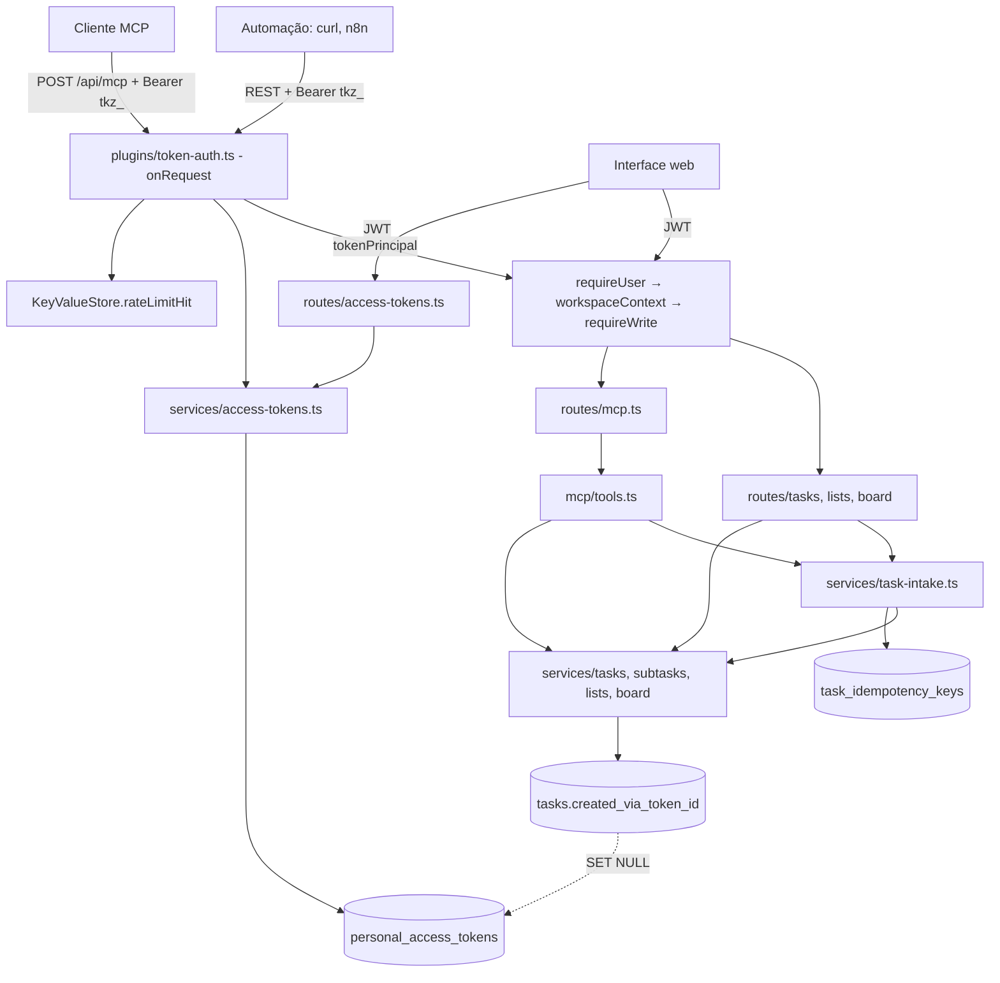
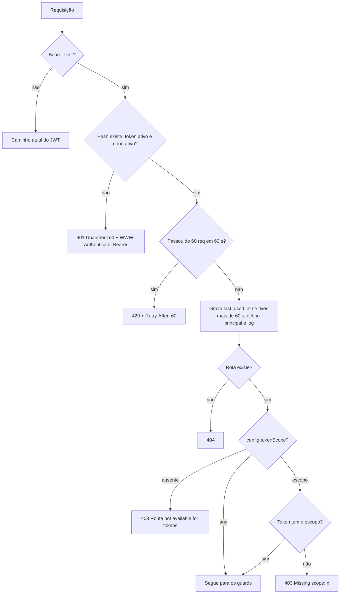

# Tokens de acesso pessoal Design

**Spec**: `.specs/features/tokens-de-acesso/spec.md`
**Status**: Approved

Segue AD-002 (a idempotência por chave única vem de `focus_actions`), AD-003 (sem estado de conexão: o MCP é sem estado e não abre fluxo de eventos), AD-005 (excluir apaga em cascata; por isso `tasks:delete` é um escopo à parte) e AD-006 (criar em `done` conta para o dono do token). Cria AD-007. O usuário escolheu a arquitetura entre as alternativas: guard por rota e namespace próprio, para a autorização; `app.inject` e JSON-RPC próprio, para o MCP.

---

## Architecture Overview

Um hook `onRequest` global trata só das requisições com `Authorization: Bearer tkz_...`. Ele autentica, aplica o limite de requisições e nega a rota se ela não declarar `config.tokenScope`. Toda rota nasce negada para tokens. O JWT não passa por nenhum passo novo: sem o prefixo, o hook não faz nada (SCOPE-10).

Depois do hook, os guards atuais continuam valendo: `requireUser` aceita a identidade já autenticada, `workspaceContext` fixa o workspace do token e `requireWrite` aplica o papel atual.

O MCP entra como mais uma rota. As ferramentas chamam os mesmos services das rotas REST, e o único código de criação com token fica em `services/task-intake.ts`.



### Ordem do hook



---

## Code Reuse Analysis

### Existing Components to Leverage

| Component | Location | How to Use |
| --------- | -------- | ---------- |
| Guards | `backend-node/src/plugins/auth.ts`, `plugins/workspace.ts` | `requireUser` e `workspaceContext` aceitam o principal; `requireWrite` fica igual e cobre SCOPE-07 |
| Limite de requisições | `KeyValueStore.rateLimitHit`, `ports/redis-store.ts:54` | Chave `rate_limit:token:<id>`; o `count` lido antes do `zadd` faz a 61ª requisição receber 429 |
| Erros | `http/http-error.ts`, `plugins/errors.ts` | `HttpError` com `headers` para `WWW-Authenticate` e `Retry-After` |
| Trava de ordem | `lockList`, `services/tasks.ts:33` | `createTask` continua serializando a posição na lista |
| Idempotência | `focus_actions`, `db/schema.ts` | Mesmo padrão de chave única e limpeza na própria escrita; aqui guarda o id da tarefa, não a resposta |
| Sinalização de feature | `/api/info` (`features`), `frontend/src/hooks/use-feature-flags.ts` | `features.personal_tokens` esconde o item do menu (TOKEN-14) |
| Diálogo de gestão | `frontend/src/components/passkey-management-dialog.tsx` | Modelo para o novo diálogo, inclusive listar, confirmar e revogar |
| Menu da conta | `frontend/src/components/workspace-switcher.tsx:253`, `app-layout.tsx:65,300,338` | Novo item e estado, igual a `onPasskeys` |
| Harness de teste | `backend-node/test/support/test-app.ts`, `test/support/roles.ts` | Testes de rota em PGlite |

### Integration Points

| System | Integration Method |
| ------ | ------------------ |
| Banco | Migration `0004` gerada por `drizzle-kit`: duas tabelas e uma coluna em `tasks` |
| OpenAPI | `transform` em `app.ts` envolve `jsonSchemaTransform` e usa `route.config.tokenScope` para preencher `security` e `description` (API-11) |
| Modo local | `local-server.ts` passa `PERSONAL_TOKENS_ENABLED=false`; rotas e hook não são registrados, o que dá 404 (TOKEN-13) |
| Build do desktop | `desktop/electron-builder.yml` empacota o backend com esbuild; o SDK fica como `external` nesse build |

---

## Components

### Hook de autenticação por token

- **Purpose**: Autenticar `tkz_`, limitar requisições e negar por padrão.
- **Location**: `backend-node/src/plugins/token-auth.ts` (novo)
- **Interfaces**:
  - `registerTokenAuth(app, ctx): void` - adiciona o hook na raiz, antes de registrar as rotas.
  - `request.tokenPrincipal: TokenPrincipal | null`
- **Dependencies**: `services/access-tokens.ts`, `KeyValueStore`
- **Reuses**: `HttpError`, `rateLimitHit`
- **Requisitos**: AUTH-01 a AUTH-05, AUTH-08, AUTH-10, SCOPE-03 a SCOPE-06, RATE-01, OBS-01, MANAGE-07

`last_used_at` é gravado quando o token autentica, mesmo que a rota responda 403 depois: quem investiga um vazamento precisa ver essa tentativa. O log usa `request.log = request.log.child({ token_id, user_id })`.

### Mudanças nos guards

- **Location**: `plugins/auth.ts`, `plugins/workspace.ts`
- **Interfaces**:
  - `requireUser`: com principal, define `request.user` e retorna sem ler JWT.
  - `requireSuperuser`: com principal, responde 403 como defesa extra, pois nenhuma rota de admin declara escopo.
  - `requireToken`: novo guard de `/api/mcp`; sem principal, responde 401 com `WWW-Authenticate: Bearer` (MCP-07, MCP-08).
  - `workspaceContext`: com principal, recusa `X-Workspace-Id` diferente (SCOPE-02) e segue com `requested = principal.workspaceId`, reaproveitando as checagens de membro e de arquivado (SCOPE-01, SCOPE-08).

### Declaração de escopo nas rotas

- **Location**: `routes/lists.ts`, `routes/board.ts`, `routes/tasks.ts`
- **Interfaces**: `config: { tokenScope: TokenScope | 'any' }`, com o tipo em `FastifyContextConfig`.
- **Requisitos**: as 14 rotas da tabela "Escopos e rotas", SCOPE-09 no handler de `GET /api/lists`

### Service de tokens

- **Purpose**: Gerar, listar, revogar, limpar e autenticar tokens.
- **Location**: `backend-node/src/services/access-tokens.ts` (novo)
- **Interfaces**:
  - `createToken(db, user, input, now?): Promise<{ row: AccessToken; plaintext: string }>`
  - `listTokens(db, userId, now?): Promise<AccessTokenView[]>`
  - `revokeToken(db, userId, tokenId, now?): Promise<void>`
  - `authenticate(db, plaintext, now?): Promise<TokenPrincipal | null>`
  - `tokenStatus(row, now): 'active' | 'expired' | 'revoked'`
  - `purgeEnded(tx, userId, now): Promise<void>`
- **Requisitos**: TOKEN-03 a TOKEN-05, TOKEN-08 a TOKEN-11, TOKEN-15, TOKEN-16, MANAGE-01 a MANAGE-03, MANAGE-05, MANAGE-06, MANAGE-08

`createToken` roda numa transação que trava a linha do usuário com `SELECT ... FOR UPDATE`, conta os ativos e confere o nome. Um índice único parcial não resolve porque "ativo" depende de `now()`. `createToken` e `revokeToken` chamam `purgeEnded`.

### Rotas de gestão

- **Location**: `backend-node/src/routes/access-tokens.ts` (novo)
- **Interfaces**: `POST /api/tokens`, `GET /api/tokens`, `DELETE /api/tokens/:token_id`, todas só com `requireUser` e sem `tokenScope` (SCOPE-06).
- **Requisitos**: TOKEN-03, TOKEN-07, MANAGE-01, MANAGE-04, AUTH-09

### Criação com idempotência

- **Purpose**: Ser o único caminho de criação com token, para REST e MCP.
- **Location**: `backend-node/src/services/task-intake.ts` (novo)
- **Interfaces**:
  - `createTaskFromToken(db, workspaceId, principal, input, idempotencyKey?, now?): Promise<{ task: TaskWithSubtasks; replayed: boolean }>`
- **Dependencies**: `createTask`, `getTask`
- **Requisitos**: API-07, API-09, API-10, IDEM-01 a IDEM-07, ORIGIN-01

Com chave, tudo roda numa transação:

1. Apaga as chaves do token com mais de 24h (IDEM-06).
2. Calcula o SHA-256 do `JSON.stringify` da entrada já normalizada pelo Zod.
3. Faz `INSERT ... ON CONFLICT DO NOTHING` com um `task_id` novo. Numa corrida, o segundo `INSERT` espera o primeiro terminar.
4. Se inseriu, cria a tarefa com esse `task_id`.
5. Se não inseriu, lê a chave: hash diferente dá 409 (IDEM-03), tarefa ausente dá 410 (IDEM-04) e, nos demais casos, devolve a tarefa com `replayed: true`.

### Mudanças em `createTask` e `POST /api/tasks`

- **Location**: `services/tasks.ts:36`, `routes/tasks.ts:67`
- **Interfaces**: a entrada ganha `id?`, `notes?`, `subtasks?`, `createdViaTokenId?`, `rejectArchived?`; o corpo ganha `notes` e `subtasks`, e `column` passa a ter `backlog` como padrão.
- **Requisitos**: API-01 a API-06, API-08, IDEM-08

A rota lê `Idempotency-Key` só com principal. Por isso o cabeçalho é validado no handler, não no schema: com JWT ele nem é lido (IDEM-08). `rejectArchived` só vai como verdadeiro com token, e a sessão de login mantém o comportamento atual.

### Origem nas respostas

- **Location**: `services/tasks.ts`, `services/board.ts:107`, `routes/tasks.ts`, `routes/board.ts`
- **Interfaces**: `TaskWithSubtasks` ganha `createdVia: string | null`, resolvido em `getTask` por `LEFT JOIN`; a consulta do quadro faz o mesmo e `TaskCardView` ganha `created_via`.
- **Requisitos**: ORIGIN-02, ORIGIN-04 a ORIGIN-06

### Servidor MCP

- **Purpose**: Expor as ferramentas por Streamable HTTP sem estado.
- **Location**: `backend-node/src/routes/mcp.ts`, `backend-node/src/mcp/tools.ts` (novos)
- **Interfaces**:
  - `POST /api/mcp` com `config.tokenScope: 'any'`, `schema.hide: true`, `onRequest: [requireToken, rejectForeignOrigin]` e `preValidation: [workspaceContext(ctx)]`; o token e a origem são conferidos antes de ler o corpo, para um corpo malformado sem token dar 401, não 422
  - `GET` e `DELETE /api/mcp`: 405
  - `TOOLS: Array<{ name, scope, input: ZodObject, write: boolean, run(ctx, wc, principal, args) }>`
- **Dependencies**: `@modelcontextprotocol/sdk@1.32.2`, importado dinamicamente na rota
- **Reuses**: `task-intake`, `tasks`, `subtasks`, `lists`, `board`, os schemas Zod das rotas
- **Requisitos**: MCP-01 a MCP-11, SCOPE-09 em `list_lists`

Cada requisição monta um `Server` e um `StreamableHTTPServerTransport` com `sessionIdGenerator: undefined` e `enableJsonResponse: true`, e chama `reply.hijack()` seguido de `transport.handleRequest(request.raw, reply.raw, request.body)`.

Handlers:

- `tools/list`: filtra por `principal.scopes` e gera o schema com `z.toJSONSchema`.
- `tools/call`: confere escopo e papel, valida com o Zod e executa. Um `HttpError` vira `isError: true` com o `detail`.

A validação usa o mesmo formato de `plugins/errors.ts`; para isso, `toItem` passa a ser exportada e ganha um adaptador de issues do Zod.

A rota não usa `McpServer`, a API de alto nível: com ela, uma ferramenta oculta responderia o erro genérico do SDK, e não `Missing scope: x` (MCP-06). A classe `Server` traz `@deprecated`, mas seu comentário a permite "for advanced use cases", que é o caso de ferramentas filtradas por requisição.

### Interface

- **Location**: `frontend/src/components/access-tokens-dialog.tsx` (novo), `workspace-switcher.tsx`, `app-layout.tsx`, `lib/api.ts`, `types`, `locales/en.json`, `locales/pt-BR.json`, `components/board/task-card.tsx`, diálogo da tarefa
- **Requisitos**: TOKEN-01, TOKEN-02, TOKEN-06, TOKEN-12, TOKEN-14, MANAGE-04, MCP-12, ORIGIN-03, ORIGIN-07

O valor do token fica só no estado do componente, nunca em cache do TanStack Query nem em `localStorage`, e some ao fechar o diálogo.

---

## Data Models

```typescript
export const personalAccessTokens = pgTable('personal_access_tokens', {
  id: uuid('id').primaryKey(),
  userId: uuid('user_id').notNull().references(() => users.id, { onDelete: 'cascade' }),
  workspaceId: uuid('workspace_id').notNull().references(() => workspaces.id, { onDelete: 'cascade' }),
  name: varchar('name', { length: 100 }).notNull(),
  /** SHA-256 hex of the token; the value itself is never stored. */
  tokenHash: varchar('token_hash', { length: 64 }).notNull(),
  lastFour: varchar('last_four', { length: 4 }).notNull(),
  scopes: json('scopes').$type<TokenScope[]>().notNull(),
  createdAt: timestamp('created_at', { withTimezone: true }).notNull(),
  expiresAt: timestamp('expires_at', { withTimezone: true }).notNull(),
  lastUsedAt: timestamp('last_used_at', { withTimezone: true }),
  revokedAt: timestamp('revoked_at', { withTimezone: true }),
}, (t) => [
  uniqueIndex('ix_personal_access_tokens_hash').on(t.tokenHash),
  index('ix_personal_access_tokens_user').on(t.userId),
])

/** No foreign key to tasks: a key whose task is gone must answer 410, not vanish (IDEM-04). */
export const taskIdempotencyKeys = pgTable('task_idempotency_keys', {
  tokenId: uuid('token_id').notNull().references(() => personalAccessTokens.id, { onDelete: 'cascade' }),
  key: varchar('key', { length: 255 }).notNull(),
  requestHash: varchar('request_hash', { length: 64 }).notNull(),
  taskId: uuid('task_id').notNull(),
  createdAt: timestamp('created_at', { withTimezone: true }).notNull(),
}, (t) => [primaryKey({ columns: [t.tokenId, t.key] })])

// em tasks
createdViaTokenId: uuid('created_via_token_id').references(() => personalAccessTokens.id, { onDelete: 'set null' }),
// índice parcial, para o SET NULL da limpeza não varrer tasks
index('ix_tasks_created_via_token').on(t.createdViaTokenId).where(sql`${t.createdViaTokenId} IS NOT NULL`)
```

```typescript
export const TOKEN_SCOPES = ['lists:read', 'tasks:read', 'tasks:create', 'tasks:write', 'tasks:delete'] as const
export type TokenScope = (typeof TOKEN_SCOPES)[number]

export interface TokenPrincipal {
  tokenId: string
  name: string
  user: User
  workspaceId: string
  scopes: TokenScope[]
}
```

**Relationships**: excluir o usuário ou o workspace apaga os tokens, e estes apagam as chaves de idempotência (AUTH-06, AUTH-07). Apagar um token deixa `tasks.created_via_token_id` nulo e mantém a tarefa (ORIGIN-05).

---

## Error Handling Strategy

| Error Scenario | Handling | User Impact |
| -------------- | -------- | ----------- |
| Token inexistente, expirado, revogado, malformado ou de dono inativo | Mesmo 401 no hook | A resposta não revela qual é o caso |
| Rota sem escopo ou escopo ausente | 403 no hook, antes de ler o corpo | Mensagem diz a rota ou o escopo |
| Falha ao criar tarefa ou subtarefa | A transação desfaz tudo | Nada fica pela metade; a retentativa com a mesma chave recria |
| Corrida na mesma chave | O segundo `INSERT` espera; depois lê a chave | As duas respostas trazem a mesma tarefa |
| Erro em ferramenta MCP | `isError: true` com o texto da rota REST | O agente lê o motivo e pode corrigir |
| Erro inesperado depois de `reply.hijack()` | O transporte responde JSON-RPC `-32603`, e `plugins/errors.ts` não atua | O cliente recebe um erro de protocolo; o detalhe fica só no log |
| Falha no `KeyValueStore` | Propaga e dá 500, como no limite de login | Com Redis fora, tokens falham em vez de ficar sem limite |

---

## Risks & Concerns

| Concern | Location (file:line) | Impact | Mitigation |
| ------- | -------------------- | ------ | ---------- |
| Rota nova sem revisão de escopo | `backend-node/src/app.ts:55` | Uma rota aberta por engano ampliaria o acesso | O padrão é negar. Um teste percorre as rotas com `onRoute` e compara com a tabela da spec, e qualquer rota nova que declare escopo sem atualizar o teste falha |
| Sem proteção para `Authorization` nos logs | `backend-node/src/server.ts:9` | Um serializer futuro poderia gravar o token | Hoje os serializers padrão não registram cabeçalhos. Um teste de OBS-01 captura o log e procura o valor do token |
| `createTask` aceita lista arquivada | `backend-node/src/services/tasks.ts:43` | Criação numa lista que saiu da tela | `rejectArchived` para tokens (API-09); a sessão não muda |
| `preview` expõe títulos | `backend-node/src/routes/lists.ts:27` | Vazaria tarefas para quem tem só `lists:read` | SCOPE-09 no handler e em `list_lists` |
| `GROUP BY` na consulta do quadro | `backend-node/src/services/board.ts:107` | O `LEFT JOIN` exige agrupar por `p.name` | Coberto pelos testes de quadro que já existem, mais os de ORIGIN-02 |
| PGlite tem uma só conexão | `backend-node/test/support/test-app.ts:27` | Testes de corrida passariam sem provar nada, e o CI não tem Postgres (`.github/workflows/ci.yml:123`) | Serviço `postgres:16` no job e testes de corrida com `TEST_POSTGRES_URL`, no padrão do `REDIS_URL` |
| Comportamento do SDK com `reply.hijack()` | `backend-node/src/routes/mcp.ts` (novo) | Só li as declarações de tipo; a integração com Fastify e o `initialize` real ainda não rodaram | A primeira tarefa do MCP é um teste de ponta a ponta com o `Client` do próprio SDK, antes de escrever as ferramentas |
| `Server` marcada como `@deprecated` | `@modelcontextprotocol/sdk`, `dist/esm/server/index.d.ts:71` | Pode sair numa versão maior | Versão fixada sem `^`; o teste de ponta a ponta acusa a quebra numa atualização |
| SDK traz `express`, `hono` e `ajv` para o backend | `backend-node/package.json:22` | Pacote maior e mais superfície de dependência | `import()` dinâmico só em `/api/mcp`; `external` no esbuild do desktop, com o teste do `local-server` provando que o modo local sobe sem o SDK |
| Dump do modo local inclui toda tabela de `public` | `backend-node/src/local/data-transfer.ts:42` | As tabelas novas entram no dump | Sem risco hoje: o modo local nunca grava tokens. O teste de `data-transfer` confirma que o dump segue válido |
| Cliente MCP que só aceita OAuth | Fora do código | Não conecta | Fora de escopo por decisão do usuário; a documentação diz que é preciso enviar o cabeçalho |

---

## Tech Decisions

| Decision | Choice | Rationale |
| -------- | ------ | --------- |
| Hash do token | SHA-256, sem salt | 256 bits aleatórios não sofrem ataque de dicionário, e a busca precisa ser determinística e rápida em toda requisição; Argon2 custaria caro sem ganho |
| Prefixo `tkz_` | Decide o caminho no hook | Evita tentar decodificar como JWT e facilita varredores de segredos reconhecerem um token vazado |
| Escopos em `json` | Coluna `json`, como `preferences` e `transports` | Nunca são consultados por SQL; a lista é pequena e fixa |
| Comparação em tempo constante | Não usada | A busca é pelo hash no índice; quem ataca não controla o hash |
| Desligar no modo local | `PERSONAL_TOKENS_ENABLED`, padrão `true` | Sem registrar as rotas, o 404 vem de graça, e `features.personal_tokens` informa a interface |
| Gravação de `last_used_at` | Comparada em memória antes do `UPDATE` | Um agente em loop não gera uma escrita por requisição |
| Limpeza | Dentro de `createToken` e `revokeToken` | Sem worker nem agendador, como a liquidação de AD-001 |

---

## Cobertura da spec

| Requisitos | Componente |
| ---------- | ---------- |
| TOKEN-01, -02, -06, -12, -14, ORIGIN-03, -07, MANAGE-04, MCP-12 | Interface |
| TOKEN-03, -07, MANAGE-01, -04, AUTH-09 | Rotas de gestão |
| TOKEN-04, -05, -08 a -11, -15, -16, MANAGE-02, -03, -05 a -08, AUTH-06, -07 | Service de tokens e schema |
| TOKEN-13 | `PERSONAL_TOKENS_ENABLED` |
| AUTH-01 a -05, -08, -10, SCOPE-03 a -06, RATE-01, OBS-01 | Hook |
| SCOPE-01, -02, -07, -08, -10, -11 | Guards (sem cache: o papel é lido a cada requisição) |
| SCOPE-09, API-11 | Rotas de listas e `transform` do OpenAPI |
| API-01 a -06, -08, -12, TOKEN-17, IDEM-05, -08 | `POST /api/tasks` e `createTask` |
| API-07, -09, -10, IDEM-01 a -04, -06, -07, ORIGIN-01 | `task-intake` |
| ORIGIN-02, -04 a -06 | Origem nas respostas e FK `SET NULL` |
| MCP-01 a -11, -13, -14 | Servidor MCP |
