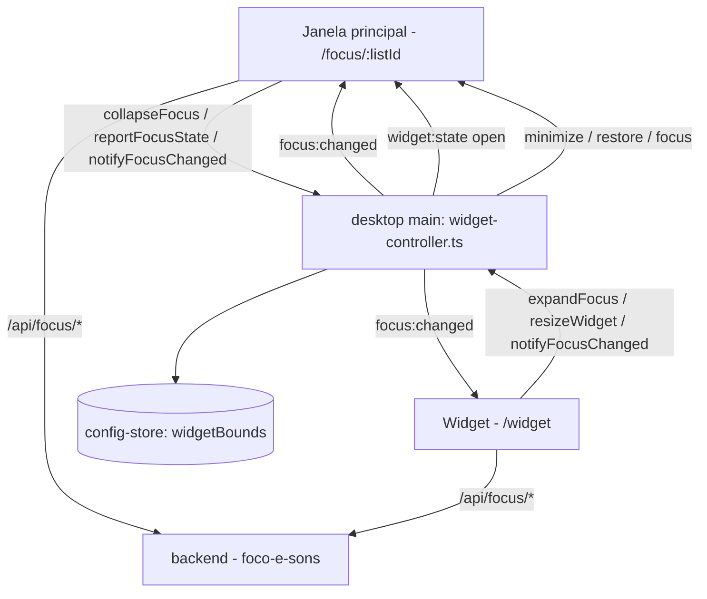

# Widget de foco no desktop Design

**Spec**: `.specs/features/widget-desktop/spec.md`
**Status**: Draft

Segue AD-003 (polling e IPC, sem push) de `.specs/STATE.md`. As ações são as de `foco-e-sons`, sem regra nova no servidor.

---

## Architecture Overview

O widget é uma segunda `BrowserWindow` do processo principal. Ela carrega o mesmo app (`APP_ORIGIN`) na rota `/widget`, com o mesmo preload e o mesmo endurecimento de segurança. Por ser a mesma origem, o widget herda o token e o workspace do `localStorage` e, no modo local, o cabeçalho do backend local que o protocolo `app://` já injeta.

O processo principal é quem sabe qual janela está aberta. Ele abre e fecha o widget, minimiza e restaura a janela principal, guarda a posição e retransmite `focus:changed` de uma janela para a outra. O renderer do widget usa os mesmos `useFocus` e `lib/sounds` da tela de foco.



---

## Code Reuse Analysis

### Existing Components to Leverage

| Component | Location | How to Use |
| --------- | -------- | ---------- |
| Criação de janela | `desktop/src/main/window.ts` | Mesmo `webPreferences` (preload, `contextIsolation`, `sandbox`) para o widget |
| Endurecimento | `desktop/src/main/security.ts` (`hardenWebContents`) | Aplicado ao widget, igual à janela principal |
| Posição salva e telas visíveis | `desktop/src/main/window-state.ts` (`resolveWindowBounds`), `config-store.ts` (`Bounds`, `isBounds`) | Nova chave `widgetBounds`; a mesma checagem de "dentro de alguma tela" (WIDGET-11) |
| IPC confiável | `desktop/src/main/ipc.ts` (`trustedHandle`) | Novos canais, só aceitos de frames `app://` |
| Ponte | `desktop/src/shared/ipc.ts`, `preload/index.ts` | Novos membros de `TrackzynApi` |
| Foco e sons | `frontend/src/lib/focus/*`, `lib/sounds/*` (de `foco-e-sons`) | O widget é só outra tela sobre os mesmos hooks |
| Diálogo ao fechar | `desktop/src/main/focus-close.ts` (de `foco-e-sons`) | Fechar o app com o widget aberto passa pelo mesmo diálogo |
| Testes do main | `desktop/src/main/*.test.ts` com `test-support.ts` | Mesmo estilo de testes com fakes de `BrowserWindow` |

### Integration Points

| System | Integration Method |
| ------ | ------------------ |
| Rotas do frontend | `/widget` dentro de `ProtectedRoute`, fora de `AppLayout` (sem menu lateral) |
| `TrackzynApi` | Membros novos; o comentário e os testes que fixam "exatamente treze membros" passam a fixar a nova contagem |
| Tela de foco | Ícone de recolher só com `window.trackzyn` (WIDGET-24) |
| Quadro | `Focar agora` no desktop chama `collapseFocus` depois de abrir a sessão (WIDGET-01) |

---

## Components

### desktop/src/main/widget-controller.ts

- **Purpose**: Ser dono do ciclo de vida do widget e das regras entre as duas janelas.
- **Location**: `desktop/src/main/widget-controller.ts` (+ `widget-window.ts` com a criação da janela)
- **Interfaces**:
  - `createWidgetController({ mainWindow, store, screen, createWindow })` → `{ open(), close(reason), isOpen(), setFocusState(s), resize(mode) }`
  - `open()`: cria (ou mostra) a janela e minimiza a principal (WIDGET-01, -02)
  - `close('expand' | 'restore' | 'system' | 'task_left')`: fecha o widget e, salvo em `restore`, restaura e foca a principal, navegando para a tela de foco, ou para o quadro em `task_left` (WIDGET-17, -18, -21)
  - Eventos da principal: `minimize` com `focusState.active` → `open()` (WIDGET-03); `restore` e `show` com o widget aberto → `close('restore')` (WIDGET-19)
  - Atalho: `before-input-event` nas duas `webContents`; `Ctrl+Shift+F` (ou `Meta+Shift+F` no macOS) alterna entre `open()` e `close('expand')` (WIDGET-04, -05, -20)
  - Posição: `widgetBounds` salva em `moved` (com espera de 500 ms, como `trackWindowState`); a primeira vez, canto superior direito da tela da janela principal, com margem de 16 px (WIDGET-09, -10, -11)
  - Retransmite `focus:changed` para a outra janela e envia `widget:state {open}` às duas (WIDGET-22, -23)
- **Dependencies**: `electron` (`BrowserWindow`, `screen`), `config-store`
- **Reuses**: `window.ts`, `security.ts`, `window-state.ts`

Janela do widget: `frame: false`, `alwaysOnTop: true` (nível `floating`), `resizable: false`, `skipTaskbar: true`, `fullscreenable: false`. Tamanho compacto de 300×64 px; `resize('notes')` muda para 300×240 px e `resize('compact')` volta (WIDGET-14).

### Ponte (shared/ipc.ts + preload)

- **Purpose**: Expor ao renderer só o necessário.
- **Location**: `desktop/src/shared/ipc.ts`, `desktop/src/preload/index.ts`
- **Interfaces** (novos membros de `TrackzynApi`):
  - `windowRole: 'main' | 'widget'` - lido de um argumento do processo, como `appVersion`
  - `collapseFocus(): Promise<void>`
  - `expandFocus(): Promise<void>`
  - `resizeWidget(mode: 'compact' | 'notes'): Promise<void>`
  - `notifyFocusChanged(): void` e `onFocusChanged(cb): () => void`
  - `onWidgetState(cb: (s: { open: boolean }) => void): () => void`
  - (`reportFocusState` e `onPauseRequest` vêm de `foco-e-sons`)
- **Dependencies**: nenhuma
- **Reuses**: padrão de `onUpdateAvailable` e `onExportState`

### Frontend: página do widget

- **Purpose**: Mostrar a tarefa e o cronômetro e, com o mouse, os controles.
- **Location**: `frontend/src/pages/focus-widget.tsx` (`/widget`), `components/focus/widget-controls.tsx`, `widget-notes.tsx`
- **Interfaces**: só componentes
  - Sem o mouse: título (`truncate`) e cronômetro (WIDGET-07). Com o mouse (`group-hover`): `Intervalo`, `Anotações`, `Pausar`/`Retomar`, `Pular`, `Concluir`, `Expandir`, e também `Estender`/`Concluir` quando `display.mode === 'awaiting_extend'` (WIDGET-08, -13)
  - Arrastar: `-webkit-app-region: drag` no fundo e `no-drag` nos botões e no campo (WIDGET-06)
  - Anotações: `resizeWidget('notes')`, textarea, salva com `PATCH /api/tasks/:id {notes}` em `blur` e volta a `compact` (WIDGET-14, -15)
  - Fila vazia: `Tudo limpo` + `Expandir` (WIDGET-16)
  - A cada ação: `notifyFocusChanged()` e, ao receber `onFocusChanged`, `queryClient.invalidateQueries(['focus'])` (WIDGET-22)
- **Dependencies**: `useFocus`, `lib/sounds`
- **Reuses**: `ui/button`, `ui/tooltip`, `break-picker` de `foco-e-sons`

### Frontend: ganchos na tela de foco e no quadro

- **Purpose**: Ligar `Focar agora` e o ícone de recolher ao widget só no desktop.
- **Location**: `frontend/src/lib/desktop/focus-window.ts`
- **Interfaces**: `isDesktop()`, `collapseFocus()`, `useWidgetOpen(): boolean` - sem `window.trackzyn`, viram no-op e `false` (WIDGET-24)
- **Dependencies**: `window.trackzyn`
- **Reuses**: o padrão de `frontend/src/lib/platform.ts`

---

## Data Models

Nenhum dado novo no servidor. No desktop, `config-store` ganha:

```typescript
interface StoredConfig {
  // ... campos que já existem
  widgetBounds?: { x: number; y: number; width: number; height: number }
}
```

---

## Error Handling Strategy

| Error Scenario | Handling | User Impact |
| -------------- | -------- | ----------- |
| Ação no widget sem conexão | Fila de `foco-e-sons` (SYNC-05 a -07) | Avisos e conflitos aparecem no próprio widget, que cresce como nas anotações |
| Última posição fora de qualquer tela | `resolveWindowBounds` devolve a posição inicial | Widget no canto superior direito (WIDGET-11) |
| Widget fechado pelo sistema | Evento `close` do widget → `close('system')` | A janela principal volta; a sessão continua (WIDGET-21) |
| Renderer do widget trava ou não carrega | `render-process-gone` / `did-fail-load` → `close('system')` | A janela principal volta com o foco |
| Tarefa sai de Hoje com o widget aberto | O widget vê `task` nulo no próximo `GET` ou `focus:changed` e chama `expandFocus` com `task_left` | O widget fecha e o quadro aparece (WIDGET-17) |

---

## Risks & Concerns

| Concern | Location (file:line) | Impact | Mitigation |
| ------- | -------------------- | ------ | ---------- |
| Testes fixam o tamanho de `TrackzynApi` | `desktop/src/shared/ipc.ts:21` e os testes que contam os membros | Quebram ao adicionar membros | Atualizar comentário e testes na mesma task da ponte, listando os membros novos |
| Fechar a janela principal encerra o app | `desktop/src/main/index.ts:169` | Com o widget aberto, a principal está minimizada; fechá-la pela barra de tarefas encerra tudo | Comportamento esperado; passa pelo diálogo de SYNC-08 quando a tarefa está contando |
| Atalhos de menu não disparam numa janela sem menu (Windows/Linux) | `desktop/src/main/menu.ts` | O atalho não funcionaria no widget | Usar `before-input-event` nas duas `webContents`, não o acelerador do menu |
| `alwaysOnTop` em tela cheia do macOS | Electron | O widget pode não aparecer sobre apps em tela cheia | `setVisibleOnAllWorkspaces(true, { visibleOnFullScreen: true })` no macOS; conferir manualmente na validação |
| e2e do desktop só cobre a janela principal | `desktop/e2e/` | O widget fica sem prova ponta a ponta | Um spec Playwright novo `desktop/e2e/widget.spec.ts` (abrir, ações, expandir) |

---

## Tech Decisions (only non-obvious ones)

| Decision | Choice | Rationale |
| -------- | ------ | --------- |
| Widget como rota do mesmo app | `/widget` em `APP_ORIGIN` | Reaproveita login, workspace, `useFocus`, sons e traduções; nenhuma origem nova a proteger |
| Atalho | `before-input-event`, não `globalShortcut` nem acelerador de menu | Decisão do usuário: só com o app ativo; funciona também na janela sem menu |
| Dono das regras entre janelas | Processo principal | Só ele vê as duas janelas e os eventos de minimizar e restaurar |
