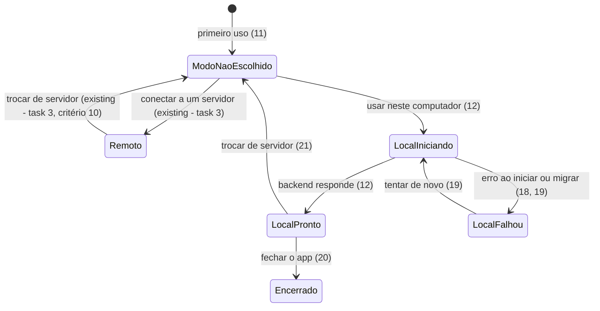

# Desktop: login por SSO (OIDC) e modo local com backend embutido

> Build this with **tlc-implement** (`.claude/skills/tlc-implement`).
> Every criterion below becomes a check with a proof, referenced by its number. Nothing under
> `Unresolved` gets settled while building.
>
> Pré-requisitos: a task 1 (`01-backend-node-paridade-de-contrato.md`, backend Node completo, suíte de contrato e portas em memória) e a task 3 (`03-desktop-cliente-remoto.md`, o app e o protocolo `app://launchkit`).

## Intent

O app desktop da task 3 não entra por SSO: um servidor com OIDC obriga o usuário a abrir o navegador, copiar o token à mão ou usar a versão web. E ele só funciona com um servidor ligado: sem rede ou sem servidor, o produto não abre. A fonte não traz números de uso.

Ao fim, o login por SSO abre no navegador do sistema e volta ao app por deep link `launchkit://auth/callback`, e o usuário pode escolher "Usar neste computador": o app sobe o backend Node em um processo próprio, com banco PGlite e arquivos em `userData`, funciona sem rede, faz backup antes de migrar e exporta e importa os dados.

27 critérios em 4 slices · 6 portas de mão única · 1 aberta, 0 bloqueiam

## Criteria

### Login por SSO pelo navegador do sistema

1. Dado um servidor com OIDC ligado, quando escolho entrar por SSO no app, então `shell.openExternal` abre `<serverUrl>/api/auth/oidc/login?redirect_target=launchkit%3A%2F%2Fauth%2Fcallback&desktop_nonce=<nonce>` e continua existindo 1 janela do app; o `<nonce>` é gerado pelo app (32 bytes aleatórios em base64url) e fica guardado em memória como fluxo pendente por 10 minutos.
2. Dado `OIDC_DESKTOP_REDIRECT=launchkit://auth/callback`, quando `GET /api/auth/oidc/login?redirect_target=launchkit://auth/callback&desktop_nonce=<nonce de 43 caracteres>` roda, então 307 para o provedor e o Redis guarda `oidc_state:<state>` com JSON `{"nonce", "code_verifier", "redirect_target", "desktop_nonce"}`.
3. Dado o `state` do critério 2, quando `GET /api/auth/oidc/callback` recebe `code` e `state` válidos, então 307 para `launchkit://auth/callback#access_token=<jwt>&token_type=bearer&desktop_nonce=<nonce>`, com o mesmo nonce do critério 2.
4. Se `redirect_target` não é exatamente um valor de `OIDC_DESKTOP_REDIRECT` (ou a variável está vazia), então `GET /api/auth/oidc/login` responde 400 `{"detail": "Invalid redirect_target"}`; se `redirect_target` vem sem `desktop_nonce` ou com `desktop_nonce` de menos de 32 caracteres, responde 400 `{"detail": "Invalid desktop_nonce"}`; nos dois casos não redireciona ao provedor e não grava nada no Redis.
5. Quando `GET /api/auth/oidc/login` roda sem `redirect_target`, então o comportamento é o de hoje: o callback redireciona para `<FRONTEND_URL>/auth/oidc/callback#access_token=<jwt>&token_type=bearer`.
6. Quando a suíte de contrato roda, então ela contém um caso para cada um dos critérios 2 a 5 e todos passam no backend Python e no backend Node.
7. Quando o sistema entrega `launchkit://auth/callback#access_token=<jwt>&token_type=bearer&desktop_nonce=<nonce>` ao app (macOS `open-url`; Windows e Linux `second-instance`) com o `<nonce>` igual ao do fluxo pendente criado há menos de 10 minutos, então o app grava o token, vai para `/`, `GET /api/users/me` retorna 200 e o fluxo pendente é consumido.
8. Quando o mesmo deep link chega 2 vezes, então o token é gravado 1 vez e a navegação ocorre 1 vez.
9. Se o deep link chega sem `access_token`, ou antes de haver servidor configurado, ou com `desktop_nonce` ausente, diferente do pendente, expirado ou já usado, ou sem fluxo pendente, então o app vai para a tela de conexão ou `/login` com a mensagem `Sign-in did not complete` (pt-BR: `O login não foi concluído`) e nenhum token é gravado.
10. Se o deep link tem host e caminho diferentes de `auth/callback`, então o app o ignora e não navega.

### Modo local

11. Dado o primeiro uso, quando abro o app, então vejo a escolha entre `Connect to a server` e `Use this computer` (pt-BR: `Conectar a um servidor` e `Usar neste computador`), antes de qualquer outra tela.
12. Quando escolho `Use this computer`, então o processo principal inicia o backend Node em um `utilityProcess` escutando em `127.0.0.1:<porta aleatória>`, mostra enquanto isso um indicador (`role="progressbar"`) e, ao ficar pronto, vai para `/setup`, onde `GET /api/setup/status` retorna `{"has_users": false}`.
13. Quando as migrations do backend Node rodam sobre PGlite, então as 6 tabelas do schema da task 1 existem, como no PostgreSQL.
14. Quando uma requisição chega à porta local sem o cabeçalho `X-Launchkit-Local-Token` com o token da sessão, então 401 `{"detail": "Unauthorized"}`; o token é aleatório a cada execução e só o processo principal o injeta nas chamadas do app.
15. Sempre, o backend local escuta apenas em loopback: uma conexão ao IP da rede local na porta dele é recusada.
16. Dado o modo local sem rede, quando crio um usuário, um workspace e um arquivo, fecho e reabro o app, então `GET /api/workspaces` e `GET /api/files` retornam os mesmos itens e o login funciona; banco em `userData/db` e arquivos em `userData/files`.
17. Dado o modo local, quando o app roda, então nenhuma conexão é aberta na porta 6379 e `REDIS_URL` não é lida; os jobs agendados rodam no próprio processo.
18. Dado uma versão nova do app com migration pendente, quando o app inicia, então o diretório do banco é copiado para `userData/backups/db-<timestamp ISO>/` antes de a migration rodar; depois da migration restam no máximo os 3 backups mais recentes; se a migration falha, o app mostra o erro e o `db` original tem o mesmo checksum de antes.
19. Se o backend local não inicia (porta, banco corrompido), então o app mostra `Could not start the local backend` (pt-BR: `Não foi possível iniciar o backend local`) com as ações `Tentar de novo` e `Abrir logs` (abre `userData/logs/`), e o banco continua intacto.
20. Quando encerro o app, então o `utilityProcess` termina em até 5 s e o pid deixa de existir.
21. Dado o modo local, quando escolho `Trocar de servidor` no menu, então a tela de escolha de modo abre e os dados locais continuam em `userData` sem alteração.

### Exportar e importar

22. Quando escolho Arquivo > Exportar dados no modo local, então `dialog.showSaveDialog` abre com `defaultPath` `launchkit-export-<timestamp ISO>.zip` e o arquivo gravado contém `manifest.json` (`{"formatVersion": 1, "appVersion", "schemaRevision"}`), `db.sql` e a pasta `files/`; enquanto exporta, a interface mostra um modal de progresso e nenhuma requisição `POST`, `PATCH` ou `DELETE` sai do renderer.
23. Dado um arquivo exportado e uma instalação nova do modo local, quando escolho Arquivo > Importar dados e confirmo, então as contagens de usuários, workspaces e arquivos são iguais às do original e o login com a mesma senha funciona.
24. Se o arquivo importado não é um zip, está corrompido ou tem `formatVersion` maior que 1, então o app mostra `Invalid export file` (pt-BR: `Arquivo de exportação inválido`) e o banco local tem o mesmo checksum de antes.
25. Dado que o banco local já tem usuários, quando tento importar, então a importação é recusada com `Import is only available on a new installation` (pt-BR: `A importação só está disponível em uma instalação nova`) e nada é alterado.

### Verificação no CI

26. Quando o job `desktop-e2e` roda nos três sistemas, então o teste Playwright cobre o modo local (escolher o modo, criar usuário e arquivo, reabrir, exportar e importar em uma instalação nova) e o deep link com o servidor de teste, e passa nos três.
27. Quando o app é empacotado, então o `backend-node` entra no pacote (bundle com esbuild) e o app com o modo local abre sem `node` instalado no sistema.

## States

## Out of scope

- Passkeys no desktop - o WebAuthn no Electron tem suporte limitado.
- O modo local num projeto que escolheu só a stack Python (`select-stack --stack python`): o desktop fica como cliente remoto, sem backend embutido (decisão do usuário; ver critério 13 da task 02).
- Sincronização entre o modo local e um servidor - complexidade própria; a saída do modo local é exportar e importar.
- Backend Python embutido (PyInstaller) - binário pesado, assinatura complexa no macOS e ainda exigiria PostgreSQL local.
- PostgreSQL embutido como binário por sistema - PGlite cobre o caso monousuário sem binários nativos.
- Armazenamento do token no Keychain/DPAPI/libsecret, bandeja, notificações e abrir ao iniciar - histórias P2 do PRD.
- Modo local multiusuário ou acessível pela rede - o backend local escuta só em loopback (critério 15).

## Observable

| Surface | Decision | Landing |
| --- | --- | --- |
| tela de escolha de modo | estado vazio | n/a - a tela só tem duas ações e aparece uma vez no primeiro uso |
| tela de escolha de modo | estado de carregamento | 12 |
| tela de escolha de modo | estado de erro | 19 |
| tela de escolha de modo | não autorizado | n/a - roda antes de qualquer sessão |
| tela de escolha de modo | design e ordenação | existing - estrutura de cartão da tela de login (`frontend/src/pages/login.tsx`) |
| menu Exportar e Importar | ação destrutiva confirma | 23, 25 |
| diálogo de salvar | cancelamento | existing - mesmo comportamento do critério 33 da task 3 |
| API `GET /api/auth/oidc/login` | formato da resposta | 2, 5 |
| API `GET /api/auth/oidc/login` | formato e códigos de erro | 4 |
| API `GET /api/auth/oidc/login` | quem pode chamar | 2, 4 (qualquer cliente; o destino é restrito por `OIDC_DESKTOP_REDIRECT`) |
| API `GET /api/auth/oidc/login` | versionamento | n/a - o parâmetro é opcional e a rota é a mesma |
| API `GET /api/auth/oidc/login` | limite de taxa | n/a - a rota não tem limite hoje e isso não muda |
| API local (loopback) | quem pode chamar | 14, 15 |
| arquivo de exportação | estrutura e o que o leitor faz depois | 22, 23 |

## Swept

- validation: 4, 9, 10, 24
- failure modes: 18, 19, 24
- idempotency and retry: 8, 19
- authorization: 4, 14, 15
- concurrency and ordering: 22 (modal que bloqueia escritas durante a exportação)
- data lifecycle: 18 (backup antes de migrar e retenção dos 3 mais recentes)
- external-dependency failure: existing - o provedor OIDC e o callback rodam no servidor, inalterados; o modo local não tem dependência externa
- state transitions: 12, 18, 19, 20, 21 (diagrama acima)
- observability: 19 (pasta de logs); logs do backend local sem segredos pelo critério 40 da task 1

## Impact

| Front | What changes |
|---|---|
| domain | new term: `mode` - `remote` ou `local`, escolhido no primeiro uso; lives na config do app |
| domain | new term: token de sessão local - segredo aleatório por execução que autoriza chamadas ao backend local; lives no processo principal |
| domain | existing term: `oidc_state:<state>` guardava `{"nonce","code_verifier"}` e passa a guardar também `redirect_target` - quem lê hoje: o callback em `backend/app/api/oidc_auth.py` e o equivalente da task 1; um leitor antigo ignora a chave extra |
| domain | existing term: `GET /api/auth/oidc/login` não tinha parâmetros; passa a aceitar `redirect_target` opcional |
| domain | existing: `frontend/src/pages/oidc-callback.tsx` continua lendo o token do fragmento da URL para o fluxo web; o desktop recebe o token pelo deep link |
| stored data | nada a migrar nas instalações existentes; no modo local, `userData/db` (PGlite), `userData/files`, `userData/backups` e `userData/logs` são novos |
| stored data | pré-condição: o schema Drizzle da task 1 roda sobre PGlite (critério 13); se não rodar, os critérios 12 a 21 não podem ser satisfeitos |
| CI | o job `desktop-e2e` da task 3 ganha os casos do modo local e do deep link |

## Decided

| Decision | Shape | Alternative rejected |
|---|---|---|
| Parâmetro e allowlist do OIDC no desktop | query `redirect_target` em `GET /api/auth/oidc/login`; env `OIDC_DESKTOP_REDIRECT` com URLs exatas separadas por vírgula; `redirect_target` e `desktop_nonce` (gerado pelo app, mínimo 32 caracteres) entram no payload de `oidc_state:<state>`; o callback redireciona para o destino com `#access_token=<jwt>&token_type=bearer&desktop_nonce=<nonce>`, e o app só aceita o deep link com o nonce de um fluxo pendente iniciado por ele (uso único, 10 minutos); mesma implementação nas duas stacks | Rotas novas `/api/auth/oidc/desktop/*`: duplicam o fluxo em duas stacks. Redirect de loopback (RFC 8252) com porta aleatória: exige registrar a porta no provedor. |
| Deep link | protocolo `launchkit://` registrado no sistema; só `launchkit://auth/callback` é tratado | Janela de login embutida: vários provedores bloqueiam webviews. |
| Layout dos dados locais | `userData/db` (PGlite), `userData/files`, `userData/backups/db-<timestamp>/`, `userData/logs/` | Guardar tudo em um único arquivo SQLite: o backend Node usa o schema PostgreSQL da task 1. |
| Formato de exportação | zip com `manifest.json` `{"formatVersion": 1, "appVersion", "schemaRevision"}`, `db.sql` e `files/` | Cópia crua do diretório do PGlite: preso à versão do PGlite e não importa para um servidor PostgreSQL. |
| Banco do modo local e backend embutido | `@electric-sql/pglite` como banco, backend Node empacotado com esbuild e rodando em `utilityProcess` | PostgreSQL embutido como binário: um binário por sistema, assinatura e tamanho. Backend Python embutido: ver Out of scope. |
| Config do app | `userData/config.json` ganha `"mode": "remote" \| "local"` ao lado de `serverUrl` (task 3) | Chave separada no `localStorage`: o processo principal precisa ler o modo antes de abrir a janela. |

## Sources

- `docs/prds/prd-feature-2-electron-desktop.md` - histórias 7, 9 e 10, requisitos FR-010 a FR-012
- `docs/plans/feature-2-electron-desktop.md` - decisões D4 e D7, fases 3 e 4
- `backend/app/api/oidc_auth.py` - o fluxo atual de login e callback que ganha `redirect_target`
- `.tasks/01-backend-node-paridade-de-contrato.md` e `.tasks/03-desktop-cliente-remoto.md` - o que esta task assume pronto

This task is the record of decision. If a linked document diverges, ask before building.

## Unresolved

| # | Kind | Question | Until answered |
|---|---|---|---|
| 1 | open | Como o `db.sql` do critério 22 é gerado a partir do PGlite? | Decidido ao implementar; vale qualquer mecanismo que produza um dump que o critério 23 restaure. |
