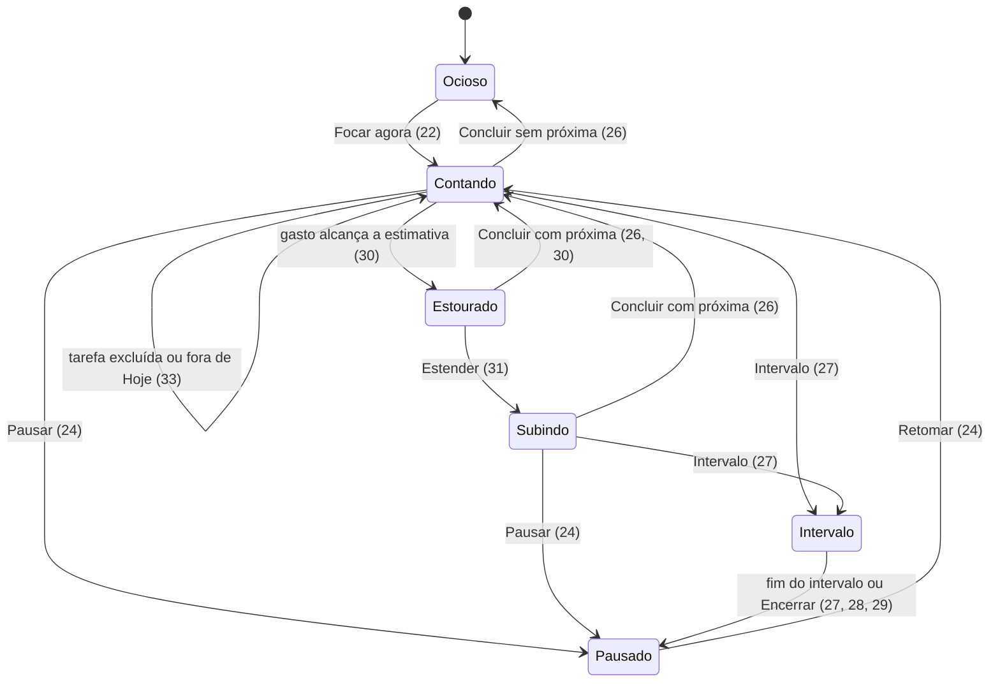
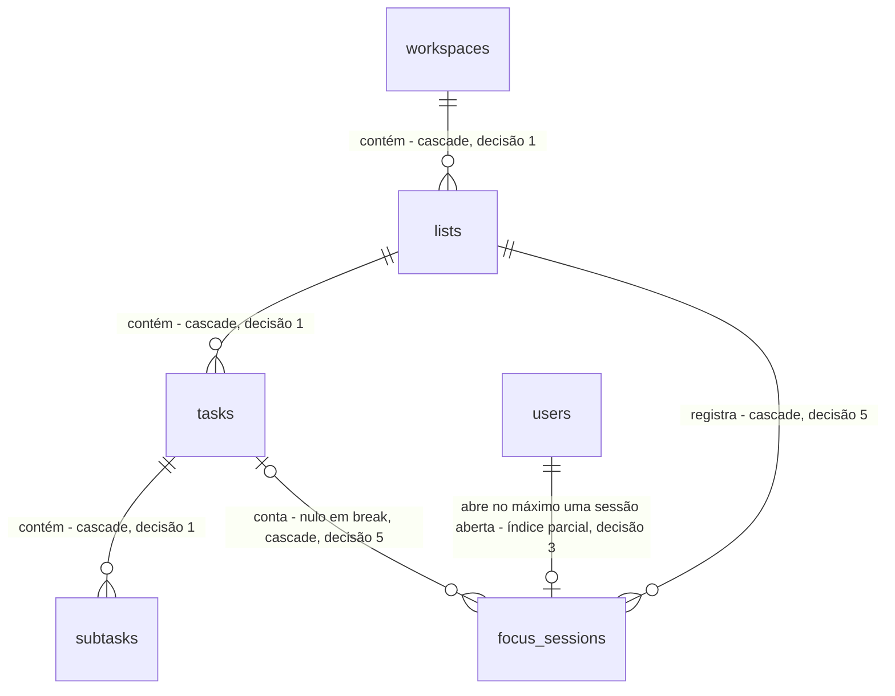

# Tarefas, foco e relatórios

> Build this with **tlc-implement** (`.claude/skills/tlc-implement`).
> Every criterion below becomes a check with a proof, referenced by its number. Nothing under
> `Unresolved` gets settled while building.

## Intent

Hoje o trackzyn é só a base do launchkit: login, workspaces, arquivos e um painel vazio. Quem quer organizar o que vai fazer e medir quanto tempo cada atividade leva continua usando outra ferramenta (o Blitzit, nos prints de referência), porque aqui não há tarefa, cronômetro nem relatório. A fonte não traz números sobre esse custo.

Com esta task, o usuário organiza tarefas em listas, cada lista com as colunas Backlog, Esta semana, Hoje e Concluídas. Ele foca nas tarefas de Hoje com um cronômetro decrescente a partir da estimativa, que pode passar a subir quando a estimativa estoura. No desktop, o foco fica num widget sempre visível. O app toca sons ao concluir e a cada 10 minutos, e os relatórios mostram tempo, produtividade e acerto das estimativas. As telas de referência estão em `docs/design/inspiracao/`. O widget não aparece nos prints e está descrito nos critérios 38 a 45.

63 critérios em 7 slices · 8 portas de mão única · 11 abertas, 0 bloqueiam, 1 bloqueia o go-live

## Criteria

### Listas na home

1. Dado um workspace sem listas, quando `/` abre, então a área `Suas listas` mostra só o cartão tracejado `Criar lista`, e o menu lateral mostra `Criar nova lista`, `Todas as minhas listas` (selecionado) e `Listas arquivadas` (tela `01-home.png`).
2. Quando a home abre, então o título é a saudação do período no fuso do dia (decisão 6) seguida de `preferences.display_name`, ou da parte do e-mail antes do `@` quando não há `display_name`. Os períodos são `Boa madrugada` (00:00–04:59), `Bom dia` (05:00–11:59), `Boa tarde` (12:00–17:59) e `Boa noite` (18:00–23:59), e cada um tem uma frase própria de subtítulo.
3. Quando o usuário cria uma lista com nome de 1 a 100 caracteres e uma cor, então aparece um cartão com: um selo com a inicial do nome em maiúscula na cor escolhida; o nome; um menu `⋮`; até 4 linhas com as próximas tarefas pendentes, completadas por linhas vazias até 4; e o rodapé `N tarefas pendentes` (tela `01-home.png`).
4. Se o nome da lista está vazio ou passa de 100 caracteres, então a API responde 422 no formato de erro de validação que já existe, e o diálogo mostra o erro sem fechar.
5. Quando o usuário arquiva uma lista pelo menu `⋮`, então ela sai de `Todas as minhas listas` e aparece em `Listas arquivadas` com a ação `Desarquivar`, e o tempo registrado nela continua contando nos relatórios.
6. Quando o usuário exclui uma lista pelo menu `⋮`, então o diálogo de confirmação que já existe pede para confirmar, mostrando o nome da lista. Confirmada a exclusão, a lista, suas tarefas, subtarefas e sessões deixam de existir, e `GET /api/lists/:id` responde 404.
7. Dado um usuário com papel `viewer` no workspace, então a home mostra as listas sem as ações de criar, renomear, arquivar e excluir, e uma escrita feita direto na API responde 403 `Read-only role`.
8. Dado listas em dois workspaces, quando a home de um deles abre, então só aparecem as listas dele, e `GET /api/lists/:id` de uma lista do outro workspace responde 404.

### Quadro da lista

9. Quando o usuário abre uma lista, então o quadro mostra: `Voltar`; o seletor de lista com o selo; o resumo `Esta lista tem N tarefas pendentes, Est.: <soma das estimativas pendentes>`; e as colunas `Backlog`, `Esta semana`, `Hoje` e `Concluídas`, nessa ordem (tela `02-quadro.png`).
10. Dado `Backlog`, `Esta semana` ou `Hoje` sem tarefas pendentes, então a coluna mostra o ícone de check e o texto `Tudo limpo`.
11. Quando o usuário adiciona uma tarefa numa coluna, com título de 1 a 255 caracteres e estimativa opcional de 1 a 1440 minutos, então o cartão aparece no fim da coluna com o título, a estimativa (`1h`, `1h 27min`) e o tempo gasto (`0min`). Título vazio ou longo demais, e estimativa fora desse intervalo, respondem 422.
12. Quando o usuário arrasta um cartão para outra posição ou coluna, então a nova ordem continua igual depois de recarregar a página.
13. O cabeçalho de `Hoje` mostra a soma das estimativas pendentes de Hoje e a barra `x/y Concluídas`, onde x é o número de tarefas da lista concluídas hoje e y é x mais as pendentes de Hoje. O cabeçalho de `Esta semana` mostra a soma das estimativas pendentes de Esta semana e de Hoje, e a mesma barra, onde x é o número de concluídas na semana corrente (de segunda a domingo) e y é x mais as pendentes de Esta semana e de Hoje. Com 11 concluídas na semana, nenhuma concluída hoje e 1 pendente em Hoje, as barras mostram `11/12` e `0/1` (tela `02-quadro.png`).
14. Cada cartão de `Hoje` mostra seu número de ordem, a partir de `1`.
15. Quando o usuário conclui uma tarefa, pelo check do cartão ou arrastando-a para `Concluídas`, então ela aparece em `Concluídas`, riscada, sob o dia da conclusão e com o tempo total gasto. Quando o usuário arrasta uma tarefa concluída para outra coluna, ela deixa de estar concluída e volta a contar como pendente.
16. A coluna `Concluídas` mostra no cabeçalho `N tarefas este mês`, contando as concluídas no mês corrente, e agrupa as tarefas por dia, do mais recente para o mais antigo. Cada grupo tem o cabeçalho `<dia da semana>, <data>` e `N tarefas`. Os intervalos encerrados aparecem no dia em que começaram, com ícone próprio e a duração (`Intervalo 10min`) (tela `02-quadro.png`).
17. Quando o usuário abre um cartão, então um diálogo permite editar título, estimativa, anotações (até 10 000 caracteres) e subtarefas, e excluir a tarefa depois de confirmar no diálogo de confirmação que já existe.
18. Dada uma tarefa com subtarefas, então o cartão mostra `x/y Subtarefas`, um `+` para adicionar uma subtarefa e uma seta que abre a lista de subtarefas, que podem ser marcadas (tela `02-quadro.png`).
19. Dado `Hoje` com ao menos uma tarefa pendente, então o rodapé de `Hoje` mostra o botão `Focar agora` habilitado; com `Hoje` sem pendentes, o botão fica desabilitado.
20. Quando o usuário troca de lista no seletor, então o quadro passa a mostrar a outra lista sem voltar à home.
21. Dado um usuário `viewer`, então o quadro não permite adicionar, mover, editar, concluir nem focar, e a API responde 403 `Read-only role` a essas escritas.

### Foco e cronômetro

22. Quando o usuário clica `Focar agora`, então abre a tela de foco (tela `03-foco.png`) com: o seletor de lista; o título `Hoje`; os ícones de ajustes, home e recolher; `Est.: <soma>`; a barra `x/y Concluídas`; as tarefas pendentes de Hoje; e `+ Adicionar tarefa`. A primeira tarefa de Hoje começa a contar: seu cartão ganha contorno destacado e mostra o cronômetro decrescente `HH:MM:SS`, igual à estimativa menos o tempo já gasto.
23. Enquanto uma sessão de tarefa está aberta, o cronômetro diminui 1 segundo a cada segundo. Ele é calculado a partir de `started_at` e do `server_now` que a API devolve, e mostra o mesmo valor (com tolerância de 1 segundo) mesmo com o relógio do computador 5 minutos adiantado ou atrasado.
24. Quando o usuário pausa, então a sessão aberta é encerrada, o cronômetro para no valor em que estava e o botão passa a ser `Retomar`. Quando o usuário retoma, uma nova sessão abre na mesma tarefa e o cronômetro continua do mesmo valor.
25. Quando o usuário pula, então a sessão é encerrada, a tarefa vai para o fim de `Hoje` e a próxima tarefa de Hoje começa a contar. Com uma só tarefa pendente em Hoje, `Pular` fica desabilitado.
26. Quando o usuário conclui a tarefa em foco, então a sessão é encerrada, a tarefa vai para `Concluídas` e a próxima de Hoje começa a contar. Se não há próxima, a tela de foco mostra `Tudo limpo` e nenhuma sessão fica aberta.
27. Quando o usuário tira um intervalo de 5, 10 ou 15 minutos, então a sessão da tarefa é encerrada, abre uma sessão de intervalo com essa duração e o cronômetro mostra a contagem regressiva do intervalo. Quando ela chega a zero, a sessão de intervalo é encerrada com exatamente a duração planejada, e a tarefa atual fica pausada.
28. Quando o usuário encerra o intervalo antes do fim, então a sessão de intervalo registra só o tempo que passou, e a tarefa atual fica pausada.
29. Se o app está fechado quando o intervalo chega ao fim, então o intervalo registra exatamente a duração planejada, e a próxima consulta ao foco mostra a tarefa pausada.
30. Quando, com a sessão aberta, o tempo gasto alcança a estimativa, então o cronômetro mostra `00:00:00` e oferece `Estender` e `Concluir`. A sessão continua aberta e o tempo continua sendo registrado até o usuário escolher.
31. Quando o usuário escolhe `Estender`, então o cronômetro passa a subir a partir da estimativa (com estimativa de 1h: `01:00:00`, `01:00:01`, …), mostrando o tempo total gasto, e a estimativa da tarefa não muda. Se o usuário reabre o foco de uma tarefa que já passou da estimativa, o cronômetro já aparece subindo, sem oferecer `Estender` de novo.
32. Dada uma tarefa sem estimativa, quando ela entra em foco, então o cronômetro sobe a partir do tempo já gasto e nunca oferece `Estender`.
33. Quando a tarefa em foco é excluída ou sai de `Hoje`, então a sessão aberta é encerrada e o foco passa para a próxima tarefa de Hoje.
34. Sempre, cada usuário tem no máximo uma sessão aberta. Começar foco em outra tarefa, em outra lista ou em outro dispositivo encerra a sessão anterior no mesmo instante em que abre a nova. Duas requisições de início simultâneas deixam exatamente uma sessão aberta (decisão 3).
35. Se uma ação que muda o estado do foco (`pause`, `complete`, `skip`, `break`) chega quando esse estado já mudou, por exemplo pausar sem sessão aberta ou concluir uma tarefa já concluída, então a API responde 409 e não altera nenhuma sessão nem o `completed_at`.
36. Se a API não responde a uma ação de foco, então a tela mostra `Não foi possível salvar. Tente de novo.`, o estado exibido volta ao último confirmado pelo servidor e nenhuma ação é repetida sozinha.
37. Quando o usuário clica no ícone de home na tela de foco, então volta ao quadro da lista com a sessão ainda aberta e o cartão em foco destacado, com o tempo correndo.

### Widget de foco no desktop

38. Dado o app desktop com uma tarefa em foco, quando o usuário clica em recolher na tela de foco, então a janela principal se esconde e abre o widget. O widget é uma janela sem moldura, sempre acima das outras janelas, que pode ser arrastada, e mostra só o título da tarefa atual (cortado com reticências quando não cabe) e o cronômetro.
39. Enquanto o mouse está sobre o widget, ele mostra também `Intervalo`, `Anotações`, `Pausar` (ou `Retomar`), `Pular`, `Concluir` e `Expandir`. Quando o mouse sai, esses controles somem.
40. As ações do widget têm o mesmo efeito das da tela de foco, nos critérios 24 a 31.
41. Quando o usuário clica `Anotações`, então o widget mostra um campo com as anotações da tarefa atual. O texto é salvo quando o campo perde o foco e aparece no diálogo da tarefa (critério 17).
42. Quando o usuário clica `Expandir`, então o widget fecha e a janela principal volta em primeiro plano, na tela de foco. Fechar o widget pelo sistema (⌘W ou Alt+F4) tem o mesmo efeito e não encerra a sessão.
43. Quando o usuário move o widget e o abre de novo, inclusive depois de reiniciar o app, então ele abre na última posição, ou na tela principal se a última posição ficou fora de todas as telas.
44. Quando uma ação muda o foco numa janela (widget ou principal), então a outra janela mostra o novo estado em até 1 segundo, sem recarregar.
45. No navegador, o ícone de recolher não aparece, a tela de foco é uma página comum e a ausência de `window.trackzyn` não gera erro.

### Sons

46. Quando uma tarefa é concluída, pela tela de foco, pelo widget ou pelo quadro, então o som de conclusão toca uma vez.
47. Enquanto uma sessão de tarefa está aberta, o som de progresso toca cada vez que o tempo gasto na tarefa passa por um múltiplo de 10 minutos (10, 20, 30, …). Sessões de intervalo não tocam esse som.
48. Com a janela principal e o widget abertos, cada som toca uma vez só: na janela visível, que é o widget quando ele está aberto.

### Relatórios

49. Quando o usuário abre `Relatórios` pelo menu lateral, então a aba `Visão geral` mostra: o filtro de lista (`Todas as listas` por padrão, com as arquivadas incluídas); o período (por padrão, hoje e os 7 dias anteriores); e os cartões `Dias trabalhados`, `Tarefas concluídas`, `Tempo trabalhado` e `Média por tarefa` (tela `04-relatorios-visao-geral.png`).
50. Dado, no período, sessões de tarefa de 1h30 na segunda e de 2h na quarta, um intervalo de 10min na quarta e 2 tarefas concluídas, então os cartões mostram `Dias trabalhados` 2 (dias com alguma sessão de tarefa), `Tarefas concluídas` 2, `Tempo trabalhado` `3h 30min` (só sessões de tarefa) e `Média por tarefa` `1h 45min` (tempo trabalhado dividido pelas concluídas). Sem tarefas concluídas, a média mostra `—`.
51. O gráfico de barras mostra, para cada dia do período, três séries: `Tarefas`, `Intervalos` e `Total` (tarefas mais intervalos), com o componente `BarChart` e a paleta que já existem (tela `04-relatorios-visao-geral.png`).
52. Os cartões `Hora mais produtiva` (faixa de uma hora com mais tempo de tarefa, como `18–19h`), `Dia mais produtivo` (dia da semana) e `Mês mais produtivo` (como `out. de 2026`) mostram o valor do período. Num empate, vale o primeiro em ordem cronológica (tela `05-relatorios-detalhes.png`).
53. A rosca `Tempo por lista` mostra uma fatia por lista e uma para `Intervalos`, com legenda de nome, tempo e porcentagem, e o cabeçalho `N listas, Tempo total: X` (tela `05-relatorios-detalhes.png`).
54. O quadro `Tarefas concluídas` agrupa as tarefas do período por dia, e cada uma ganha um selo. O selo é verde (`2h 32min antes`) quando o tempo gasto ficou abaixo da estimativa, verde (`No prazo`) quando ficou igual, e vermelho (`21min depois`) quando ficou acima. Tarefas sem estimativa ficam sem selo. O cabeçalho mostra a porcentagem de verdes e de vermelhos entre as tarefas com estimativa, e uma barra proporcional a elas (tela `05-relatorios-detalhes.png`).
55. A aba `Sessões` lista, agrupadas por dia, todas as sessões do período, com início, fim, tarefa (ou `Intervalo`), lista e duração. Uma sessão aberta aparece como `em andamento`.
56. Quando o usuário clica `Exportar PDF`, então abre o diálogo de impressão com a `Visão geral` formatada para página, com o período e o filtro de lista no topo.
57. Dias e horas são contados no fuso do dia (decisão 6). Uma sessão das 23:30 às 00:30 conta 30min em cada um dos dois dias.
58. Uma sessão ainda aberta conta até o momento da consulta.
59. Dado um período sem sessões, então os cartões mostram `0`, `0min` e `—`, e o gráfico, a rosca e as listas mostram `Sem atividade no período`.
60. Se o fim do período vem antes do início, ou se o período passa de 366 dias, então a API responde 422.
61. Os relatórios contam só as sessões do usuário logado e as tarefas que ele concluiu, mesmo num workspace com outros membros.

### Dados no modo local

62. Dado o desktop no modo local, quando o usuário exporta e depois importa os dados, então listas, tarefas, subtarefas e sessões voltam com as mesmas contagens e os mesmos ids.
63. Sempre, uma tarefa está na coluna `done` exatamente quando tem `completed_at` preenchido.

## States

Estado do foco de um usuário. A tarefa atual é a primeira pendente de `Hoje` na lista em foco.

## Out of scope

- Plano, cobrança e `Account & Billing` dos prints: o trackzyn é self-hosted e não cobra.
- Grade de apps e integrações, busca global, `Shortcuts`, `Report a Bug`, botão de ajuda, chat e o aviso `New: Timezone Support`: aparecem nos prints, mas não fazem parte do que foi pedido.
- Widget sobre outras janelas no navegador (Document Picture-in-Picture): pela decisão do usuário, o widget existe só no desktop.
- Relatórios de equipe, somando vários membros: a fonte mostra um uso individual (critério 61).
- Tarefas recorrentes, prazos e lembretes: não aparecem na fonte.

## Observable

| Surface | Decision | Landing |
| --- | --- | --- |
| tela home (`/`) | estado vazio | 1 |
| tela home | carregando | existing - o padrão de carregamento das páginas do `AppLayout` |
| tela home | erro | existing - o tratamento de erro do `api.ts` e as notificações que já existem |
| tela home | sem permissão | 7 |
| tela home | densidade e ordem | 3; Unresolved 9 |
| tela home | confirmação de ação destrutiva | 6 |
| tela quadro | estado vazio | 10 |
| tela quadro | carregando | existing - o padrão de carregamento das páginas do `AppLayout` |
| tela quadro | erro | existing - o tratamento de erro do `api.ts` e as notificações que já existem |
| tela quadro | sem permissão | 21 |
| tela quadro | densidade e ordem | 12, 13, 14, 16 |
| tela quadro | confirmação de ação destrutiva | 17 |
| tela foco | estado vazio | 26 |
| tela foco | carregando | existing - o padrão de carregamento das páginas do `AppLayout` |
| tela foco | erro | 36 |
| tela foco | sem permissão | 21 |
| tela foco | densidade e ordem | 22, 25 |
| tela foco | confirmação de ação destrutiva | n/a - concluir e pular podem ser desfeitos no quadro (15, 12) |
| janela widget | estado vazio | 26 (fechar o widget sem tarefa em foco: Unresolved 6) |
| janela widget | carregando | n/a - só abre a partir de um foco já carregado (38) |
| janela widget | erro | 36 |
| janela widget | sem permissão | 21 |
| janela widget | densidade e ordem | 38, 39 |
| janela widget | confirmação de ação destrutiva | n/a - mesmo motivo da tela de foco |
| tela relatórios | estado vazio | 59 |
| tela relatórios | carregando | existing - o padrão de carregamento das páginas do `AppLayout` |
| tela relatórios | erro | 60 |
| tela relatórios | sem permissão | 61 |
| tela relatórios | densidade e ordem | 49, 52, 54, 55 |
| tela relatórios | confirmação de ação destrutiva | n/a - a tela não altera dados |
| API `/api/lists`, `/api/tasks`, `/api/subtasks` | formato da resposta | Surface |
| API `/api/lists`, `/api/tasks`, `/api/subtasks` | formato e códigos de erro | 4, 8, 11; existing - `plugins/errors.ts` |
| API `/api/lists`, `/api/tasks`, `/api/subtasks` | quem pode chamar | 7, 8, 21 |
| API `/api/lists`, `/api/tasks`, `/api/subtasks` | versionamento | n/a - a API só atende o frontend do próprio repositório |
| API `/api/lists`, `/api/tasks`, `/api/subtasks` | limite de requisições | n/a - o rate limit que existe vale só para login |
| API `/api/focus/*` | formato da resposta | Surface; 23 |
| API `/api/focus/*` | formato e códigos de erro | 35; existing - `plugins/errors.ts` |
| API `/api/focus/*` | quem pode chamar | 21, 34 |
| API `/api/focus/*` | versionamento | n/a - a API só atende o frontend do próprio repositório |
| API `/api/focus/*` | limite de requisições | n/a - o rate limit que existe vale só para login |
| API `/api/reports/*` | formato da resposta | Surface |
| API `/api/reports/*` | formato e códigos de erro | 60 |
| API `/api/reports/*` | quem pode chamar | 61; existing - `workspaceContext` |
| API `/api/reports/*` | versionamento | n/a - a API só atende o frontend do próprio repositório |
| API `/api/reports/*` | limite de requisições | n/a - o rate limit que existe vale só para login |
| copy (saudação, estados vazios, selos) | estrutura, tom e próximo passo | 2, 10, 54, 59; Unresolved 8 |

## Swept

- validation: 4, 11, 60
- failure modes: 36
- idempotency and retry: 35
- authorization: 7, 8, 21, 61; existing - `requireWrite` e `workspaceContext` em `plugins/workspace.ts`
- concurrency and ordering: 34, 44
- data lifecycle: 5, 6, 62
- external-dependency failure: 36 (API inacessível vista do desktop); os sons não dependem de rede
- state transitions: 24–33, 63 e o diagrama em States
- observability: existing - o log de requisições do Fastify registra cada chamada a `/api/focus/*` com status e duração

## Impact

| Front | What changes |
|---|---|
| domain | novo termo: `List` - um conjunto de tarefas dentro de um workspace, com nome, cor, posição e arquivamento; tabela `lists` |
| domain | novo termo: `Task` - uma atividade de uma lista, com título, estimativa em minutos, anotações, coluna, posição e `completed_at`; tabela `tasks` |
| domain | novo termo: `Subtask` - um item que pode ser marcado dentro de uma tarefa; tabela `subtasks` |
| domain | novo termo: `FocusSession` - um intervalo de tempo de um usuário, do tipo `task` (contando uma tarefa) ou `break` (intervalo); tabela `focus_sessions`, de onde sai todo tempo gasto e todo relatório |
| domain | termo existente: `dashboard` (`/`, `pages/dashboard.tsx`, a entrada `nav.dashboard` em `nav-items.ts`) era o painel do template e passa a ser a home de listas; `Relatórios` entra no menu lateral |
| desktop | `TrackzynApi` (`desktop/src/shared/ipc.ts`) tem um comentário e testes que fixam "exatamente treze membros"; o widget acrescenta membros e canais, então esses testes mudam junto |
| desktop | `window.ts` cria uma só janela hoje; o widget é a segunda e precisa do mesmo endurecimento de `security.ts` |
| backend | `test/db/baseline.test.ts` e `test/fixtures/pg-columns.json` fixam as 6 tabelas da migration `0000`. A migration nova (`0001`) não pode quebrar essas provas: elas continuam valendo para a `0000`, e as tabelas novas ganham provas próprias. O comentário de `db/schema.ts` sobre paridade com o Alembic não vale mais desde o select-stack |
| backend | o modo local (`local/data-transfer.ts`) exporta e importa as tabelas que estão em `db/schema.ts`, então as tabelas novas entram sem mudar o código (critério 62) |
| stored data | nada a migrar: as 4 tabelas são novas e nenhuma coluna existente muda |

## Decided

| Decision | Shape | Alternative rejected |
|---|---|---|
| 1. Lista é uma tabela nova dentro do workspace (decisão do usuário) | `lists.workspace_id` → `workspaces.id` com `ON DELETE CASCADE`; `tasks.list_id` → `lists.id` com cascade; `subtasks.task_id` → `tasks.id` com cascade | Usar o workspace como lista: `X-Workspace-Id` limita cada requisição a um workspace, então `Todas as listas` nos relatórios exigiria uma consulta entre workspaces |
| 2. A coluna da tarefa é um texto fechado | `tasks.column` ∈ `backlog`, `this_week`, `today`, `done`, mais `tasks.position` inteiro dentro de cada coluna; `done` ⇔ `completed_at` não nulo (critério 63) | Um booleano `is_done` separado da coluna: permite uma tarefa concluída em `today`, um estado que nenhuma tela sabe mostrar |
| 3. No máximo uma sessão aberta por usuário | índice único parcial `focus_sessions (user_id) WHERE ended_at IS NULL`; abrir uma sessão encerra a anterior na mesma transação | Controlar só no código: duas requisições simultâneas abririam duas sessões (critério 34) |
| 4. O relógio do servidor manda | `started_at` e `ended_at` vêm do relógio do servidor; o cliente nunca envia horário; toda resposta de `/api/focus` traz `server_now`, e o cliente calcula a diferença | Cronômetro só no cliente, enviando a duração ao fim: um computador com relógio errado ou um app fechado no meio da sessão perde ou inventa tempo |
| 5. A sessão sabe a que lista pertence e o intervalo é encerrado quando alguém consulta | `focus_sessions` tem `list_id` (cascade), `task_id` que pode ser nulo (nulo em `break`, cascade a partir de `tasks`), `kind` ∈ `task`, `break` e `planned_seconds` (só em `break`). Um intervalo cujo `started_at + planned_seconds` já passou é encerrado com `ended_at` nesse instante pela próxima requisição que lê o foco ou os relatórios | Um job agendado para encerrar intervalos: acrescenta um worker obrigatório ao modo local e ao Compose só para isso. Excluir uma tarefa ou lista apaga as sessões dela e o tempo sai dos relatórios; quem quer manter o histórico arquiva (critério 5) |
| 6. Fuso que define o dia | o fuso do dia é `workspaces.timezone` e, se ele for nulo, `applicationTimezone()` (`services/timezones.ts`); ele vale para saudação, "hoje", "semana", "mês" e relatórios | O fuso do navegador: dois dispositivos em fusos diferentes mostrariam números diferentes para o mesmo relatório |
| 7. Widget é a segunda janela do Electron | `BrowserWindow` com `frame: false`, `alwaysOnTop: true`, que pode ser arrastada, na mesma origem `APP_ORIGIN`, com o mesmo preload e o mesmo `hardenWebContents`; canais IPC novos `focus:collapse`, `focus:expand` e `focus:changed` (aviso entre as janelas); a posição fica salva no `config-store` | Desenhar o widget dentro da janela principal, reduzindo o tamanho dela: não fica sobre as outras janelas nem conserva a posição e o tamanho da janela principal |
| 8. Rotas da API | as da seção Surface; as ações de foco são `POST`s nomeados, não um `PATCH` de estado | Um `PATCH /api/focus {state}` genérico: as transições inválidas (critério 35) virariam combinações de campos para validar, em vez de rotas que podem responder 409 |

## Relations

## Surface

| Route | In | Out | Status | Criteria |
|---|---|---|---|---|
| `GET /api/lists` | `archived` (bool) | `id`, `name`, `color`, `is_archived`, `position`, `pending_count`, `preview` (até 4 títulos) | `200` | 1, 3, 5, 8 |
| `POST /api/lists` | `name`, `color` | a lista | `201`, `403`, `422` | 3, 4, 7 |
| `PATCH /api/lists/:id` | `name`, `color`, `is_archived`, `position` | a lista | `200`, `403`, `404`, `422` | 5, 7, 8 |
| `DELETE /api/lists/:id` | - | - | `204`, `403`, `404` | 6, 7 |
| `GET /api/lists/:id/board` | - | colunas com tarefas, somas, barras `x/y`, `done_this_month`, intervalos do dia | `200`, `404` | 9, 13, 14, 16 |
| `POST /api/tasks` | `list_id`, `title`, `estimate_minutes`, `column` | a tarefa | `201`, `403`, `404`, `422` | 11, 21 |
| `PATCH /api/tasks/:id` | `title`, `estimate_minutes`, `notes`, `column`, `position` | a tarefa | `200`, `403`, `404`, `422` | 12, 15, 17, 33, 41 |
| `DELETE /api/tasks/:id` | - | - | `204`, `403`, `404` | 17, 33 |
| `POST /api/tasks/:id/subtasks` | `title` | a subtarefa | `201`, `403`, `404`, `422` | 18 |
| `PATCH /api/subtasks/:id`, `DELETE /api/subtasks/:id` | `title`, `done` | a subtarefa | `200`, `204`, `403`, `404`, `422` | 18 |
| `GET /api/focus` | - | `server_now`, `session` (`id`, `kind`, `task_id`, `list_id`, `started_at`, `planned_seconds`) ou `null`, `task` com `spent_seconds` | `200` | 23, 29, 31 |
| `POST /api/focus/start` | `task_id` | igual a `GET /api/focus` | `200`, `403`, `404`, `409` | 22, 24, 34 |
| `POST /api/focus/pause`, `/skip`, `/complete` | - | igual a `GET /api/focus` | `200`, `403`, `409` | 24, 25, 26, 35 |
| `POST /api/focus/break` | `minutes` ∈ 5, 10, 15 | igual a `GET /api/focus` | `200`, `403`, `409`, `422` | 27, 35 |
| `POST /api/focus/break/end` | - | igual a `GET /api/focus` | `200`, `403`, `409` | 28, 35 |
| `GET /api/reports/overview` | `from`, `to` (datas), `list_id` | cartões, série por dia, mais produtivos, tempo por lista, concluídas com diferença para a estimativa | `200`, `422` | 49–54, 57–61 |
| `GET /api/reports/sessions` | `from`, `to`, `list_id` | sessões por dia | `200`, `422` | 55, 57, 58, 61 |
| IPC `focus:collapse`, `focus:expand`, `focus:changed` | - | - | - | 38, 42, 44 |

## Sources

- Pedido do usuário nesta conversa (2026-10-24). Sem endereço; trechos que decidem: "O widget de foco que fica sempre visível na tela. Possui como informações principais apenas a atividade atual e o cronômetro decrescente. Ao passar o mouse no widget, são exibidos também de tirar um intervalo, anotações, pausar, pular, concluir e aumentar (sai do widget e vai para a tela normal do app)." e "emite sons ao concluir atividades e a cada 10min um som de progresso é emitido. Ao final de cada cronômetro estimado, é possível também extender o tempo estimado, iniciando um timer a partir do tempo estimado em valor ascendente."
- Respostas do usuário nesta conversa: lista é "Tabela nova no workspace"; o widget é "Só no desktop, janela sem moldura e movível. No navegador, é uma tela normal do app, sem ficar sobre outras janelas."
- `docs/design/inspiracao/` - **binding for the interface** quanto a estrutura e conteúdo, não à marca: `01-home.png` (home de listas), `02-quadro.png` (quadro de 4 colunas), `03-foco.png` (tela de foco), `04-relatorios-visao-geral.png` e `05-relatorios-detalhes.png` (relatórios). A identidade visual (cores, fontes, nome) segue os tokens do trackzyn em `frontend/src/index.css`, não a do Blitzit. Os textos ficam em `frontend/src/locales/en.json` e `pt-BR.json`.

This task is the record of decision. If a linked document diverges, ask before building.

## Unresolved

| # | Kind | Question | Until answered |
|---|---|---|---|
| 1 | blocks go-live | De onde vêm os arquivos dos sons de conclusão e de progresso, e sob qual licença? | Os critérios 46–48 podem ser provados com sons provisórios, mas o app não pode ir para usuários com áudio sem licença de uso. |
| 2 | open | Precisa existir uma opção para desligar os sons? | Nesta task não existe a opção; os sons sempre tocam (46–48). |
| 3 | open | As durações de intervalo 5, 10 e 15 minutos estão certas? | Escrito com 5, 10 e 15 (critério 27); o print mostra um intervalo de 10min. |
| 4 | open | Ao fim do intervalo, a tarefa retoma sozinha ou fica pausada? | Escrito como pausada (27–29). |
| 5 | open | Ao recolher para o widget, a janela principal fica escondida ou minimizada? | Escrito como escondida (38). |
| 6 | open | O que o widget mostra quando a última tarefa é concluída por ele? | Por enquanto, o widget fecha e a janela principal volta na tela de foco com `Tudo limpo` (26, 42). |
| 7 | open | `Dias trabalhados` são os dias com alguma sessão de tarefa, ou todos os dias do período? O print mostra 9 com atividade em só 4 dias. | Escrito como os dias com sessão de tarefa (50). |
| 8 | open | Rótulos e tom: `Focar agora` no lugar de `Blitzit now`, as faixas de horário e as frases da saudação, e `No prazo` para tempo igual à estimativa. | Escrito como nos critérios 2, 19 e 54. |
| 9 | open | Em que ordem ficam as listas na home: criação, posição arrastável ou nome? | `lists.position` existe (Surface); a ordem padrão é a de criação, sem arrastar na home. |
| 10 | open | `Exportar PDF` pelo diálogo de impressão está bom, ou precisa gerar o arquivo direto (no desktop, com `printToPDF`)? | Escrito com o diálogo de impressão (56). |
| 11 | open | Num workspace com vários membros, um membro vê no quadro a tarefa que outro está focando? | Por enquanto não há indicação: o foco é de cada usuário (34, 61). |
